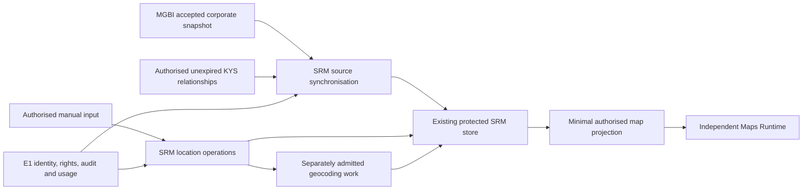

# TASK 01 — SRM Supplier Locations: architecture, provider discovery and E1 readiness

Date: 2026-10-21. Profile SRM; Development; actual execution local macOS in isolated branch `srm/supplier-locations-task01-20261021`. Task `SRM-SUPPLIER-LOCATIONS-TASK01-20261021`.

**Status: PARTIAL — design and independent discovery complete; E1 producer publication pending. No business feature, migration, provider order, infrastructure configuration or deployment is implemented here.** This document and its [machine-readable companion](2026-10-21-srm-supplier-locations-task01-contract.json) are a proposed implementation contract, not an active operation grant or a new Canon. TASK 02 must adopt the eventual producer receipt explicitly. TASK 03 owns final UX.

## Evidence authority and limits

Authority refreshed from `profitia/SG-dev/main`. Initial inventory `faa97ee433a9f60de28b417b4ee323759c7c9ffb`; current source baseline `39d0aadfafa621c214a69ac1b7f666a8220a51b1` includes independently merged Identity Runtime governance PR589. That new Canon reserves identity implementation to ARCHITECTURE; it creates no new identity runtime or permission for this task. No identity bootstrap, Clerk change or account migration is proposed here.

The source links below are pinned to [39d0aadf](https://github.com/profitia/SG-dev/tree/39d0aadfafa621c214a69ac1b7f666a8220a51b1). Provider documentation was read on 2026-10-21. Synthetic test data demonstrates parser behaviour only. Current customer MGBI/KYS payloads were not read through privileged credentials, and no new paid verification was ordered.

The limited ordinary roles returned zero visible private rows without an operation context. This proves withholding in that query, **not** absence of reports or branches. No tenant was impersonated and no RLS bypass or owner connection was used to improve discovery coverage.

## A. Architecture decision and exact routing

The existing Maps Capability remains the independent renderer and Google adapter. SRM owns supplier identity, organisation-owned location records, accepted-source synchronisation, author attribution and authorised gateways. Public supplier-domain DTOs belong in the existing SRM X-Ray module. Generic map DTOs remain in Maps Contracts. ARCHITECTURE owns E1 context, operation catalogue, protected request/delegation/Source mechanisms and access-store SQL.

No new runtime, identity store, KYS connector or geocoding proxy service is needed. Keep the existing `geocodeAddress` adapter in Maps Runtime and expose it only through the bounded server command described below after E1 producer acceptance. SRM must not import another application's private adapter source. The current runtime has no business geocoding endpoint. Never expose an unauthenticated address-to-Google endpoint.

Proposed exact paths and current resolver results are embedded in `contract.json#/routing`, all uniquely resolved ALIGNED. These are design targets, not files changed by TASK 01. Principal targets:

| Owner / profile | TASK 02 responsibility and exact paths |
| --- | --- |
| SRM Runtime / SRM | `apps/srm/src/server/supplier-locations.ts`, `supplier-location-store.ts`, `supplier-location-sync.ts`, `supplier-location-geocoding.ts`; `apps/srm/src/app/api/supplier-locations/route.ts` |
| SRM Runtime / SRM | Extend existing `apps/srm/src/server/mgbi-general.ts`, `company-general-cache.ts`, `vercly-kys.ts`, `supplier-api-composition.ts`, `supplier-sensitive-operation.ts`, `supplier-native-company.ts`, `supplier-native-sensitive.ts`, `private-runtime.ts` only as required by the adopted contract |
| SRM X-Ray Module / SRM | `packages/srm-xray/src/supplier-locations.ts`, `contracts.ts`, `index.ts`: provider-neutral supplier location model/projection, no source credentials or login |
| SRM Runtime / SRM | Proposed new controlled installation `apps/srm/db/private-store/013-supplier-locations.sql`; refresh main and choose the next unused sequence before creation; never overwrite an existing installation |
| SRM Runtime / SRM | Small mounting hooks in `apps/srm/src/modules/xray/supplier-report.tsx`, `use-supplier-report.ts`, `report-controller.ts`; final controls remain TASK 03 |
| Maps Capability / SRM | `packages/maps-contracts/index.mjs`, `index.d.mts`, `packages/maps-embed/index.mjs`, `index.d.mts`, `apps/maps-runtime/src/client/embed.mjs`, `src/server/google/geocoding.mjs`, `src/server/server.mjs`, `src/server/config.mjs`, `platform-integration.json`: generic transport/rendering and explicitly admitted server execution |
| Architecture Platform / ARCHITECTURE | `packages/platform-contracts/src/operation-context.mjs`, `.d.mts`, `request-operations.mjs`, `access-store.mjs`, `test/operation-context.test.mjs`; the existing operation-context Canon and matrix have Governance Source Layer routing |

Any additional exact producer SQL/Source/channel path must pass the producer's fresh routing/preflight before mutation. Source directories are registered; the sequence number and package version are not reserved by this proposal. An SRM preflight must still reject producer source mutation.

### Existing persistence and deployment bindings

| Evidence | Verified observation |
| --- | --- |
| Render SRM Development | `srv-db1vu6gm7kps73d0e3r0`, environment `evm-dapbd70ae00c73cgrup0`, manual deploy; latest deploy `dep-dbbnb22fngtc73bn0i90` LIVE at source `260ade12608faaea27376c1c976db392f046f267` |
| Render Maps Development | `srv-dbat5ulg1s2s73defcp0`; latest `dep-dbati9rrjlhs73akpsj0` LIVE at `db2df0a6cccb994ea4654ae0eb5b3af4b46867ff`; Maps source-only peer receipt1.23 is not a deployed Maps release |
| Historical SRM product binding | `snowy-breeze-40315151 / br-dark-surf-b1vrhda9 / srm_app`, ordinary `srm_app_runtime`; no superuser/BYPASSRLS; existing sensitive tables have ENABLE/FORCE RLS |
| Current E1 private receiver target | `spring-bread-28217539 / br-sparkling-term-b99l107x / platform_private`, schema `srm`, ordinary `srm_private_development_runtime`; no superuser/BYPASSRLS; private reads without admitted scope returned zero rows |
| Continuity | Separate `bold-breeze-68888550 / srm_pmos`, registered SRM endpoint; never the product or ARCHITECTURE PMOS |

Read [private receiver targets](https://github.com/profitia/SG-dev/blob/39d0aadfafa621c214a69ac1b7f666a8220a51b1/apps/srm/deployment/private-runtime-targets.json), `private-runtime.ts`, `supplier-native-runtime.ts` and the actual service deploy metadata together. Dated fields such as `SCHEMA_PREPARED_APPLICATION_DISABLED` or top-level `deploymentAdoption: NOT_PERFORMED` are not independent evidence of current cloud activation. The live deploy is newer; no full E1 business acceptance is asserted by this document.

New private location persistence belongs to the accepted E1 private receiver boundary, not an unprotected alternate writer in the historical database. TASK 02 must verify the actual ordinary role, installation descriptors, exact checksums and deployed configuration again. No new Neon database or Render service is proposed.

## B. Provider capability matrix

| Capability | Verdict / evidence | Population and fallback |
| --- | --- | --- |
| MGBI headquarters | VERIFIED field contract: official Get Records example and actual mapper agree on `content.current_excerpt.dane.dzial1.siedzibaIAdres.adres` | Use the accepted report snapshot. Missing address remains unresolved; no guessed marker |
| MGBI branches | NOT_CONFIRMED. Model page repeatedly timed out; accessible Get Records public example has headquarters but no branch schema. Current mapper/public DTO and bounded archive projection have no branch collection | Keep BRANCH kind in the design, population disabled. Show coverage unknown, not “supplier has zero branches” |
| Vercly related entities | PARTIAL provider confirmation; VERIFIED existing code path `Body.DepEntities[] → relatedEntities`. Producer type is `unknown[]`; no authorised live related-entity sample or deeply typed schema was obtained | Preserve the source candidates privately; display only verified legal entities in this map domain. Names/identifiers alone create no marker |
| Vercly related addresses | NOT_CONFIRMED; current projection has no related-entity address. `Body.Entity` address is the selected supplier's address | Never copy the supplier's address to its related companies; do not infer an undocumented field |
| Related headquarters from MGBI | PARTIAL end-to-end availability; headquarters source capability exists, but a unique legal match and an available authorised record are required for each relation | Reuse authorised stored corporate data first; otherwise leave entity unlocated. New paid acquisition stays blocked until separate admission and cost approval |

Detailed source shapes and dependencies are in `contract.json#/providerFields`. The source HQ object has 0..1 cardinality, string/null fields `ulica`, `nrDomu`, `nrLokalu`, `kodPocztowy`, `miejscowosc`, `poczta`, `kraj`. Normalized example is deliberately synthetic: `{ulica: "SYNTHETIC STREET", nrDomu: "1", kodPocztowy: "00-001", miejscowosc: "SYNTHETIC CITY", kraj: "POLSKA"}`. Preserve country/postcode and structure for geocoding; the existing comma-joined `registeredAddress` remains backwards compatible.

The provider record ID is `id`; KRS/NIP/REGON are under `identifiers`. Use the existing current-company/registry-continuity resolution before address selection. Do not turn predecessor KRS reports into current branches. Effective date comes from `naglowekA.stanZDnia`, otherwise supported `dataCzasOdpisu`; retrieval date remains separate. The public documentation sample is dated May2025 and is structural evidence, not current supplier information.

[Get Records](https://mgbi-api.apidog.io/get-records-9055163e0) documents pagination and separate operation/result/record counters. [Get Projections](https://mgbi-api.apidog.io/get-projections-14004863e0) describes the current subscription field scope; [provider concepts](https://mgbi-api.apidog.io/poj%C4%99cia-691258m0) explain plan-specific fields/counters. None establishes this account's branch entitlement or reuse licence. No metadata API or new record call was made with a paid key. `ADDITIONAL_MGBI_REQUEST_REQUIRED=UNKNOWN`, `ADDITIONAL_MGBI_COST_OR_PERMISSION_REQUIRED=UNKNOWN` for branches. For related entities, enrichment is required; additional requests depend on an existing matching authorised record. Cost gate remains UNKNOWN and defaults to no new request.

### Existing MGBI archive path

`fetchMgbiGeneral → rawResponse.pages → saveMgbiArchive` preserves the source separately from `GeneralCompanyData`. `readArchivedCompanyGeneral` uses a bounded SQL projection with checksum/NIP/cardinality checks. A future confirmed branch mapping must update both fresh and archived projections plus corporate publication allowlists; otherwise cache hits and fresh reports diverge. Raw archives can contain private/person fields; never project every address-looking field. Contract/licence entitlement remains separate from technical payload presence.

## C. Existing KYS end-to-end path and enrichment contract

The accepted supplier HTTP composition calls `supplier.private.refresh`, admits a bounded request, executes native sensitive work through `job.execute`/Source, and ends with a fresh `supplier.private.read`. `supplier-native-sensitive.ts` reuses `getOrFetchKys` and `fetchVerclyKys`; the existing lease is armed before the possible paid POST. The adapter posts once to `/api/verifications`, retains the returned correlation ID, then polls `/api/verifications/{id}`. Uncertain acceptance is not retried as a new paid order.

`mapReport` validates supplier NIP and correlation, then allowlists `Body.DepEntities`: Name, Role, Krs/Nip/Regon IDs, Start/Koniec attributes, first mandate description and sanctions flag. The current related-identifier Type spelling is specifically `Krs` and `Nip`; primary supplier IDs use different spellings. Confirm provider aliases from an approved source before widening parsing. `Body.Entity.DepPersons` and Beneficiaries are separate, privacy-sensitive streams and never supply related-company map markers.

`createSrmSensitiveNativeStore.storeKys` persists the normalized envelope through the existing `persistSection`, passing no raw provider payload. Source snapshots/private projections and the organisation-bound `catalog_kys_reports` cache retain the allowlisted result. Existing TTL is at most168hours and an earlier `retentionUntil` wins. Expired private input cannot be extended by copying its derived relationship into a location row. The separate `apps/vercly` producer can store `CompanyVerificationPayload.payloadJson`, but SRM must not import its private source, read its database directly or assume that its raw report is an authorised SRM enrichment API.

Consequently, an address excluded from the SRM mapper is **not demonstrated to be recoverable from a stored SRM KYS report**. Actual stored private rows were withheld under the ordinary role. A new deeply typed Vercly projection would require verified provider evidence and an independently owned producer contract, not speculative raw JSON extraction.

Enrichment dependency chain:

1. Current authorised KYS snapshot, its retrieval/effective dates, completeness and retention.
2. Candidate `DepEntities` entry; verify legal entity with a unique country+KRS corporate match. A validated NIP can select a unique corroborating corporate record; REGON is secondary. Name-only, multiple matches, sole proprietor or person classification remains unlocated.
3. Existing authorised MGBI corporate record for that legal entity, with independent snapshot/version/effective date and permitted reuse. A private relation does not grant access to a different organisation's archive.
4. Normalized postal address and address version; record both Vercly relationship provenance and MGBI address provenance.
5. Separately admitted geocoding and permitted coordinate expiry. Without step2/3, the entity may remain in the authorised related-company list without a marker.

An expired relationship, expired KYS source, revoked permission or ceased product access withholds this private association. A newer public address does not renew the private relation. Neither sanctions flags nor person-level identifiers are needed by Maps. Opening the map does not order new KYS/MGBI reports; Google map-load billing is separate, as specified below.

## D. Three-group domain contract and identity

`SUPPLIER_LOCATIONS`: HEADQUARTERS and verified BRANCH. `RELATED_ENTITIES`: RELATED_ENTITY_HEADQUARTERS and separately verified RELATED_ENTITY_OTHER_LOCATION. `USER_LOCATIONS`: USER_DEFINED. Group population has explicit source coverage/status independent of marker count.

The machine contract defines required identity, ownership, author/editor, address/provenance, source report version, relationship validity, synchronisation, geocoding, retention and lifecycle fields. It is a logical DTO/resource model, not a prescribed table-per-field schema.

Organisation owns the resource; supplier scope is the existing organisation-scoped SRM supplier ID; location ID is stable and server assigned. `createdByUserId`/`updatedByUserId` retain internal Profitia IDs. E1 security `ownerUserId` is null for ORGANISATION_PRIVATE; authorship never becomes a personal row filter or implicit write grant. Actual SERVICE actor and initiating subjectUserId remain distinguishable for automatic work. Browser IDs, Clerk subjects, project/task IDs, iframe placement and map API keys confer no rights.

Deduplicate source-owned rows using organisation+supplier+group+kind+verified source entity/branch identity, not coordinates/address alone. Two legal entities and a manual site can share coordinates and remain three resources. Source address changes advance addressVersion while preserving confirmed business identity. Without a stable branch identifier, observations are stable only within the accepted snapshot; do not silently merge new snapshots using array position or address. Hold ambiguous lineage for reconciliation. Manual IDs are independent; matching a headquarters address does not convert or overwrite the manual point.

Manual update/deactivation requires explicit write permission and expectedVersion. A read-only member can see all eligible organisation points regardless of author; write grants can be restricted to particular resources. Creation authorship does not automatically expand a grant. Source-owned address edits are not manual writes; an authorised correction is a separate USER_DEFINED record preserving the original evidence. Manual delete is audited deactivation; irreversible cleanup follows an approved retention policy.

### Presentation contract compatibility

Existing `MapLocationInput` supports id, label, address, kind, source and optional position. It preserves unresolved entries and strips unrelated metadata. This supports all three groups without sending internal tenant/user IDs, raw KYS, relationship payloads or tokens to Google. Group selection/filtering and provenance details belong to the authorised host. The generic runtime can receive the selected group projection; TASK 03 decides tabs/checkboxes. The current channel bounds are500locations/262144bytes: store all lawful domain records, page/filter the host projection, expose truncation/count honestly and never silently drop persisted records.

## E. E1 access and operation matrix

Platform package1.23.0 / operation contract1.0.0 candidate.15 and catalogue1.2.0 do not implement location operations. Existing `supplier.report.read/project/refresh`, `supplier.private.read/refresh`, `job.execute`, embedded-read/command and Source primitives are reusable prerequisites, not automatic grants for location effects.

The four **proposed**, unadopted operations are fully specified in `contract.json#/operations`:

| Operation | Effect / resource | Authority and purpose |
| --- | --- | --- |
| `supplier.location.read` | READ / organisation-private location collection | Current HUMAN membership, supplier_report feature, SUPPLIER_INTELLIGENCE, explicit read; related group also requires current private-source read |
| `supplier.location.write` | WRITE / organisation-private location | Explicit resource-scoped write for manual create/update/deactivate, current read for returned projection, expectedVersion and idempotency |
| `supplier.location.sync` | REQUEST_COMPUTE / private operation-audit intent | HUMAN admission to exact accepted source versions, SERVICE work by narrow delegation; local source reuse only |
| `supplier.location.geocode` | REQUEST_EXTERNAL / private operation-audit intent | Explicit location/addressVersion rights, finite organisation/provider usage reservation and separate Source authority before the possible cost |

Names follow the existing `supplier.<resource>.<action>` pattern; they remain proposals until the producer approves the exact schema/semantics. Reuse existing supplier_report feature/module and SUPPLIER_INTELLIGENCE entitlement for the initial SRM consumer. Other applications explicitly adopt supplier-domain rights or supply their own authorised generic map projection; reuse of the renderer gives no supplier-data rights.

All operations require protected SECURITY_REQUIRED INTENT/OUTCOME records. New request kinds must be explicitly accepted by the existing request ledger, native SQL work boundary and delegated target catalogue. Google transport must use the existing fixed-origin external-admission mechanism with provider budget, request/response bounds and uncertainty handling. No second ledger/worker/runtime, automatic wildcard grant, user-role upgrade or local bypass is allowed.

Input organisation selection is validated server-side against current session/internal account binding, membership, product, module, grant and resource owner. Current Source/KYS rights are checked again before projection and asynchronous effects. DENY remains DENY; missing audit/policy/budget returns unavailable without an effect; unknown operation/version is rejected. Mutation conflicts are409, unverified identity401, denied owner/permission403, malformed selection400, dependency outage503; do not leak whether a foreign location exists. Bind actor/org/op/resource/idempotency key and payload digest; conflicting reuse fails. Revocation is rechecked before returning even an idempotent existing result.

### Executable ARCHITECTURE producer handoff — pending separate authorisation

Create a new separately authorised ARCHITECTURE Development task, for example `ARCHITECTURE-SUPPLIER-LOCATIONS-OPERATIONS-V1-20261021`. Use fresh main, CORE/ARCHITECTURE Canons, its own workspace/PMOS endpoint/database and full before/begin/require-begin gates. This SRM task does not authorise that producer mutation and has not sent another chat an instruction.

Read this package and current implementation. Review/adopt the smallest four-operation proposal above; explicitly settle operation names, feature/module alignment, resource creation intent, source-input rights, private retention, minimum audit and result projection. Extend existing operation context/declarations/tests and catalogue. Extend the existing request/delegation/Source SQL installation only where necessary; select the next unused optional file in `packages/platform-contracts/migrations/access/` after routing the exact name. Preserve historical SQL/checksums; no installation or live grant under source-only authority.

Additional routed producer targets in the machine contract cover existing private-operation host, request ledger, delegation/work and external-call transport. Proposed optional SQL is `packages/platform-contracts/migrations/access/019-supplier-location-operations.sql`; the producer must choose a different next-unused name if another task has consumed019. The historical installations remain immutable. This is a source/installation proposal, not permission to install it or grant a service role.

Producer acceptance requires positive and negative ordinary-role PostgreSQL and real host tests: two users/one org, second org/same supplier, author not owner, revoked membership, private KYS expiry, service/subject separation, deny/usage/audit outage, replay/concurrency and uncertain external delivery. Keep old operations and both consumers compatible. Produce reviewed package version, exact source SHA and content/installation digests, PR/CI, own PMOS/PHR and an explicit list of what is source-only versus installed. No consumer adoption or runtime readiness may be inferred from this publication.

Only then start separate SRM TASK 02 adoption. Missing producer authority is a real dependency and is not hidden by passing design tests. `E1_PRODUCER_PUBLICATION=PENDING`, `SRM_CONSUMER_ADOPTION_READY=NO`.

## F. Deterministic synchronisation and lifecycle

| Event | Required effect |
| --- | --- |
| First accepted report | Authorised transaction/outbox records exact accepted snapshot and sync intent; populate verified postal resources once. Separately authorise geocoding |
| Reopen stored report | Read current permitted saved records; no new KYS/MGBI order, automatic sync duplication or automatic SDK mount |
| New accepted version | Reconcile only source-owned records. Same digest/version is a no-op. Manual rows remain |
| Source uncertainty/partial report | Preserve last known source evidence with explicit stale/incomplete coverage; omission is not proof of removal |
| Same effective day, conflicting digest | PENDING_RECONCILIATION; retrieval time alone does not establish supersession |
| Confirmed closure/terminated relationship | Audited inactive/superseded state with effective evidence; current markers withheld. Keep only retention-permitted history |
| Manual create/update/deactivate | Explicit rights, idempotency, expectedVersion, author/editor and audit; no implicit source acquisition/geocoding |
| Private source expiry/revocation | Immediately withhold related projection and purge expired private derivatives; public address source may remain independently lawful |
| Coordinate expiry/address change | Invalidate/delete old coordinates; keep lawful postal record; pending/expired list entry until separately admitted resolution |

The sync work key is organisation+supplier+source kind+accepted snapshot+projector version. Use the existing durable request/work fence and one atomic business transaction; an outbox/retry must not acknowledge before persistence. Optimistic collection versions prevent stale jobs overwriting newer accepted data. A request from a second user can reuse the stored result only after its own current read check. Failed jobs preserve intent, source/version references and bounded error state for recovery; no blind repurchase.

Related-company lifecycle is bounded by both relationship and address evidence. A late older KYS response cannot reactivate a ceased relationship. Clearing a related layer also clears host/iframe state; org switch/logout/revocation closes the old channel and aborts in-flight requests. Access checks apply equally to API, map read, provenance, export, cache, jobs and record-by-ID.

## G. Google policy, cost gate and owner-controlled actions

### Chosen server transport and responsibility

The server command contract is `contract.json#/geocodingTransport`. SRM admits `supplier.location.geocode` in its existing protected request store. The existing Maps Runtime becomes a narrowly registered SERVICE executor for that job, using producer-approved E1 identity, exact target binding and bounded delegation, with the real initiating subjectUserId retained in protected audit. This technical executor gets no organisation membership, supplier CRUD or human login. Its only product effect is the separately admitted Google request.

TASK 02 introduces `POST /api/internal/geocode` on the **existing** Maps Runtime after producer and receiver adoption. The command carries only `commandId`, opaque `jobRef`, `addressVersion` and a maximum512-character postal address. IDs are correlation only: the shared E1 authority must resolve/validate the current grant, exact caller/executor/environment, organisation/location/address digest, source deadline and finite reservation before any network call. No custom JWT verifier, static shared bypass key, browser cookie authority or access token in a URL is permitted. The public browser map key has no command authority. The existing public GET read channel and bodyless peer-read identity facility do not authorise this command.

Maps Runtime uses its existing Google adapter with a7second upstream deadline and262144byte maximum response. Return only the matching command/address version, closed status, permitted coordinates/placeId/timestamps and protected receipt reference. Do not return Google formatted addresses, error text, tokens or raw payloads. Root/Source admission records attempt/settlement; failed or uncertain delivery does not trigger a second paid request. The service uses only its approved central E1/Source binding; it never accesses SRM business rows directly.

SRM rechecks current location owner, source/KYS retention and addressVersion before applying the result. An expired/revoked scope withholds it even if an unavoidable upstream cost already occurred; preserve settlement rather than pretending the call was unsent. This transport requires the separate producer work above plus independent Maps/SRM acceptance receipts. Until those exist, the endpoint stays unsupported. This settles deployment responsibility without creating a new service or copying private code.

Read [EEA terms6.1–6.2](https://cloud.google.com/terms/maps-platform/eea/maps-service-terms) and [Geocoding policies](https://developers.google.com/maps/documentation/geocoding/policies). Keep MGBI/user addresses independently; project Google results to coordinates/place_id only. Shared Geocoding coordinates expire no later than30days and earlier when their source expires. The indefinite per-End-User cache exception cannot be shared across organisation users. place_id has a separate storage exception; it never proves that an old address or private relationship is still current.

No Google-formatted address replaces customer/source labels. No map tiles/raw Google responses are archived. Attribution stays visible. Terms/privacy links and source transmission disclosures belong to the eventual host. User-entered coordinates and Google-derived coordinates need explicit provenance; confirming a point does not silently change Google-derived data into unrestricted customer data.

Google Cloud project `profitia-maps-development` was inspected read-only in the existing signed-in browser. Billing-country readback was not obtainable from the payment-profile iframe. Prior EEA acceptance does not independently establish current billing jurisdiction; use the stricter EEA design now and confirm the actual country before activation. No API/key/quota/billing/restriction was modified. Thus policy design constraints are specified, while `GOOGLE_GEOCODING_POLICY=PARTIAL` records the remaining verification/configuration gate.

Geocoding states are closed in the machine contract. The target automatic headquarters admission requires a complete postal input, one non-partial address-level match and ROOFTOP precision; lower precision remains LOW_PRECISION without an automatic headquarters marker. Inspect Google precision transiently; persist only the allowed result projection and an internal admission outcome. The current adapter checks cardinality, partial matches and numeric bounds but does not yet enforce this precision rule; that extension belongs to TASK02, not a claimed current capability. ZERO_RESULTS remains UNRESOLVED. Timeout/unknown delivery leaves DELIVERY_UNCERTAIN with the reservation/effect receipt retained, never an automatic paid retry. Quota/provider failures preserve postal data and an explicit status. AddressVersion change prevents old coordinates from reappearing. Coordinate cache keys and in-flight fences include organisation/location/addressVersion/provider/policy; no cross-tenant private address cache.

Opening a report only reads stored data; the Google SDK is lazy until the user explicitly opens the map. [Dynamic Maps](https://developers.google.com/maps/documentation/javascript/usage-and-billing) can charge per map load; avoiding duplicate source/geocoding requests is not a promise of zero map-rendering cost. [Geocoding billing](https://developers.google.com/maps/documentation/geocoding/usage-and-billing) is per request/SKU and supports quotas. Proposed estimates use approved daily map loads and geocode misses multiplied by the then-current applicable SKU tiers, allowing for shared project volume/free allowances only after verification. No stale fixed price or assumption that a budget alert is a hard cap is used here.

### USER ACTION REQUIRED — only before paid TASK 02 activation

1. In GCP select **profitia-maps-development**, Billing → Payment settings. Confirm billing country/jurisdiction and applicable agreement; return only the country/receipt, not payment details.
2. APIs & Services → Enabled APIs: verify Geocoding API. Enable it yourself only if absent and after approving usage. Create a separate **server** key restricted to Geocoding API and the actual deployment's permitted outbound IPs, obtained from its Render networking details. Do not reuse/relax the browser key and do not paste credentials into chat.
3. Supply the secret through approved runtime secret configuration on **profitia-maps-development-runtime**, service `srv-dbat5ulg1s2s73defcp0`. The proposed TASK 02 binding is `GOOGLE_GEOCODING_SERVER_API_KEY`; adopt that name in reviewed server code before configuration. No currently running service is claimed to consume it. Separately provide the producer-approved limited E1/Source service binding through secure secret references, with exact service/app/environment and immutable installation receipts; never reuse SRM/PMOS owner credentials. Any new role/grant/access installation requires its own owner-approved execution.
4. Approve finite values `OWNER_APPROVED_GEOCODE_CALLS_PER_DAY`, `OWNER_APPROVED_MAP_LOADS_PER_DAY`, `OWNER_APPROVED_MONTHLY_COST` for Development. Set compatible Google quotas and separate application/Source reservations. Until approved, new provider calls default to0. Browser map-load protection must be assessed separately from server geocoding caps.
5. After producer/consumer adoption, verify one authorised synthetic business address through the actual server key, the deployed config receipt, quota/audit counters, denial and expired-cache cases. Explicit paid-call permission is required for that check.

No new Render/Neon/GitHub resource is required by this design. If existing hosting cannot provide adequate outbound restriction or recovery, return an exact owner action instead of provisioning a workaround. MGBI branch capability/licence can be confirmed by a provider-approved schema/sample/projection-and-contract receipt; do not buy an exploratory report. The same applies to Vercly related-entity address enrichment. Existing headquarters/manual work can proceed through its properly adopted gates while these optional populations stay disabled.

## H. TASK 02 implementation handoff and acceptance

Execute as a new SRM Development task after reading the eventual approved producer handoff and this package. TASK 01 does not authorise starting TASK 02 automatically.

1. Refresh main and all Canons, resolve exact paths again, inspect current ordinary private binding/source receipt and owner-controlled settings. Confirm separate ARCHITECTURE publication with actual version/SHA/digests; do not invent or infer them from package version. Register own SRM PMOS task and require-begin.
2. Adopt the exact producer operations and module/SQL/request/Source descriptors in SRM. Preserve identity/account/organisation mappings from existing E1. No legacy/demo fallback. Test denied scopes before exposing any writer.
3. Implement the logical contract in the existing SRM-XRay surface and organisation-owned repository in the existing private store, with composite org/supplier foreign keys, FORCE RLS and ordinary roles plus current operation scope. Include manual author/editor, source identity/version, concurrent writes, sync work and retention/expiry. Controlled migrator and immutable installation receipt remain separate from runtime. Take the required owner-approved recovery backup before installation; this task supplies no migration execution authority.
4. Map headquarters from both fresh and archived accepted MGBI sources. BRANCH stays unsupported until exact provider fields/identity/licence are verified. Reuse existing KYS normalized reports and freshness mechanisms; only verified legal entities with authoritative addresses are eligible. Do not add a second Vercly order pathway.
5. Wire accepted-source sync via existing protected composition, durable intent and work units. Add manual CRUD and authorised read/provenance endpoints with current-source rights. Adopt the existing generic read/command transport explicitly; host forms can call the same protected backend. Do not add a public Maps writer.
6. Connect the existing Google adapter through the reviewed server transport and finite external admission. Enforce source-aware TTL/deletion, single-flight, addressVersion invalidation, no automatic retry after uncertain delivery, and protected usage audit. Store all lawful postal records even when geocoding is unavailable.
7. Mount the SRM supplier modal with current stored projections and three-group metadata. Keep failures local; preserve X-Ray/KYS/financial flows. TASK 03 defines final view controls; provide accessible functional hooks without inventing an unrelated final UX.
8. Run the acceptance checklist below on actual backend/ordinary database roles, plus full applicable regression, types and builds. Distinguish local/synthetic/provider/browser evidence. Source merge is not deployment. Before separately authorised Development release, verify LKG retained artifact/config/install/migration/recovery and owner-controlled configuration. No Staging/Production change.

Required actual implementation acceptance: two users share one org's points; other org/same supplier denied; one account switching orgs has no stale frame/cache; current and revoked membership; denied/manual write actions; input/ID/owner replacement; same-address different legal entities; incomplete/historical/person candidates; all seven supplier data combinations in TASK01; snapshot replay, source-order races and expectedVersion conflicts; partial/failed source preserves manual points; KYS and Google expiry across API/exports/jobs; provider quota/outage/uncertain delivery; no new paid calls on reopening; real independent-host read/write adoption and teardown; actual ordinary-role SQL isolation. No such business UAT is claimed by TASK 01's contract tests.

## I. Governance and validation record

Three exact changed targets were routed before edits: this document, its JSON companion, and `apps/srm/scripts/supplier-locations-task01.test.mjs`. All are ALIGNED under their existing owners and SRM allowlists. No new owner or directory was invented. The test file contains source/contract evidence only; it is not imported by product runtime.

Before/begin gates passed at initial main. A later require-begin correctly blocked when PR589 advanced main; no dependent source edit occurred under that verdict. The isolated clean branch fast-forwarded to39d0aadf, read the new Identity Runtime Canon/routing changes, validated manifest3.27.0 and reran require-begin successfully. No gate failure was followed blindly by a mutation. Own task registration `cmvi2btut00005clwks6q5024`; conversation `pmos-task-v2:77f784f452cba6e0b9a439ee2818f782b59d66d2423d921daa1c945244b052c9`. Current browser inventory supplied actual host ID `01a133ad-8739-7a21-ac6e-36f0a9bf8ed5`; no historical PMOS registration was rewritten.

Independent PMOS dependencies, context, recovery files and PHR clone are local to this task. SRM dependency installation reported two moderate audit findings; no dependency upgrade or broad security remediation was undertaken. Repository tests, provider readbacks and source inspection are recorded separately. No product deployment means no deployment LKG transition occurred; rejected/unmerged design changes can be reverted through their isolated Git branch without altering product data.

Validation commands: `node --import tsx --test scripts/supplier-locations-task01.test.mjs src/server/mgbi-general.test.ts src/server/company-general-cache.test.ts src/server/vercly-kys.test.ts src/server/kys-cache.test.ts` from apps/srm; `node --test packages/platform-contracts/test/operation-context.test.mjs`; Maps lockfile install/build/test; governance manifest and exact-target preflight; JSON/source/routing checks. Synthetic source fixtures, current E1 context tests and generic Maps compatibility are distinct from unperformed live capability and new feature tests.

Actual local results: **43/43** source/contract tests, including13 TASK01 design/source cases; **150/150** existing E1 operation-context tests; **12/12** Maps tests; zero failures/skips in each final run; Maps build PASS. JSON parsing, JavaScript syntax and diff checks PASS. These are controlled/synthetic checks, not a live location writer, new RLS policy, provider capability, Google geocoding or business-UAT acceptance. No full SRM production build is claimed: its runtime/dependencies/lockfile are unchanged by the three documentation/test artifacts.

Exact candidate SHA, PR/CI references and verified canonical PMOS/PHR closeout are supplied by the execution closeout. This source document does not pre-claim its later publication. The requested overall verdict remains PARTIAL while mandatory E1 producer authority/publication is pending; optional source uncertainty has explicit disabled-population fallbacks. The next executable dependent step is the separately authorised ARCHITECTURE producer task; independent TASK01 documentation/review/continuity can complete now. A Draft PR is the review boundary for these proposed contracts; this task does not automatically merge them or begin TASK02.
