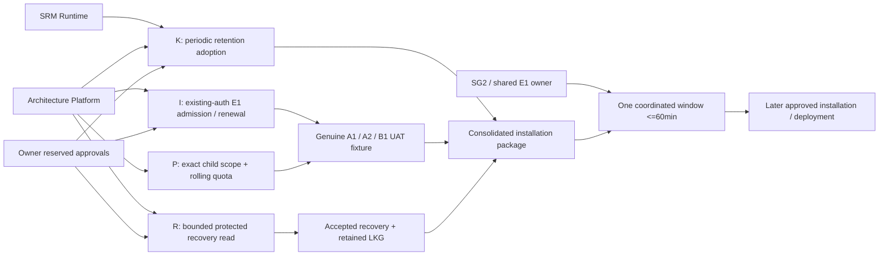

# TASK02-R — controlled Supplier Locations release preparation

Current-status authority: **Executable owner packages after PR601 promotion**, appended below. All earlier dated/undated status labels below this pointer remain historical; the companion JSON selects `ownerExecutionPackages`.

Status: **PARTIAL — coordinated gate closure;82 tables verified,20 isolated tests PASS; installation remains NO-GO**.
Initial checkpoint: 2026-10-22 04:14:59 UTC. The final **Coordinated Release Gate Closure** section and JSON coordinatedGateClosure are current; earlier dated observations and window variants are retained history and are superseded.
Task: `SRM-SUPPLIER-LOCATIONS-TASK02-R-20261022`. Profile SRM; Development only.
This is a prepared installation and acceptance package, not installation, activation or release evidence.

The owner's subsequent direct response confirms the direction and provisionally
accepts write100/sync100 per organisation per24h and paid budget ZERO. It expressly
withholds approval for a service window, application disablement, SQL019/SQL013,
active binding changes and grant activation. The owner has now created the Task02-R recovery snapshot, isolated branch and compute.
The permitted read-only verification is recorded below. Any new user accounts remain
owner-created. No release GO or agent resource-creation authority is inferred.

## Authority and verified source

Repository [profitia/SG-dev](https://github.com/profitia/SG-dev), current authority main
`4115d539501bfd73c4467129caacbadd6c94b8a4` after PR598. Supplier Locations'
accepted feature baseline remains `fd6b630afa37fb6f055b3291332d380b0d19e005`.
TASK02 [PR597](https://github.com/profitia/SG-dev/pull/597) merged candidate
`3c6805cbb1aa135454b6f6e1aad9308951cfea85`.
Historical Supplier Locations [main CI](https://github.com/profitia/SG-dev/actions/runs/39674364353),
[SRM CI](https://github.com/profitia/SG-dev/actions/runs/39674364559) and
[Maps CI](https://github.com/profitia/SG-dev/actions/runs/39674364509) passed.
The SRM Staging promotion jobs were skipped; no promotion was performed.

Root package 1.24.0 / candidate.16: all eight files reproduce
`9fe1ee707bb5510e66cbe9470ba970de177f8a6fe4533470f771af88d68bf728`.
All 33 current adoption file hashes match. The eighteen historical migrations,
initializer, manifest and original boundary are unchanged from the pre-TASK02 authority.
The five live shared function bodies that SQL019 replaces exactly match SQL017;
no B1 overwrite conflict was found at this observation point. Recheck on resume.

Fresh SRM preflights passed with require-begin, current origin/main, isolated
branch `srm/supplier-locations-release-task02-r-20261022`, local execution,
exact declared paths, ALIGNED code state and SRM/Maps/Governance routing.
Applicable Canon manifest 3.27.0: 41 loaded SRM/CORE documents.
No runtime source correction was required for this preparation phase.

## Current shared receiver

Neon project `spring-bread-28217539`, branch `br-sparkling-term-b99l107x`,
database `platform_private`; ordinary role `srm_private_development_runtime`.
The current service configuration points to `ep-late-heart-b9mxo8oi.c-7.eu-central-1.aws.neon.tech`.
The post-B1-I Stage2 ordinary-role readback is revision109 (the initial checkpoint was75); SQL017 receipt digest
`a0bd21a268e41f8a41befad777f7717fb3014fb851ff42cdb290004f93a98f94`.
Existing private boundary
`19220c7bb31365ed058bc55a99bca2aa4a9f38b7f8ca2a2ddde52ec71ed16ed4`.
SQL019, SQL013 and the location tables are absent. Location grants, policies and
intents are zero. The controlled access owner remains NOLOGIN/NOINHERIT with no
elevated flags or memberships. Ordinary-role descriptors are readable.

ACTIVE applications: srm, srm-jobs, spendguru,
spendguru-benchmark-dispatch, spendguru-forecast-dispatch.
Identity-runtime-development remains DISABLED.
Seven access bindings include the two SpendGuru dashboard/runtime bindings and
the disabled identity binding; preserve each exact pre-window status.

The shared queue has **139 PENDING jobs**: 136 Macrobond benchmark requests and
3 SRM source requests; 11 CONFIRMED. No current job leases, non-accepted phase
effects or queries over five minutes were observed. This is a point-in-time
observation, not permission to execute, cancel or replay the queued work.
Source external-call ledger visibility is unavailable through the present
controlled access-owner connection. The authorised Source owner must establish
the actual external in-flight state before maintenance. Do not widen grants for this audit.

Existing affected Render Development services:

| Service | ID |
|---|---|
| SRM runtime / request-bound SRM jobs | srv-db1vu6gm7kps73d0e3r0 |
| SG2 dashboard | srv-dapa3ujm8hqs73a9t2og |
| SG2 runtime / dispatch paths | srv-dapa3tid0e5s73f8bc5g |
| SG2 forecast current worker | srv-dapa3vlg1s2s739vp7dg |
| SG2 forecast verification worker | srv-dapa40ad0e5s73f8bjm0 |

All remain running with auto-deploy off. Source/corporate adapters are existing
request-bound connections; do not provision another worker.
The unrelated contact-email cron is not a retention operator and is outside this release.

B1-I Stage2, task `ARCHITECTURE-IDENTITY-B1-I-STAGE2-20261022`, completed in its
own PMOS at 2026-10-22 04:30:11 UTC. Result SUCCESS; CLOSEOUT_COMPLETE; required
PMOS/context/archive/PHR gates passed. Independent PHR verification at commit
`0b9797f0ee20821bdb257ddd8cb0baa5ce1bd7e3` checked all five file hashes and bundle
hash `2065843d9e5d20711cb260c3aafcefdf3c3e1f98a99d75b873a847552498c7e7`.
Its actual ordinary-runtime tests used a controlled provider fixture, not real
Clerk/browser UAT. Its final cleanup left the identity app/binding DISABLED,
five synthetic accounts DISABLED, their identities REVOKED/expired, one test
organisation and two memberships SUSPENDED, no profiles/policies/test key and
no usable former credential. Current direct metadata agrees with that state.

No active Architecture PMOS execution remains. SG2 PMOS contains one historical
September live-verification registration with no shared-receiver target; this
does not establish an approved maintenance reservation. No cross-chat message,
inherited approval or reuse of B1 recovery resources occurred. Owner coordination
for the proposed shared SRM/SG2 interruption remains NOT_GRANTED.

## Recovery and LKG gate

The existing B1 resource `br-square-field-b9vzels8` was restored from
`snap-noisy-art-b9uwq5rf` (B1 preinstall snapshot, 2026-10-21 19:34:40 UTC).
It expires 2026-10-22 19:34:39 UTC (21:34:39 Europe/Warsaw).
It is not accepted as coverage for the current installed B1 state or this window.
At the initial checkpoint no TASK02-R restore rehearsal had run. The owner's
subsequent isolated restore and its current read-only verification are recorded below.

Historical owner console instructions — creation is now complete; retained for traceability:

1. Open [this exact Backup & Restore page](https://console.neon.tech/app/projects/spring-bread-28217539/branches/br-sparkling-term-b99l107x/restore).
   Confirm project **profitia-platform-private / spring-bread-28217539**, branch
   **development / br-sparkling-term-b99l107x**, region AWS Frankfurt. The relevant
   database is platform_private; snapshots cover the branch, not a PMOS database.
2. Keep Enhanced view ON. The upper Restore from history / Point in time section
   is not the snapshot creation flow. Do not press its Restore button.
3. After B1-I Stage2 is closed, use the separate **Create snapshot** section and
   its **Create** button. Capture the present state; do not select an older B1
   snapshot or an earlier historical timestamp. Only the owner performs creation.
4. On the new snapshot row, use the visible **Edit text** control to name it
   `srm-supplier-locations-task02-r-preinstall-<UTC timestamp>` if creation did not
   already permit naming. Record the actual creation/expiry shown by the console.
   Seven days is preferred if offered; coverage must be at least24h and extend
   beyond the eventual approved window and recovery period. The current UI does
   not expose expiration in the row's menu, so do not assume that a seven-day
   value was set. No backup schedule or project history-retention change is needed.
5. On **that newly created snapshot row**, expand **Restore** and select
   **Multi-step restore**. One-step restore explicitly changes the active branch
   and is excluded. The verified multi-step confirmation says the development
   branch remains unchanged and a new `branch_from_snapshot_...` branch is created.
6. Only after those two statements are visible, the owner presses the confirmation
   **Restore**. An automatic branch name is acceptable; an optional later name is
   `srm-supplier-locations-task02-r-restore-<UTC timestamp>`. Identity is its br-ID,
   source snapshot and actual provider mapping, not a display name.
7. Do not press **Migrate connections and settings**, **Finalize Restore**, change
   the default branch, or move the existing endpoint ep-late-heart-b9mxo8oi.
   If a separate rehearsal compute is required, the owner creates it on the new
   branch only: fixed0.25CU, autosuspend300s, no primary-endpoint transfer. The
   agent must first inventory computes and must not silently provision one.
8. Return the new snap-ID and br-ID, actual capture/expiry and, if created, the new
   compute ID. No connection string, password, API key or token is needed in chat.
9. The operator verifies project/snapshot lineage, unchanged primary/default and
   original endpoint mapping, isolated compute, exact schema/receipts/E1 bindings,
   B1 state and protected table/queue/audit checksums through authorised read-only
   roles. This is inspection of the already restored copy; no production finalize
   or primary restore is authorised. Ordinary-role tests may not alter that copy
   unless their exact scope receives separate approval.
10. A snapshot is not RPO0 while legitimate shared writes continue. Before the
    eventual window, compare capture/LSN, state drift and any new writes; refresh
    coverage through the owner if necessary. A stale/expired or mismatched copy
    cannot pass the recovery gate. Never reset or repurpose another task's branch.

The multi-step confirmation was opened read-only on an existing B1 snapshot to
verify its wording, then cancelled. No snapshot, branch, compute or restore was
created or executed by the agent. The owner subsequently performed the authorised
snapshot and Multi-step restore; no Finalize Restore or connection migration followed.

This follows the current [Neon backup/restore procedure](https://neon.com/docs/guides/backup-restore).
A new branch or snapshot must be created by the owner, not implicitly by the agent.

Current SRM LKG candidate:
deploy `dep-dbbnb22fngtc73bn0i90`, source
`260ade12608faaea27376c1c976db392f046f267`.
Read-only SSH remains unavailable, but the existing Render **Web Shell** works
without adding a key. It provided direct read-only measurement of the running
instance `srv-db1vu6gm7kps73d0e3r0-5ccd45459d-zxpgf`:

- Algorithm sha256-sorted-path-type-content-v1; roots .next, node_modules,
  public, package.json and package-lock.json; exclude .next/cache and nested
  .cache content; hash link targets without dereferencing.
- All23485 entries /636136486 bytes hash to
  `f4216032035055e8ab8ad3e387882cf2fb02a82d8daca6bc4a58e57e52f502cf`.
- BUILD_ID digest `c3155dc91d9a7eb8fea77def1cd4432e9d31a3d0d5b6d88db0623ff6504f78fc`.
- The exact full digest and build ID independently match existing completed job
  `job-dbbo4cc9v7es73fs7u80`, observed 2026-10-20 15:02:39 UTC, from the same exact
  current source. Fresh running-files measurement: 2026-10-22 04:48:40 UTC.
- The31 selected environment values read from actual server PID72 produce the
  same configuration fingerprint as the current Render service configuration.
  No credential value was printed, copied into evidence or changed.

This is real file/configuration evidence, not a SHA-only substitute. No new
one-off job, deployment, restart or access key was created. The older recorded digest
`d419e35a1131f637b6009ce9ae9b511f3c193f077b9ada9fe71e4548db19301e`
belongs to source `6eede5cd19fd3a4519d66298effe9ef94633757a` and a one-off build,
not this running artifact. It cannot satisfy this gate.
Current SRM environment fingerprint:
`d86ce81c0d4207d51c9200c86474e4acb30fdfa51b26a2205b74f385740069b5`.
It now also matches the running server's effective startup environment. Together
with exact build/start/health/plan/instance settings, this forms the frozen runtime
fallback inventory. No missing SRM shell/artifact search is delegated to the owner.

Render records this exact successful uploaded build as Live; existing prior
retained deploys expose Rollback, while requesting the current Live deploy's
rollback preview redirects to its details. The task did not execute a rollback
and does not claim a tested post-candidate rollback. Immediately before release,
recheck the retained build set and use the exact native deploy ID, never a rebuild.
The full combined LKG gate remains NO until current database recovery/restore
coverage and its binding/schema/configuration compatibility are accepted.
Render rollback reuses a retained artifact; rebuilding the old source is not
equivalent. Environment groups and mutable platform settings require drift review under
[Render rollback documentation](https://render.com/docs/rollbacks).

## Consolidated maintenance and installation proposal

Package version: `srm-locations-task02-r-owner-gate-v1`.
Owner selects **one exclusive 60-minute Development window after B1-I Stage2**,
with the SRM, SG2 and ARCHITECTURE owners covered. Sixty minutes is a proposed
maximum authorised disruption, not a prediction or approval.

Before the window, verify actual LKG, current-state restored backup, exact
candidate/CI, retention, lawful UAT identities, Source in-flight effects, and
an executable non-destructive fallback. Missing evidence means no shared disable.

During an approved window:

1. Refresh authority and repeat full registered governance preflight. Capture all
   application/binding/worker/configuration states and current queue IDs/counters.
2. Close new admission through the approved owners, quiesce dispatch consumers,
   wait for leased/in-flight work to settle, and hold pending work durably.
   Do not run pending jobs merely to empty the queue, trigger paid calls, cancel
   accepted requests, alter receipts or acknowledge unexecuted work.
3. Set all shared access applications and relevant bindings to the approved
   DISABLED state. Preserve already disabled identity state. Recheck that no
   concurrent owner is mutating the receiver and that installation guards pass.
4. In **one outer transaction**, use SET LOCAL ROLE profitia_access_owner;
   execute unchanged accepted SQL019 bytes; insert its exact immutable receipt;
   execute unchanged SRM SQL013 bytes; insert its receipt with schema version
   1.0.0, exact SHA256 and accepted source SHA. No source interpolation,
   relaxed guards, historical-migration adoption or table reset.
5. Grant only the exact HUMAN EXECUTE list in the JSON companion, retaining
   existing adopted E1 grants. No direct table DML, internal helper grants,
   owner memberships, SERVICE geocoding grants or paid allowance.
6. Apply separately owner-approved location read/write/sync permissions restricted
   to named current internal accounts and organisations. Proposed per-organisation
   request-count policies: write100 and sync100 within one24-hour window,
   paid allowance zero. Exact account/org IDs, policy IDs, source references,
   start/end and expiration must be reviewed and recorded before execution;
   unresolved parameters keep the gate closed. No wildcard grant.
7. Re-read receipts, hashes, ownership, FORCE RLS, PUBLIC revocations, signatures
   and effective ordinary-role grants. Any error rolls back the transaction.
   An uncertain COMMIT requires receipt inspection; never blindly replay.
8. Restore each authorised application/binding/consumer state in controlled order.
   Verify pending work was preserved, ordinary SRM/SG2 paths, both forecast workers,
   source admission and existing audit continuity. Keep identity DISABLED unless
   its own owner separately authorised activation.
9. Deploy only the accepted exact SRM source with locations initially disabled.
   Verify the real artifact, configuration, health and old paths. Maps deployment
   is not required for this zero-budget core release.
10. Enable location core/presentation only after all applicable gates pass, with
    PROFITIA_SUPPLIER_LOCATIONS_ENABLED=true and configuration version
    srm-supplier-locations-v1. Execute actual authenticated UAT and independently
    verify persisted results. No Google geocoding activation.
11. If verification or the authorised time limit fails, stop propagation and use
    the verified feature-off/runtime/configuration fallback. Restore shared
    service availability as safely authorised. Escalate any unresolved incident.

SQL019 digest:
`34ec633dbf38dfffd6b3954ae79b0ef6f771d75ad8f0443882be71ca78b084e5`.
SQL013 digest:
`b3f05a4c56f32bd32c0c59dcc8b60c486d4d4813823665301ce08318f793704b`.
Accepted source for these bytes: main SHA above. Changed authority requires revalidation.

## Retention and UAT gates

No accepted existing scheduled KYS cleanup was found. PostgreSQL has only
plpgsql/pgcrypto; no pg_cron. The existing Render inventory has no SRM retention
cron. Read-time cleanup plus the controlled location_expire_controlled() port
does not establish background retention.

The completed investigation found no accepted periodic execution or named operator.
A concrete SRM/Architecture adoption decision is therefore still required.
Adoption must prove physical removal at retentionUntil, manual-row preservation,
source-right revocation, idempotency, bounded work, execution audit and missed-run
handling. Do not grant the owner-only port to HUMAN/SERVICE runtimes or create a
competing scheduler. KYS persistence/projection stays blocked until accepted.
The accepted host currently injects its protected KYS reader when the native
supplier runtime is available; enabling the overall flag is not a KYS-free rollout.
If HQ/manual are released independently, first establish an effective KYS input
and projection fence; do not falsely infer one from an empty group.

Google geocoding remains disabled, budget ZERO, with no provider/API/key changes
and zero Google requests from this execution. Future Google coordinate caching
requires a separate accepted at-most24-hour physical-cleanup execution for the
29-day cache. No such paid adoption is part of this task.

Only one current ACTIVE E1 account, one ACTIVE organisation and one ACTIVE
membership exist. B1-I Stage2 additionally left five DISABLED synthetic accounts,
five REVOKED/expired invalid-issuer identities, one SUSPENDED organisation and two
SUSPENDED memberships; they must not be reactivated or reused as browser users.
The existing Clerk Development instance, issuer
`https://unified-drum-7191.clerk.accounts.dev`, independently has one user and zero
users explicitly marked for this task's UAT. No customer or owner account is
silently reclassified as a test fixture.

Owner account-creation instructions:

1. Use the existing application in Clerk Dashboard, select Development, and match
   its Frontend API/issuer to unified-drum-7191.clerk.accounts.dev. Create no new
   Clerk application, instance, API key or authentication provider.
2. Use the existing application's Invitations flow for three owner-controlled
   test mailboxes, labelled UAT-A1, UAT-A2 and UAT-B1. The owner creates/accepts the
   invitations and completes the existing authentication method. Keep passwords,
   OTPs and sessions private. These are application users, not workspace team
   administrators. SRM's current SignIn has sign-up disabled.
3. Do not create Clerk Organizations as a substitute for E1 Organisation IDs.
   Canon assigns permanent User ID, Organisation ID, memberships and access to
   Profitia. Clerk roles/metadata/email are not that authority.
4. The current PORR_SUITE host is fixed to organisation
   225e465b-8b89-467d-92d1-7fef61b555fe. A1 and A2 can be HUMAN test members
   of that Development organisation only after the owner explicitly approves
   the test cohort and data scope. B1 belongs to a separate internal UAT
   organisation B. If a wholly new organisation A is required, host tenant/profile
   adoption must first be separately reviewed; a browser organisation selector
   cannot override the fixed host. This is not an authority change in Maps. Use generated internal UUIDs, never Clerk IDs as owners,
   and no memberships crossing A/B. Product SUPPLIER_INTELLIGENCE and feature
   supplier_report require explicit current grants. No owner/BYPASSRLS/CREATE,
   private-key, SERVICE or maintenance-port access is part of an end-user role.
5. Account/binding provisioning and the two organisation/membership/product
   assignments require the accepted E1 operator/admission process and explicit
   Architecture owner authority for these three named subjects. B1 source/SQL
   acceptance is not productive onboarding activation: its app/policy is disabled,
   no Identity Runtime application is on current main or deployed, and automatic
   organisation/product onboarding remains later work. Do not manufacture raw
   INSERT instructions or enable registration to bypass that missing admission.
6. The exact unresolved Architecture decision is a lawful controlled onboarding
   path for the three real Clerk subjects and their memberships, including the
   finite binding lifetime/renewal policy. B1 currently caps new bindings at300s
   and implements no renewal; expiry must not be evaded with far-future dates or
   reactivation. This decision is required before a reliable longer browser UAT.
7. After the owner's creation, verify actual SDK identity/session, distinct
   internal UUIDs, current bindings/memberships/product access and explicitly
   approved location/report/source rights. Users A1/A2 share their supplier;
   B1 must be refused access to A. No account or membership was created here.

See the current [Clerk invitation procedure](https://clerk.com/docs/guides/users/inviting)
and Canon/v1.0-identity-runtime-architecture-and-ownership-canon.md. Creating
Clerk users alone does not complete the E1 acceptance fixture.

The UAT checklist is: lawful MGBI report refresh/backfill, exact HQ address,
stable repeated refresh, manual create/edit/deactivate/reload, two-member sharing
and authorship, other-organisation denial, revocation, replay/CAS/audit rollback,
all three groups and paged KYS only after retention acceptance, and existing
SRM/SG2 regressions. Unconfirmed MGBI branches remain NOT_CONFIRMED.
Zero paid geocoding means address-only entries remain visibly unresolved until
lawful coordinates exist; do not invent markers or promise automatic coordinate resolution.
Real browser map loads must remain within existing approved Maps quotas.

## Verification completed and limits

Fresh local results: locations33/33 with the real SQL019/SQL013 fixture, Maps15/15,
contract/source acceptance3/3; no skips. Maps build passed, digest
`d036e19eb963f956d866add4296fcd0d318402be394547a62344cca017ef2bb1`.
The owned local PostgreSQL instance was stopped after testing.
The first restricted-sandbox HTTP test could not bind its local socket; the
proper permitted rerun passed. One wrong-directory test command was corrected;
neither incident changed source or cloud state.

Maps live deploy `dep-dbati9rrjlhs73akpsj0`, source
`db2df0a6cccb994ea4654ae0eb5b3af4b46867ff`, public build-manifest digest
`357464b3948e1141e73f8877f4bc42047d2fc7fcc1299e913d8ad98c6fabb984`.
All13 public files independently match their manifest and current-main build.
Health/configuration permit the SRM Development origin. Private runtime bytes and
secret-file contents were not attested. No SDK/tiles/geocoding request was run.
Public/static compatibility PASS is not authenticated SRM embed UAT.

There were no product database writes, cloud resource creation, deployments,
configuration changes, shared application interruptions, Google changes or
Staging/Production changes. No broad live regression or live acceptance is claimed.

## Continuation and business release decision

**NO-GO for live Supplier Locations activation at this checkpoint.**
Resume the same task after the consolidated owner actions; retain all completed
read-only/source/local verification and recheck only drift-sensitive evidence.

PMOS registration `cmvj0baur0000t43u7k05vcpm` is in srm_pmos.
The task remains running/resumable at this mandatory owner gate. Canonical local
execution trail and this checkpoint preserve findings without fabricating a final
closeout or completing the registration. PMOS closeout is PARTIAL and PHR is
PENDING until release acceptance or an explicitly final disposition. MEMOROS is
DISABLED_BY_PROFILE. TASK03/MagicPath remains CONDITIONAL.

The JSON companion contains the complete required verdict block and exact
reviewable permission proposal. The owner action gate is required by TASK02-R
sections4,6,7 and16: "Owner approval of the recovery point, coordinated maintenance
window and controlled installation procedure" and "This task request does not,
by itself, constitute approval to interrupt SG2/SRM traffic."


## Retention owner and exact remaining decisions

Cross-checking current GitHub source/PR549/555/597, SRM PMOS, reachable PHR,
Neon functions/extensions and the complete Render service inventory found no
accepted periodic KYS maintenance executor. The logical source owner is **SRM
Runtime**; the privileged E1/owner boundary belongs to **Architecture Platform**.
No named operational owner of a scheduled execution was established.

The existing protected native cleanup runs as current-organisation
SRM_SENSITIVE_EXPIRE work during a supplier request. Its cache helper nulls
expired KYS payloads in the organisation cache. Neither is periodic or cleans
supplier_locations. The SQL013 candidate owner port physically removes expired
SOURCE derivatives and clears expired coordinates, preserving manual rows, but
requires current_user=profitia_access_owner. A normal HUMAN/SERVICE call cannot
be substituted, and no broad owner grant is acceptable.

The concrete decision is adoption of a controlled periodic execution with
physical-expiry receipts, current-source withholding, manual preservation,
idempotency, bounds, audit and missed-run handling. SRM accepts the domain
retention requirement; Architecture reviews any privileged execution channel.
No scheduler/role/service was created. KYS remains BLOCKED. An independent
HQ/manual release needs an effective KYS input **and projection** fence first;
the existing overall feature flag alone does not provide one. This is an
identified corrective prerequisite, not an invented accepted partial rollout.

The no-wildcard grant review also found a concrete SQL019 semantic: exact
application/org/user/feature/operation are mandatory, but resource_id=NULL
matches every resource ID within that exact scope. It is not a per-supplier
selector and is **not preapproved** by the owner's response. SQL019 supports an
exact resource ID or NULL, not a typed supplier-prefix selector. The final matrix
must explicitly resolve dynamic manual CREATE scope before full browser CRUD
acceptance. No GRANT ON ALL FUNCTIONS/tables, null operation, null organisation,
null actor, cross-product grant, or unreviewed resource wildcard is proposed.

## Proposed window variants and abort conditions

B1-I Stage2 is closed; this is evidence of completed work, not a reservation or
maintenance approval. Conditional options in Europe/Warsaw are 22 October2026,
10:00-11:00 or14:00-15:00. Neither is booked or executable. Select a later window
if the owner actions and verified evidence are not ready before those times.
No automation or scheduled release has been created.

The impact is the five ACTIVE shared E1 applications and their seven access
bindings (including the already DISABLED identity binding), SRM request-bound
jobs/sources, SG2 dashboard/runtime/dispatch paths and two existing forecast
workers. Maps remains running and unchanged; Staging/Production are excluded.
Hold the139 pending requests without replay, charge, cancellation or loss.

Abort before disablement for recovery/LKG/Source visibility/UAT/retention/grant
or coordination failure. Abort the SQL transaction for any guard/hash/receipt,
owner/RLS/PUBLIC-ACL mismatch or uncertain commit; inspect receipts before retry.
Stop candidate propagation for health, audit, tenant isolation, queue preservation,
manual/source persistence or SG2 regression. Stop when the approved60-minute
limit cannot be respected. First restore approved feature-off runtime/config
and exact pre-window shared availability; preserve new data and forensic state.
Database restore requires a separate incident decision accounting for unrelated
newer writes. Never automatically reverse migrations or drop populated tables.

The owner response is preserved as conditional preparation authority. This
updated packet does not request an unconditional maintenance GO while recovery,
identity, retention and exact resource-scope decisions remain unresolved.

## Owner-created recovery verification — 2026-10-22T05:43:12Z

The owner supplied and authorised inspection of:

| Resource | Verified identity / state |
| --- | --- |
| Project / database | spring-bread-28217539 / platform_private |
| Snapshot | snap-bold-bird-b99s4c9q; manual; srm-supplier-locations-task02-r-preinstall-20261022 |
| Snapshot created | 2026-10-22 05:23:04 UTC |
| Restored data point | parent_timestamp 2026-10-22 05:22:36 UTC; parent_lsn 0/3B8E828 |
| Recovery branch | br-green-glitter-b9weet99; created05:25:09 UTC; ready; restore_status=restored |
| Recovery compute | ep-divine-mode-b9fekhdg; separate endpoint; fixed0.25CU; suspend300s |
| Original branch / compute | br-sparkling-term-b99l107x remains primary/default; ep-late-heart-b9mxo8oi remains attached |
| Expiration | snapshot console explicitly says **Expires on: never**; recovery branch says **Never** |
| Finalize / migration | neither executed; restored branch remains non-primary/non-default |

The snapshot API omits expires_at for this snapshot. The independently observed
console text resolves that ambiguity. Current [Neon snapshot retention documentation](https://neon.com/docs/guides/backup-restore#snapshot-retention)
also states that manual snapshots have no automatic expiry unless one is assigned.
The one-day PITR/history window is a separate setting and does not expire this
manual snapshot. No retention setting, backup schedule or resource was changed.
Resource availability/expiry and capture drift must still be checked before any
later approved window; this is not an RPO0 promise while legitimate writes continue.

Read-only verification used explicitly selected project, branch, compute and
database. Catalog/content transactions were REPEATABLE READ READ ONLY; controlled
content was read as SET LOCAL ROLE profitia_access_owner, never by disabling RLS
or granting a new role. An ordinary srm_private_development_runtime login also
read the existing supplier business descriptor successfully on both endpoints.

Verified comparisons:

- 105 ordinary tables in24 business schemas, including30 SRM tables. The catalog
 comparison's107 relation objects additionally include two sequences.
- 846 columns,730 constraints,172 indexes,454 RLS policies,208 public/business
 functions (including owner/ACL/body/search-path attributes),161 user triggers,
 schema owners/ACLs, default ACLs, sequence definitions, extensions and all23
 role memberships match between original and restored endpoints.
- The existing application roles have identical flags. The copy additionally has
 unreferenced NOLOGIN token_roles with zero memberships and zero pg_shdepend
 dependencies. Its creation provenance was not independently attributed. Therefore
 the full role catalogs are explicitly **not identical**; no application authority
 difference was found and no role was removed or altered.
- Counts and SHA256 fingerprints of authorised visible contents match for **79
 tables**. This includes all12 access-directory tables,2499 access audit events,
 exact product/permission grants, six application rows with five ACTIVE, seven
 bindings, access revision109, installation receipts,150 intents/dispatches,
 request policies and phase-effect state. The companion JSON preserves every
 compared table/count/hash plus exact query algorithms.
- SQL019/SQL013 remain absent. Queue remains139 PENDING /11 CONFIRMED, with zero
 unexpired leases and zero non-accepted phase effects at this observation.
- No query over five minutes was present on the recovery compute.
- The copied immutable descriptor intentionally retains the original branch ID.
 Physical copy lineage is separately proved by provider metadata. Rewriting that
 receipt or attaching an application to the copy is excluded.

Coverage limits are explicit. **Full physical-content parity is NOT VERIFIED**:

- 19 Source-owner tables require an accepted profitia_ingestion_owner inspection
 channel; the present session cannot assume that owner. This includes authoritative
 external-call/uncertain-effect state. No role membership was broadened.
- Seven further table measurements were refused by existing RLS/runtime admission:
 sg_runtime_benchmarks.BusinessBenchmark; srm.users; srm.user_supplier_interest;
 srm.organization_supplier_interest; srm.catalog_companies;
 srm.catalog_financial_facts; srm.catalog_financial_indicators.
- The initial broad aggregate read was rejected and its read-only transaction
 aborted. Bounded read-only subdivision established the79 successful results and
 exact seven refusals; no fence, function or data was changed to make a read pass.
- Visible-content equality is not evidence of unseen rows. No write test, SQL019/
 SQL013 installation, traffic cutover, second restore, Finalize Restore, connection
 migration or database rollback occurred. Restore/cutover RTO remains unmeasured.

**Recovery resource/lineage/expiry: PASS. Schema and application ACL parity: PASS.
Permitted isolated read validation: PASS with documented coverage.
Full recovery acceptance and combined LKG: PARTIAL / NOT YET ACCEPTED.**
Render independently still reports the same live SRM and Maps deployment IDs and
SHAs as the already measured artifacts above. No deploy or rollback was triggered.

## Current identity dependency and consolidated remaining decisions

A fresh GitHub/Architecture PMOS check found [Draft PR598](https://github.com/profitia/SG-dev/pull/598),
**feat(identity-runtime): B2 session compatibility and bounded navigation**,
head ed9e64cc19bb52a673160e92f981eb7767a454ac, open/unmerged.
Its task ARCHITECTURE-IDENTITY-B2-SESSION-COMPAT-20261022 is running; B1-I Stage2
remains completed. Its28 changed files are Identity Runtime/CI/evidence/runbook,
without overlap with this task's declared files or a product SQL migration.
This is scope evidence, not an exclusive shared-environment reservation.

The candidate session-boundary code and consumer adoption runbook were inspected
at that exact head. B2 resolves existing bindings per protected request and
explicitly excludes implicit renewal, automatic organisation/member/product
provisioning and live consumer adoption. It therefore does **not** close the UAT
admission gate. Main still has no Identity Runtime implementation. Current E1
still has one ACTIVE genuine account/membership and five DISABLED B1 fixtures;
no user, binding, organisation or membership was created here. The earlier Clerk
user-count observation is historical; this continuation rechecked E1, not Clerk.

The same owner-gate-v1 package is updated. It is **prepared but not ready for a
window approval request**. No additional resource creation is currently requested.
The remaining decisions are consolidated in the JSON and here:

| Gate / responsible owner | Exact unresolved acceptance |
| --- | --- |
| Recovery coverage / authorised Source + Architecture operator | Lawful readback of the26 excluded table contents and Source in-flight/uncertain effects; no audit privilege expansion |
| KYS / SRM Runtime + Architecture Platform | Named periodic controlled-retention execution with physical-expiry/audit/missed-run evidence, or reviewed implementation and verification of an independent HQ/manual KYS input and projection fence |
| UAT / E1 Architecture + SRM owner | Genuine A1/A2/B1 Clerk subjects through accepted E1 admission, approved fixed-org A data scope, separate B membership, exact product/report/source rights and finite binding/renewal policy |
| Dynamic CREATE / E1 producer + SRM receiver | A bounded no-wildcard authority design; current write resource is a server-derived location UUID from MANUAL plus the idempotency key, while SQL019 matches exact resource ID or NULL |
| Installation / SRM + SG2 + Architecture authorised owners | After previous gates and final LKG: one exact <=60-minute coordinated window, immutable SQL/receipts, exact grants/config/runtime and executable rollback; fresh B2/no-conflict check |

A blank resource_id would cover every resource inside the specific approved
org/user/operation; it is still outside the owner's no-wildcard approval. This
preparation neither adopts that blank grant nor invents a new selector. Exact
collection READ/SYNC grants alone cannot make arbitrary later manual CREATE
available. The current source/configuration-only release targets cannot silently
change the shared E1 authority contract.

KYS source cleanup remains request-bound; no accepted periodic operator was
found in current main or the refreshed related PR inventory. A signature or
installation approval cannot supply missing retention/onboarding implementation.
The earlier window variants remain conditional, unreserved and non-executable;
if prerequisites are late, withdraw them and propose a fresh window.

The user explicitly withholds application disablement, SQL019/SQL013 and deployment.
No new approval is requested before the preceding prerequisites close.
Same TASK02-R remains running; PMOS closeout PARTIAL, PHR PENDING, MEMOROS disabled.

## Coordinated Release Gate Closure — 2026-10-22T06:32:55Z

### Business result and current verdict

The existing TASK02-R continues under the same running SRM registration.
The installation package remains **PARTIAL**, not READY_FOR_INSTALLATION_APPROVAL.
No maintenance approval is requested while mandatory dependencies remain open.

| Gate | Current result | Executed resolution / exact remaining decision |
| --- | --- | --- |
| R Recovery | READY_FOR_OWNER_APPROVAL | Fresh79-table count/hash parity plus three complete protected singleton records verified. Exact23-table administrative aggregate-read proposal prepared, not executed. |
| K KYS retention | BLOCKED | Actual local physical expiry, manual/nonexpired preservation, rollback, repeat and maintenance denial pass. No accepted named periodic operator/schedule exists. |
| I Identity/UAT | BLOCKED | B2 is merged and independently closed in PMOS/PHR. Existing Clerk/SRM authentication can be reused; a lawful active three-user admission/renewal path is still absent. Full B2 deployment is not a prerequisite invented by SRM. |
| P Permissions/quota | BLOCKED | Exact existing-location update and read-only member behavior pass. Dynamic CREATE grant scope and true rolling24h semantics need E1 producer acceptance. |

### Current authority and independent handoffs

Current main4115d539501bfd73c4467129caacbadd6c94b8a4 contains merged PR598
(head ed9e64cc19bb52a673160e92f981eb7767a454ac; merged22Oct07:53:38 Europe/Warsaw).
[Current-main governance](https://github.com/profitia/SG-dev/actions/runs/39730633424)
and [Identity Runtime CI](https://github.com/profitia/SG-dev/actions/runs/39730633408)
are SUCCESS for that exact main SHA. Git comparison proves apps/srm, Maps and
platform-contracts sources are byte-unchanged from Supplier Locations' accepted
fd6b630 baseline. Existing source tests/receipts remain valid historical evidence.

The old isolated branch and2cc22086 checkpoint were preserved. Its stale
CODE_STATE_GATE was BLOCKED, so no product edits ran on it. A clean isolated
srm/supplier-locations-gates-20261022 branch was prepared from fresh main; full
preflight passed before merging the preserved task history. Reconciled full
require-begin preflight also passed. Only the two declared evidence files differ
from current main; no product source/configuration target was edited.

B2's independent Architecture registration is completed at05:40:54.196 UTC,
artifact cmvj44g6i000010z9y7bj44nx, CLOSEOUT_COMPLETE with required publication PASS.
PHR commit70f61db0629fd2015c1411d4556283202e046130 contains the exact
history/2026/10/22/2026-10-22-05-40-45Z__architecture-architecture-identity-b2-session-compat-20261022
bundle. All five recorded file hashes were independently verified; recorded
bundleHash09067e899c018d490b8c515c1315e5c631d33f38ffaee831db2811ffe1ef803c.
That source closeout supplies neither active productive onboarding nor consumer UAT.

### R — precise recovery coverage and bounded owner action

Fresh read-only original/copy comparison again matches all79 earlier accessible
table counts and SHA256 fingerprints, including the access directory/audit,
policies, receipts and queue. No legitimate live-content drift was observed.

Three previously unverified Source tables are now fully compared through **existing
accepted non-mutating descriptor functions**, using ordinary existing roles:
srm_provider_development_source for profitia_ingestion.runtime_descriptor() and
profitia_srm_acquisition.runtime_descriptor(); srm_corporate_development_source for
profitia_srm_catalog.runtime_descriptor(). No credential was exposed or changed.
Every stored field is mapped back from the descriptors. Validated
PRIMARY KEY(singleton), its non-nullability and CHECK(singleton) prove that a
non-null descriptor covers the only possible row. These are full singleton-record
proofs, not empty RLS-filtered SELECTs or new owner exemptions. The JSON retains
the field maps, actual values, constraints, query identities and equality proof.

Therefore: **79 full count/hash comparisons +3 complete singleton descriptors =
82 verified tables;23 remain unverified.** Overall105-table physical integrity,
external in-flight state and final recovery acceptance remain incomplete.

All26 originally unverified tables are accounted for below. Each is critical to
recovery and must receive complete readback or an explicitly accepted owner
equivalent before full release. Descriptive classifications identify the recovery
purpose and do not invent new formal E1 DataClass enums.

| Original uncovered table | Governance owner | Descriptive data classification | Current proof |
| --- | --- | --- | --- |
| profitia_external_call.calls | Architecture Platform | CONTROL_AUDIT_EFFECT_OR_BILLING_STATE | Pending exact bounded owner read |
| profitia_external_call.installation | Architecture Platform | CONTROL_CONFIGURATION_AND_INSTALL_RECEIPT | Pending exact bounded owner read |
| profitia_external_call.policies | Architecture Platform | CONTROL_CONFIGURATION_RIGHTS_AND_QUOTA | Pending exact bounded owner read |
| profitia_external_native.installation | Architecture Platform | CONTROL_CONFIGURATION_AND_INSTALL_RECEIPT | Pending exact bounded owner read |
| profitia_external_native.policies | Architecture Platform | CONTROL_CONFIGURATION_RIGHTS_AND_QUOTA | Pending exact bounded owner read |
| profitia_ingestion.budgets | Architecture Platform | CONTROL_CONFIGURATION_RIGHTS_AND_QUOTA | Pending exact bounded owner read |
| profitia_ingestion.effects | Architecture Platform | CONTROL_AUDIT_EFFECT_OR_BILLING_STATE | Pending exact bounded owner read |
| profitia_ingestion.grants | Architecture Platform | CONTROL_CONFIGURATION_RIGHTS_AND_QUOTA | Pending exact bounded owner read |
| profitia_ingestion.installation | Architecture Platform | CONTROL_CONFIGURATION_AND_INSTALL_RECEIPT | PASS: complete singleton descriptor |
| profitia_ingestion.runtime_bindings | Architecture Platform | CONTROL_CONFIGURATION_RIGHTS_AND_QUOTA | Pending exact bounded owner read |
| profitia_ingestion.security_events | Architecture Platform | CONTROL_AUDIT_EFFECT_OR_BILLING_STATE | Pending exact bounded owner read |
| profitia_ingestion.sources | Architecture Platform | CONTROL_CONFIGURATION_RIGHTS_AND_QUOTA | Pending exact bounded owner read |
| profitia_public_web.installation | Architecture Platform | CONTROL_CONFIGURATION_AND_INSTALL_RECEIPT | Pending exact bounded owner read |
| profitia_public_web.policies | Architecture Platform | CONTROL_CONFIGURATION_RIGHTS_AND_QUOTA | Pending exact bounded owner read |
| profitia_srm_acquisition.installation | Architecture Platform | CONTROL_CONFIGURATION_AND_INSTALL_RECEIPT | PASS: complete singleton descriptor |
| profitia_srm_acquisition.outcome_witnesses | Architecture Platform | CONTROL_AUDIT_EFFECT_OR_BILLING_STATE | Pending exact bounded owner read |
| profitia_srm_catalog.installation | Architecture Platform | CONTROL_CONFIGURATION_AND_INSTALL_RECEIPT | PASS: complete singleton descriptor |
| profitia_srm_catalog.outcome_witnesses | Architecture Platform | CONTROL_AUDIT_EFFECT_OR_BILLING_STATE | Pending exact bounded owner read |
| profitia_srm_catalog.publications | Architecture Platform | MIXED_SOURCE_PACKET_NOT_AUTOMATICALLY_SHARED | Pending exact bounded owner read |
| srm.users | SRM Runtime | PERSONAL_ACCOUNT_PROJECTION | Pending exact bounded owner read |
| srm.user_supplier_interest | SRM Runtime | ORGANISATION_PRIVATE_SUPPLIER_ASSIGNMENT | Pending exact bounded owner read |
| sg_runtime_benchmarks.BusinessBenchmark | SG Runtime / SG2 | BENCHMARK_BUSINESS_DATA | Pending exact bounded owner read |
| srm.catalog_companies | SRM Runtime | SUPPLIER_CATALOGUE_PROJECTION_WITH_SOURCE_RIGHTS | Pending exact bounded owner read |
| srm.catalog_financial_facts | SRM Runtime | SUPPLIER_CATALOGUE_PROJECTION_WITH_SOURCE_RIGHTS | Pending exact bounded owner read |
| srm.catalog_financial_indicators | SRM Runtime | SUPPLIER_CATALOGUE_PROJECTION_WITH_SOURCE_RIGHTS | Pending exact bounded owner read |
| srm.organization_supplier_interest | SRM Runtime | ORGANISATION_PRIVATE_SUPPLIER_ASSIGNMENT | Pending exact bounded owner read |

The detailed JSON matrix additionally records owning subsystem/database owner,
why ordinary access is insufficient, existing reader/descriptor, criticality,
required owner evidence and whether independent proof remains mandatory.

A15-minute, exact23-table aggregate-read proposal is ready:
**srm-task02-r-protected-recovery-readback-v1**. The current existing administrative
backup connection neondb_owner has SELECT on these tables and BYPASSRLS=true,
superuser=false. **No protected business content was queried with that bypass
authority.** Using it for these checks is expressly reserved for separate owning
project approval under task3.3. No new privileges, role inheritance, function,
policy or standing account is proposed. Precompiled REPEATABLE READ READ ONLY
queries,30s statement/3s lock deadlines, two exact branch/compute identities,
count/hash-only output, aggregate Source states and stop criteria are in JSON.

Current console read again shows snapshot snap-bold-bird-b99s4c9q with
**59.79 MB Expires on: never**. The one-day history window is separate.
The copy remains ready/restored, non-default/non-primary, from LSN0/3B8E828 at
05:22:36 UTC; original br-sparkling-term-b99l107x remains default with its original
endpoint. No new snapshot/compute, Finalize Restore or connection migration occurred.
Capture freshness still needs the final pre-window drift check.

### K — executed retention acceptance and independent HQ/manual option

A temporary extended harness reuses the unchanged real SRM/E1 integration fixture.
It ran on disposable local PostgreSQL16.14/127.0.0.1:57435 only, with no Neon data
or provider network. **20 tests PASS;0 fail;0 skipped.**
Log SHA2566de3bcf04db5a5b655b432a06441b4e06652bf7a36efc2a65a3e7f7d3d78b774;
generated harness SHA256ef6bf187e295870bb79465cc8f05f21857ebc071667347bda49acbb5f61586d9.
The disposable test database was removed and the local cluster stopped.
No test/helper was added to deployed product source.
The full transcript and temporary reproduction harness are embedded in the JSON
localAcceptance evidence so the proof does not depend on later /private/tmp retention.

The controlled expiry port removed exactly one expired derivative and preserved
manual-row fingerprints and all nonexpired rows. A deliberately rolled-back run
left the expired row intact; its later controlled run removed it; repetition
removed zero. An ordinary runtime call was refused. Existing fixture cases also
verify immediate source-right withholding, read-time expiry, sharing, CAS,
protected audit rollback, Source paging and zero paid geocoding effects.

The owner routing lookup independently resolves KYS cache/native cleanup and
SQL013 to **SRM Runtime**, and shared authority to **Architecture Platform**.
This verifies logical responsibility; it does not invent a named operational
owner. Refreshed Render inventory contains no SRM retention cron. The separately
hosted KYS service belongs to profitia/KYS and auto-deploys; it has no accepted
SRM private-store maintenance binding and was not repurposed. The email cron
remains unrelated. No live scheduled cleanup is claimed.

**Correction to the earlier overly broad HQ/manual dependency conclusion:**
for a deliberately bounded cohort, the existing E1 default-deny private/KYS rights
can provide the input/projection fence without a new runtime switch. The isolated
test removed KYS/private READ for every location-capable test user, then proved
HQ sync/manual preservation and zero KYS-derived persistence. A release adopting
this variant must also prove no location-capable SERVICE has KYS access, an empty
initial derivative store and no location grants for unrelated already-entitled
users. Their existing KYS rights are preserved. This conditional option does not
approve a general rollout or replace full KYS periodic-retention adoption.

### I — concrete existing-auth UAT design

Reuse the accepted Clerk/SRM authentication receiver and B1 provisioner/Access Store
when an owner-accepted admission operation is available. B2's merged source does
not implement renewal or organisation/product onboarding and is not deployed.
Deploying the whole B2 stack solely to create three users is not selected.

Actual known Development issuer is unified-drum-7191.clerk.accounts.dev,
application app_3KoJk9FmKeTC4hhlQwTgX6PMZmD, instance
ins_3KoJk8us60Ywqei67JBwUx6R5pi, verified by the independent B2 handoff.
Its observed allowlist is enabled with one identifier; approval of the exact test
identifiers is reserved to the owner. No Clerk configuration or account was changed.
Fresh E1 content still has one ACTIVE genuine account/membership. The five
disabled/revoked B1 fixtures are not reusable live users.

| Test user | Actual provisioning | Organisation / intended rights |
| --- | --- | --- |
| A1 | Owner-created genuine subject; internal UUID pending | Explicitly approved fixed A; exact location READ/WRITE/SYNC plus lawful report source; no KYS/private READ in the independent variant |
| A2 | Owner-created genuine subject; internal UUID pending | Same A; exact READ, no WRITE/SYNC |
| B1 | Owner-created genuine subject; internal UUID pending | Separate internal B; no membership/grants in A; signed-in request to fixed-A SRM must deny |

The fixed A is225e465b-8b89-467d-92d1-7fef61b555fe, requiring explicit cohort/data
consent. B1's valid B identity can be tested negatively at that accepted fixed-A
boundary; serving positive B data in this host is not required and no guard is
bypassed. The two existing supplier rows and six private snapshots were counted,
but no customer/supplier resource was silently adopted as a UAT fixture.

Binding proposal: follow actual verified SDK token/session expiry, max300s for
new B1 bindings, not an assumed guaranteed300s. Membership/product/operation
rights end at the approved UAT deadline. Current renewal is unimplemented; no
expired/revoked binding is automatically extended. An explicit current-proof
renewal/admission decision, auditable revocation/logout and post-UAT lifecycle
are required before a longer authenticated acceptance. No passwords, tokens,
email identifiers or fabricated internal IDs are part of this report.

### P — exact grants and quota semantics

Local actual E1/SQL acceptance additionally proves: A2 READ200/WRITE403; ungranted
dynamic CREATE403; exact existing-location UPDATE202; expired membership403;
accepted replay zero extra quota units; over-capacity429. The original sharing,
cross-organisation denial, direct SQL fences, changed payload/CAS, Source and
audit/revocation tests remain intact. Fixture broad grants are synthetic setup,
not proposed live grants.

READ and SYNC may name exact collection supplier-locations:<approved supplier UUID>.
WRITE currently names the server-derived child-location UUID. SQL019 matches that
exact ID or resource_id=NULL. The latter is an unapproved resource wildcard.
Arbitrary future CREATE cannot be made available by granting only known existing
location IDs. No SRM-local authorisation selector or null grant is implemented.
The owner-routed E1 brief below addresses a bounded, verified supplier/child scope.

The accepted policies store immutable window_start/window_end plus accepted_count.
reserve increments only a NEW reservation; an accepted same-key replay does not
increment it. Failed transactions roll back admission. A stable unchanged Source
sync key is read/replayed; a newly accepted Source version is a new sync even when
physical writes are zero. The units are admitted operations, not SQL row changes
or billable provider calls.

**A fixed24-hour policy is not a replenishing rolling24-hour quota.**
No current SQL read counts admitted intents over the moving last24h. A finite,
single, never-renewed capacity100 UAT policy can conservatively cap its whole
interval at100, but is not silently substituted for the required rolling policy.
True rolling100/operation/org/24h is a producer-owned compatibility gap. No second
quota table/limiter/ledger or unlimited SERVICE allowance is introduced.

### Cross-project graph, owner decisions and immediately usable briefs



Classification: R is a reserved bounded privileged verification (C) with missing
operational proof (B); K is adoption/owner assignment (A/C); I is accepted component
reuse plus reserved real-user/lifecycle admission (A/C); P has genuine producer
resource-scope/rolling-window semantics to resolve (D/C), with no local workaround.

Each following brief is **a proposal, not an approval or a registered foreign task**.
It can be supplied directly to the responsible owner. No other chat was messaged.

**ARCHITECTURE protected recovery decision**

```text
PROPOSED OWNER DECISION — NOT APPROVED OR EXECUTED.
Owner: ARCHITECTURE / Architecture Platform, with SRM Runtime and SG Runtime consent for their seven tables.
Dependency: existing SRM-SUPPLIER-LOCATIONS-TASK02-R-20261022; do not create another SRM registration.
Approve ONLY proposal srm-task02-r-protected-recovery-readback-v1 in this JSON: <=15min, project spring-bread-28217539/platform_private, original br-sparkling-term-b99l107x/ep-late-heart-b9mxo8oi and copy br-green-glitter-b9weet99/ep-divine-mode-b9fekhdg, exact23 listed tables.
Use the existing administrative backup connection neondb_owner only for the precompiled REPEATABLE READ READ ONLY aggregate SELECTs. Existing BYPASSRLS and SELECT are observed privileges, not new grants; present SRM authority has NOT authorised their use to bypass protected-content fences.
No new role, membership, ACL, function, policy, DDL, DML, raw-row export, business/provider execution, replay, restore, finalize or endpoint migration.
Return only actor/physical-target/read-only identity, timestamps, per-table counts/SHA256 and aggregate Source call/effect statuses. Identify changed live data rather than hiding snapshot drift. Do not accept partial/RLS-filtered rows as full coverage.
Execute only after the owning project's explicit bounded approval and applicable preflight/PMOS. If that administrative integrity mode is refused by Canon/owner, use an already approved owner integrity receipt; otherwise return the exact unresolved objects. Return an immutable independent receipt (task, source SHA, digest), never foreign closeout writes through srm_pmos.
```

**ARCHITECTURE identity/permission producer corrective**

```text
READY-TO-USE ARCHITECTURE EXECUTION BRIEF — no task has been registered by SRM and this brief is not approval to change live state.
Reference active SRM TASK02-R; current accepted main4115d539501bfd73c4467129caacbadd6c94b8a4, Root1.24.0/candidate.16. Refresh main and check for an existing matching corrective before registering a separate narrowly scoped ARCHITECTURE task in architecture_pmos.
Keep B2 source merged; do not require or deploy the entire Identity Runtime for three UAT users. Reuse existing Clerk/SRM authentication and accepted B1 ensureAccount/Access Store. Deliver a lawful controlled admission path for three owner-created genuine Clerk subjects, internal UUIDs, A1/A2 same owner-approved fixed A, B1 separate B, exact product/feature/source rights, finite membership/binding lifetime and audited current-proof renewal decision. Expired/revoked authority must still deny. No manual privileged user inserts, fixture reactivation, impersonation or Clerk-org identity substitution.
Resolve only two demonstrated permission gaps through the E1 producer: bounded authority for dynamic manual CREATE (existing write resource is a server-derived child-location UUID, SQL019 accepts exact ID or NULL), and genuine rolling100 per org/operation/24h on the existing Root request ledger. No NULL/wildcard grant, SRM-local selector, second limiter, new request ledger or universal SERVICE permission.
Use exact approved supplier/child-location evidence and preserve the organisation boundary. Preserve all historical migrations/receipts; any actual correction is additive, backward compatible and separately accepted by the SRM receiver before installation.
Acceptance: concurrent100/101 admission; exact24h boundary; same-key replay zero extra units; new source-version admission vs unchanged sync; transactional rollback/audit; A1 allowed; A2 READ with WRITE denied; B1 denied A; expired membership/binding; revoked grants; wrong supplier/location; zero paid effects; actual ordinary-role PostgreSQL. Source tests are not live Clerk UAT.
Declare exact owner-routed paths and pass full governance before code. Publish own Draft PR/CI and canonical PMOS/PHR receipt. No live users/roles/keys/policies, SQL019/SQL013, B2/SRM/Maps deployment, shared disablement, cross-profile merge or maintenance window is authorised by this brief. Return exact candidate/source digest and pending reserved owner actions.
```

**SRM controlled KYS retention adoption**

```text
READY-TO-USE SRM RETENTION ADOPTION BRIEF — continue existing TASK02-R; no new SRM task or schedule is created.
Verified logical source owner: SRM Runtime. Privileged-channel owner: Architecture Platform. No named/accepted periodic operational executor exists in the refreshed SRM/Render/Neon evidence. Foreign profitia/KYS web service is a separate repository with autoDeploy=yes, not an accepted SRM private-store operator; the contact-email cron must not be reused.
Assign a named operational owner and approve a concrete binding to an existing accepted controlled-maintenance execution, with its existing secret-delivery model and permitted cadence/maximum lag derived from actual KYS rights. Do not silently create a scheduler, publish an administrative DB password to a normal runtime, or grant owner/maintenance access to HUMAN/SERVICE.
After SQL013 is installed in the separately approved window, execute only srm.location_expire_controlled() as current_user=profitia_access_owner via the accepted controlled operator. Capture source/config/run ID/timestamps/counts/status and failures without payloads; prove missed-run detection, safe retry/idempotency, expiry, revocation withholding and preservation of manual/nonexpired/unrelated data. Local20/20 acceptance already proves the function behavior, rollback and ordinary-role denial; live scheduling is not yet verified.
If no lawful existing periodic executor can be adopted, keep KYS-derived persistence inactive. A bounded HQ/manual variant may use the existing tested default-deny KYS rights only if every location-capable actor/service lacks KYS/private-source READ and the initially empty location store is independently verified; do not alter unrelated users' existing rights or claim full KYS release. Any new privileged execution channel requires an explicit Architecture-owned proposal/approval; do not invent a parallel deletion framework.
```

The only user-reserved actions are the exact bounded backup-read authorisation,
appointment/approval of the controlled periodic operator, genuine test-user
creation and accepted E1 lifetime/cohort/data scope. Technical findings, actual
resource identities and prepared query scope are supplied here; no technical
resource hunting is delegated to the user. Actual producer corrections retain
their own ARCHITECTURE task/PMOS/PHR and return immutable receipts to TASK02-R.

### Installation package, Development safety and continuation

Owner-gate srm-locations-task02-r-owner-gate-v1 remains PARTIAL.
Earlier conditional clock-time variants are withdrawn as executable options.
No feasible/reserved window is claimed until gate evidence, binding lifetime and
recovery RTO are accepted. Conditional60-minute budget: quiesce5, SQL/receipts10,
deploy/health15, UAT10, rollback reserve20; feasibility is NOT VERIFIED.

Current SRM live dep-dbbnb22fngtc73bn0i90 /260ade12608faaea27376c1c976db392f046f267
and Maps dep-dbati9rrjlhs73akpsj0 /db2df0a6cccb994ea4654ae0eb5b3af4b46867ff
remain unchanged. The prior full SRM artifact
f4216032035055e8ab8ad3e387882cf2fb02a82d8daca6bc4a58e57e52f502cf and configuration
d86ce81c0d4207d51c9200c86474e4acb30fdfa51b26a2205b74f385740069b5
are retained historical byte measurements, now linked to unchanged deploy IDs;
they were not remeasured or rebuilt in this continuation. Maps' earlier manifest
and configuration evidence remain separately scoped. Combined LKG is not promoted
to PASS while full recovery/compatibility and rollback execution are unaccepted.

SQL019/SQL013 digests were reread and remain34ec633dbf38dfffd6b3954ae79b0ef6f771d75ad8f0443882be71ca78b084e5 /
b3f05a4c56f32bd32c0c59dcc8b60c486d4d4813823665301ce08318f793704b.
Neither is installed. Actual receiver has **five ACTIVE shared applications and
seven bindings**, not five bindings; the Identity application/binding stays disabled.
There are139 pending and11 confirmed requests in the preserved queue.
Source in-flight/uncertain state remains pending the exact authorised readback.

Before later disablement require all gates, original-state snapshot/drift and
retained artifacts/config compatibility, lawful UAT, exact grants and Source
quiescence. Do not drain by replaying/cancelling pending work. Unknown paid-effect
state stops maintenance. SQL hash/owner/receipt/audit/tenant errors abort. An
uncertain commit is inspected before retry; no blind installation replay.
Keep20minutes for validated rollback or abort before change; first contain through
approved feature-off runtime/config and restore exact pre-window statuses.
Do not automatically down-migrate, delete populated tables or restore a whole
database over newer shared writes. Maps need not redeploy for this scope.

The same SRM registration remains running; no duplicate begin, final closeout or
premature PHR publication was created. MEMOROS remains disabled. Local evidence
and canonical trail retain this continuation. The smallest lawful next step is
the reserved bounded recovery approval plus execution of the precise owner briefs;
installation still requires its later explicit consolidated decision.

### Mandatory consolidated output

```text
TASK_ID = SRM-SUPPLIER-LOCATIONS-TASK02-R-20261022
TASK_STATUS = PARTIAL
RECOVERY_SNAPSHOT = snap-bold-bird-b99s4c9q
RECOVERY_BRANCH = br-green-glitter-b9weet99
ORIGINAL_DEVELOPMENT = br-sparkling-term-b99l107x
RECOVERY_GATE = READY_FOR_OWNER_APPROVAL
RECOVERY_CHECKED_TABLES = 82
RECOVERY_UNVERIFIED_TABLES = 23
RECOVERY_PROTECTED_READBACK = PARTIAL
RECOVERY_RESTORE_PROOF = PARTIAL
SNAPSHOT_RETENTION_VERIFIED = YES
KYS_RETENTION_OWNER = SRM Runtime (verified source/domain routing); periodic operational owner NOT_ASSIGNED; Architecture Platform controls privileged execution
KYS_RETENTION_GATE = BLOCKED
KYS_OPERATOR_ADOPTION = BLOCKED
KYS_PHYSICAL_EXPIRY = PARTIAL
IDENTITY_B2_PR598 = MERGED
E1_ONBOARDING_ROUTE = BLOCKED
E1_ONBOARDING_GATE = BLOCKED
E1_BINDING_RENEWAL_POLICY = PENDING
LIVE_UAT_IDENTITIES = PENDING
LOCATION_PERMISSION_GATE = BLOCKED
READ_GRANTS = PROPOSED
WRITE_GRANTS = BLOCKED
SYNC_GRANTS = PROPOSED
LIVE_PERMISSION_ACTIVATION = NOT_PERFORMED
LOCATION_WRITE_LIMIT = 100_PER_ORG_24H
LOCATION_SYNC_LIMIT = 100_PER_ORG_24H
LIMIT_ENGINE_COMPATIBILITY = PARTIAL
PAID_GEOCODING_BUDGET = ZERO
GOOGLE_GEOCODING_ACTIVATION = DISABLED
SQL019_INSTALLED = NO
SQL013_INSTALLED = NO
SRM_DEPLOYMENT_PERFORMED = NO
MAPS_DEPLOYMENT_PERFORMED = NO
DEVELOPMENT_CHANGED = NO
STAGING_CHANGED = NO
PRODUCTION_CHANGED = NO
ARCHITECTURE_OWNER_DEPENDENCIES = Approve bounded 15-minute read-only backup/integrity operation for exact 23 tables on original/recovery endpoints using existing privileged operator; no grant or RLS change; Accept existing-auth/B1 UAT admission and finite renewal procedure with exact memberships/entitlements, no dependency on deployment of full B2; Accept additive bounded supplier/location grant scope and actual rolling-24h semantics in existing request ledger; preserve immutable historical migrations; Review privileged KYS retention execution binding; separate ARCHITECTURE PMOS/PHR for actual producer corrective
SRM_OWNER_DEPENDENCIES = Assign/adopt lawful periodic KYS operator and receipts; preserve default-disabled KYS persistence pending adoption; Accept bounded HQ/manual UAT variant using existing E1 default-deny KYS rights only if complete actor/service grant fence is approved; Approve UAT cohort and exact report/supplier resource within fixed Development organisation; preserve unrelated users' existing rights; Receive any separately accepted E1 producer change and refresh exact SQL/source receipts before installation
USER_ACTIONS_REMAINING = Owning-project approval for the attached exact read-only recovery operation; no new snapshot/compute is requested; Owner-controlled creation/invitation of three genuine Clerk Development users after exact identifier/allowlist approval; use no customer accounts; Approve finite E1 onboarding/renewal and exact organisation/product/supplier scope and the retention operator proposal through the responsible owners; Approve final <=60min shared window only after gate receipts, current LKG and feasibility are accepted
INSTALLATION_APPROVAL_PACKAGE = PARTIAL
MAINTENANCE_WINDOW_APPROVAL = NOT_REQUESTED
PMOS_TASK_STATE = RUNNING
PHR_TASK02_R_PUBLICATION = NOT_YET_PUBLISHED
```


## Controlled Recovery Closure & Remaining Release Dependencies — 2026-10-22T07:32:06Z

This is the current controlling checkpoint for **the same TASK02-R**. Earlier dated
sections/readbacks remain historical receipts. No new SRM registration, product
source, migration, deployment, infrastructure, live grant/binding or final PHR was
created. Exact changed targets are this file and its existing release JSON.
SRM profile / SG-dev Codespaces SRM / Development; execution is local, not a
Codespace claim. Fresh main remains4115d539501bfd73c4467129caacbadd6c94b8a4.
Full require-begin preflight PASS; the existing registration remains RUNNING.

**Result: PARTIAL; installation approval package PARTIAL.** The useful next
decisions are the object-specific recovery reads, a bounded E1 producer corrective,
the existing-auth UAT lifecycle, the restricted HQ/manual business scope and the
real test cohort. Installation/deployment permission is not requested while those
dependencies remain incomplete.

### What actually changed in recovery evidence

One more complete protected table is independently verified:
**profitia_external_call.installation**. Existing ordinary
`srm_provider_development_source` called the accepted non-mutating
`profitia_external_call.descriptor('srm.provider.mgbi','srm-provider:mgbi')` on both
explicit computes in REPEATABLE READ READ ONLY. All eight stored columns are
reconstructed and equal; validated NOT NULL + PK(singleton) + CHECK(singleton)
prove exactly one row. Complete reconstructed-record SHA256 is `953ce5d7b7eb9f39ae28e637f267868658dffd7fb3c45a846f8ed979809fd941`
(sorted JSON algorithm; not confused with PostgreSQL row-text hashing).
No external provider call, quota reservation, audit writer or privilege change ran.

The earlier82-table claim also contained an insufficient empty RLS read for
**srm.financial_scanner_frames**. Its current policies have no owner-TRUE read
branch; matching visible0/empty-hash is not accepted here as complete physical
coverage. That table returns to pending. The historical result is preserved,
not rewritten. Current strict result is therefore **78 complete owner count/hash
comparisons +4 complete singleton descriptors =82/105;23 pending**. It is not a
claim that the same23 objects remain unchanged.

The benchmark-specific hypothesis was tested without changing RLS: both attempted
controlled-owner reads were refused, with the recovery retry reporting
`Ordinary isolated runtime required`. Its additional category-input policy still
calls runtime authority. No bypass retry followed. Native/public Source descriptors
also cannot prove their installation records: their SourceRef fields refer to
**policies**, leaving installation.source_ref unobserved. Their FOR SHARE paths
were not invoked merely to obtain an incomplete proof.

Current original/recovery metadata again agrees for105 ordinary tables,846
columns,730 constraints,172 indexes,454 RLS policies,208 functions and161 triggers,
plus namespaces/ACLs/sequences/extensions and23 memberships. The known additional
recovery `token_roles` remains an explicitly recorded role-catalog difference,
not an assertion of exact full role equality. These metadata comparisons do not
replace the pending data evidence.

### Complete105-table matrix

The companion JSON `controlledRecoveryContinuation.recovery.tableMatrix105`
contains every object exactly once, with actual database owner, routed source
owner/path, classification, all applicable SELECT policies, existing reader,
why a proof is incomplete, need for row access, operator/approval, expected output
and PASS criterion. No raw business export is required for any table. Complete
prior per-table counts/hashes and current singleton maps are linked in each row.
AGG = complete controlled-owner count/hash; DESC = complete singleton descriptor;
PENDING = no accepted complete data proof. Classifications are descriptive, not
invented E1 enums or assumptions that a provider packet is shared knowledge.

| Table | Routed source owner | Class | Data proof | Rows / required group |
| --- | --- | --- | --- | --- |
| profitia_access.accounts | Architecture Platform | IDENTITY_ACCESS_AUDIT | AGG / PASS | 6 |
| profitia_access.applications | Architecture Platform | IDENTITY_ACCESS_AUDIT | AGG / PASS | 6 |
| profitia_access.bootstrap_receipts | Architecture Platform | IDENTITY_ACCESS_AUDIT | AGG / PASS | 1 |
| profitia_access.directory_installation | Architecture Platform | INSTALLATION_RECEIPT | AGG / PASS | 1 |
| profitia_access.external_identities | Architecture Platform | IDENTITY_ACCESS_AUDIT | AGG / PASS | 6 |
| profitia_access.installation | Architecture Platform | INSTALLATION_RECEIPT | AGG / PASS | 1 |
| profitia_access.memberships | Architecture Platform | IDENTITY_ACCESS_AUDIT | AGG / PASS | 3 |
| profitia_access.organisations | Architecture Platform | IDENTITY_ACCESS_AUDIT | AGG / PASS | 2 |
| profitia_access.permission_grants | Architecture Platform | IDENTITY_ACCESS_AUDIT | AGG / PASS | 18 |
| profitia_access.product_grants | Architecture Platform | IDENTITY_ACCESS_AUDIT | AGG / PASS | 3 |
| profitia_access.runtime_bindings | Architecture Platform | IDENTITY_ACCESS_AUDIT | AGG / PASS | 7 |
| profitia_access.security_events | Architecture Platform | IDENTITY_ACCESS_AUDIT | AGG / PASS | 2499 |
| profitia_benchmark_discovery.commands | SG Runtime / SG2 | PRIVATE_BENCHMARK_WORK | AGG / PASS | 136 |
| profitia_benchmark_discovery.installation | SG Runtime / SG2 | INSTALLATION_RECEIPT | AGG / PASS | 1 |
| profitia_benchmark_discovery.results | SG Runtime / SG2 | PRIVATE_BENCHMARK_WORK | AGG / PASS | 136 |
| profitia_category.installation | SG Runtime / SG2 | INSTALLATION_RECEIPT | AGG / PASS | 1 |
| profitia_delegated_phases.installation | Architecture Platform | INSTALLATION_RECEIPT | AGG / PASS | 1 |
| profitia_external_call.calls | Architecture Platform | CONTROL_AUDIT_EFFECT | PENDING | R-ARCH-EFFECT |
| profitia_external_call.installation | Architecture Platform | INSTALLATION_RECEIPT | DESC / PASS | 1 |
| profitia_external_call.policies | Architecture Platform | CONTROL_RIGHTS_BUDGET | PENDING | R-ARCH-POLICY |
| profitia_external_native.installation | Architecture Platform | INSTALLATION_RECEIPT | PENDING | R-ARCH-INSTALL |
| profitia_external_native.policies | Architecture Platform | CONTROL_RIGHTS_BUDGET | PENDING | R-ARCH-POLICY |
| profitia_forecast_dispatch.discovery_installation | SG Runtime / SG2 | INSTALLATION_RECEIPT | AGG / PASS | 1 |
| profitia_forecast_dispatch.installation | SG Runtime / SG2 | INSTALLATION_RECEIPT | AGG / PASS | 1 |
| profitia_forecast_requests.commands | SG Runtime / SG2 | PRIVATE_BENCHMARK_WORK | AGG / PASS | 4 |
| profitia_forecast_requests.installation | SG Runtime / SG2 | INSTALLATION_RECEIPT | AGG / PASS | 1 |
| profitia_ingestion.budgets | Architecture Platform | CONTROL_RIGHTS_BUDGET | PENDING | R-ARCH-POLICY |
| profitia_ingestion.effects | Architecture Platform | CONTROL_AUDIT_EFFECT | PENDING | R-ARCH-EFFECT |
| profitia_ingestion.grants | Architecture Platform | CONTROL_RIGHTS_BUDGET | PENDING | R-ARCH-POLICY |
| profitia_ingestion.installation | Architecture Platform | INSTALLATION_RECEIPT | DESC / PASS | 1 |
| profitia_ingestion.runtime_bindings | Architecture Platform | CONTROL_RIGHTS_BUDGET | PENDING | R-ARCH-POLICY |
| profitia_ingestion.security_events | Architecture Platform | CONTROL_AUDIT_EFFECT | PENDING | R-ARCH-EFFECT |
| profitia_ingestion.sources | Architecture Platform | CONTROL_RIGHTS_BUDGET | PENDING | R-ARCH-POLICY |
| profitia_jobs.delegations | Architecture Platform | CONTROL_REQUEST_AUDIT | AGG / PASS | 150 |
| profitia_jobs.delivery_observations | Architecture Platform | CONTROL_REQUEST_AUDIT | AGG / PASS | 11 |
| profitia_jobs.dispatches | Architecture Platform | CONTROL_REQUEST_AUDIT | AGG / PASS | 150 |
| profitia_jobs.execution_grants | Architecture Platform | CONTROL_RIGHTS_BUDGET | AGG / PASS | 4 |
| profitia_jobs.installation | Architecture Platform | INSTALLATION_RECEIPT | AGG / PASS | 1 |
| profitia_jobs.operation_bindings | Architecture Platform | CONTROL_RIGHTS_BUDGET | AGG / PASS | 4 |
| profitia_modules.application_bindings | Architecture Platform | CONTROL_RIGHTS_BUDGET | AGG / PASS | 4 |
| profitia_modules.audit_installation | Architecture Platform | INSTALLATION_RECEIPT | AGG / PASS | 1 |
| profitia_modules.installation | Architecture Platform | INSTALLATION_RECEIPT | AGG / PASS | 1 |
| profitia_profile.installation | Architecture Platform | INSTALLATION_RECEIPT | AGG / PASS | 1 |
| profitia_profile.runtime_policies | Architecture Platform | IDENTITY_ACCESS_AUDIT | AGG / PASS | 0 |
| profitia_profile.user_profiles | Architecture Platform | IDENTITY_ACCESS_AUDIT | AGG / PASS | 0 |
| profitia_public_web.installation | Architecture Platform | INSTALLATION_RECEIPT | PENDING | R-ARCH-INSTALL |
| profitia_public_web.policies | Architecture Platform | CONTROL_RIGHTS_BUDGET | PENDING | R-ARCH-POLICY |
| profitia_request_inspection.installation | Architecture Platform | INSTALLATION_RECEIPT | AGG / PASS | 1 |
| profitia_request_phases.effects | Architecture Platform | CONTROL_REQUEST_AUDIT | AGG / PASS | 0 |
| profitia_request_phases.installation | Architecture Platform | INSTALLATION_RECEIPT | AGG / PASS | 1 |
| profitia_request_phases.policies | Architecture Platform | CONTROL_RIGHTS_BUDGET | AGG / PASS | 0 |
| profitia_request_work.installation | Architecture Platform | INSTALLATION_RECEIPT | AGG / PASS | 1 |
| profitia_request_work.policies | Architecture Platform | CONTROL_RIGHTS_BUDGET | AGG / PASS | 37 |
| profitia_requests.external_installation | Architecture Platform | INSTALLATION_RECEIPT | AGG / PASS | 1 |
| profitia_requests.installation | Architecture Platform | INSTALLATION_RECEIPT | AGG / PASS | 1 |
| profitia_requests.intents | Architecture Platform | CONTROL_REQUEST_AUDIT | AGG / PASS | 150 |
| profitia_requests.operation_installation | Architecture Platform | INSTALLATION_RECEIPT | AGG / PASS | 1 |
| profitia_requests.policies | Architecture Platform | CONTROL_RIGHTS_BUDGET | AGG / PASS | 5 |
| profitia_services.installation | Architecture Platform | INSTALLATION_RECEIPT | AGG / PASS | 1 |
| profitia_services.read_grants | Architecture Platform | CONTROL_RIGHTS_BUDGET | AGG / PASS | 0 |
| profitia_services.runtime_bindings | Architecture Platform | CONTROL_RIGHTS_BUDGET | AGG / PASS | 3 |
| profitia_srm_acquisition.installation | SRM Runtime | INSTALLATION_RECEIPT | DESC / PASS | 1 |
| profitia_srm_acquisition.outcome_witnesses | SRM Runtime | SOURCE_OUTCOME_AUDIT | PENDING | R-SRM-WITNESS |
| profitia_srm_catalog.installation | SRM Runtime | INSTALLATION_RECEIPT | DESC / PASS | 1 |
| profitia_srm_catalog.outcome_witnesses | SRM Runtime | SOURCE_OUTCOME_AUDIT | PENDING | R-SRM-WITNESS |
| profitia_srm_catalog.publications | SRM Runtime | MIXED_SOURCE_PACKET | PENDING | R-SRM-PUBLICATION |
| profitia_supplier_jobs.installation | Architecture Platform | INSTALLATION_RECEIPT | AGG / PASS | 1 |
| profitia_supplier_requests.commands | SRM Runtime | CONTROL_REQUEST_AUDIT | AGG / PASS | 10 |
| profitia_supplier_requests.installation | SRM Runtime | INSTALLATION_RECEIPT | AGG / PASS | 1 |
| sg_runtime_benchmarks.BenchmarkProviderMapping | SG Runtime / SG2 | PRIVATE_BENCHMARK_WORK | AGG / PASS | 1 |
| sg_runtime_benchmarks.BusinessBenchmark | SG Runtime / SG2 | PRIVATE_BENCHMARK | PENDING | R-SG2-BENCHMARK |
| sg_runtime_benchmarks.Category | SG Runtime / SG2 | PRIVATE_BENCHMARK_WORK | AGG / PASS | 1 |
| sg_runtime_benchmarks.CategoryCostComponent | SG Runtime / SG2 | PRIVATE_BENCHMARK_WORK | AGG / PASS | 1 |
| sg_runtime_benchmarks.OrganizationBenchmarkSelection | SG Runtime / SG2 | PRIVATE_BENCHMARK_WORK | AGG / PASS | 1 |
| sg_runtime_benchmarks.private_installation | SG Runtime / SG2 | INSTALLATION_RECEIPT | AGG / PASS | 1 |
| srm.catalog_companies | SRM Runtime | SOURCE_RIGHTS_CATALOGUE | PENDING | R-SRM-CATALOG |
| srm.catalog_financial_facts | SRM Runtime | SOURCE_RIGHTS_CATALOGUE | PENDING | R-SRM-CATALOG |
| srm.catalog_financial_indicators | SRM Runtime | SOURCE_RIGHTS_CATALOGUE | PENDING | R-SRM-CATALOG |
| srm.catalog_kys_reports | SRM Runtime | PRIVATE_SUPPLIER_SOURCE | AGG / PASS | 0 |
| srm.delegated_supplier_installation | SRM Runtime | INSTALLATION_RECEIPT | AGG / PASS | 1 |
| srm.financial_facts | SRM Runtime | PRIVATE_SUPPLIER_SOURCE | AGG / PASS | 111 |
| srm.financial_scanner_frames | SRM Runtime | PRIVATE_FINANCIAL_FRAME | PENDING | R-SRM-SCANNER |
| srm.financial_source_documents | SRM Runtime | PRIVATE_SUPPLIER_SOURCE | AGG / PASS | 19 |
| srm.lookup_requests | SRM Runtime | PRIVATE_SUPPLIER_SOURCE | AGG / PASS | 7 |
| srm.mgbi_source_archives | SRM Runtime | PRIVATE_SUPPLIER_SOURCE | AGG / PASS | 4 |
| srm.msr_projections | SRM Runtime | PRIVATE_SUPPLIER_SOURCE | AGG / PASS | 0 |
| srm.msr_sources | SRM Runtime | PRIVATE_SUPPLIER_SOURCE | AGG / PASS | 3 |
| srm.named_interest_installation | SRM Runtime | INSTALLATION_RECEIPT | AGG / PASS | 1 |
| srm.organization_supplier_interest | SRM Runtime | PRIVATE_ACCOUNT_INTEREST | PENDING | R-SRM-IDENTITY |
| srm.organizations | SRM Runtime | PRIVATE_SUPPLIER_SOURCE | AGG / PASS | 1 |
| srm.private_installation | SRM Runtime | INSTALLATION_RECEIPT | AGG / PASS | 1 |
| srm.provider_attempts | SRM Runtime | PRIVATE_SUPPLIER_SOURCE | AGG / PASS | 11 |
| srm.schema_migrations | SRM Runtime | INSTALLATION_RECEIPT | AGG / PASS | 18 |
| srm.section_projections | SRM Runtime | PRIVATE_SUPPLIER_SOURCE | AGG / PASS | 6 |
| srm.source_snapshots | SRM Runtime | PRIVATE_SUPPLIER_SOURCE | AGG / PASS | 6 |
| srm.supplier_business_installation | SRM Runtime | INSTALLATION_RECEIPT | AGG / PASS | 1 |
| srm.supplier_inspection_installation | SRM Runtime | INSTALLATION_RECEIPT | AGG / PASS | 1 |
| srm.supplier_private_acquisition_installation | SRM Runtime | INSTALLATION_RECEIPT | AGG / PASS | 1 |
| srm.supplier_sensitive_installation | SRM Runtime | INSTALLATION_RECEIPT | AGG / PASS | 1 |
| srm.supplier_web_identity | SRM Runtime | PRIVATE_SUPPLIER_SOURCE | AGG / PASS | 2 |
| srm.supplier_web_installation | SRM Runtime | INSTALLATION_RECEIPT | AGG / PASS | 1 |
| srm.supplier_work_installation | SRM Runtime | INSTALLATION_RECEIPT | AGG / PASS | 1 |
| srm.suppliers | SRM Runtime | PRIVATE_SUPPLIER_SOURCE | AGG / PASS | 2 |
| srm.user_supplier_interest | SRM Runtime | PRIVATE_ACCOUNT_INTEREST | PENDING | R-SRM-IDENTITY |
| srm.users | SRM Runtime | PRIVATE_ACCOUNT_INTEREST | PENDING | R-SRM-IDENTITY |

### Recovery owner decisions, narrowed to actual objects

The unapproved homogeneous v1 request is **superseded** by
`srm-task02-r-protected-recovery-readback-v2`. No extra authority is inferred from
this continuation. Ownership is corrected from database-role inference to actual
source routing: profitia_srm_catalog/acquisition are **SRM Runtime** migrations,
although their database owner is profitia_ingestion_owner. Shared controlled
backup authority remains Architecture Platform. The full105 matrix follows that
distinction, including SG2's domain schemas.

| Decision scope | Data owner | Exact objects | Why narrower business proof is insufficient |
| --- | --- | --- | --- |
| R-ARCH-INSTALL | Architecture Platform | profitia_external_native.installation; profitia_public_web.installation | Existing native/public descriptors expose schema version/digest but nativeSourceRef/publicWebSourceRef come from POLICY rows, not installation.source_ref. They also acquire FOR SHARE locks. They cannot reconstruct the complete singleton record. No misleading equivalence was accepted. |
| R-ARCH-POLICY | Architecture Platform | profitia_external_call.policies; profitia_external_native.policies; profitia_public_web.policies; profitia_ingestion.budgets; profitia_ingestion.grants; profitia_ingestion.runtime_bindings; profitia_ingestion.sources | Existing ordinary Source current_state/descriptor exposes only the active currently admitted source/resource and omits some stored fields and inactive/expired/revoked/history rows. Two external policy projections match, but do not prove complete tables. |
| R-ARCH-EFFECT | Architecture Platform | profitia_external_call.calls; profitia_ingestion.effects; profitia_ingestion.security_events | Existing read_status requires a known call plus current role/source/resource/policy; receipt requires exact key/payload. Neither enumerates the complete ledger or proves all uncertain external effects. No accepted global integrity operator/receipt was found. |
| R-SRM-WITNESS | SRM Runtime | profitia_srm_acquisition.outcome_witnesses; profitia_srm_catalog.outcome_witnesses | SRM owns these migration paths even though database owner is profitia_ingestion_owner. Existing receipt/current_packet is bound to a particular source transaction and cannot supply full outcome-witness coverage. |
| R-SRM-PUBLICATION | SRM Runtime | profitia_srm_catalog.publications | current_packet requires an admitted current transaction/effect. It is not a historical catalogue enumerator. Packet contents are mixed source data and not automatically approved shared knowledge. |
| R-SRM-IDENTITY | SRM Runtime | srm.users; srm.user_supplier_interest; srm.organization_supplier_interest | Current named-person and delegated-target policies require an actual admitted human/request. Administrative SET ROLE alone does not provide that context; no complete-table permitted descriptor or independent owner receipt was found. |
| R-SRM-CATALOG | SRM Runtime | srm.catalog_companies; srm.catalog_financial_facts; srm.catalog_financial_indicators | Corporate/native reader requires the current source or HUMAN work scope. A single supplier report is not complete catalogue integrity evidence. Ordinary source admission rejects the administrative session. |
| R-SRM-SCANNER | SRM Runtime | srm.financial_scanner_frames | Prior count=0/hash(empty) was obtained through FORCE RLS. Current permissive/restrictive policies call profitia_modules.scope_allows and have no controlled-owner TRUE branch. Treat the earlier result as visible-content-only until full owner evidence exists; do not silently include it in physical coverage. |
| R-SG2-BENCHMARK | SG Runtime / SG2 | sg_runtime_benchmarks.BusinessBenchmark | Table-specific recheck on both branches was refused; explicit retry on recovery returned Ordinary isolated runtime required. The additional private_category_benchmark_input SELECT policy calls module authority even though other policies contain owner CASE branches. No RLS/policy change or bypass was attempted. |


All nine scopes have exact precompiled SQL and SHA256, stored separately in JSON.
Together:12 Architecture,10 SRM and1 SG2 table. The proposed existing backup
principal is neondb_owner, only under the expressly approved object/owner scope.
Existing BYPASSRLS is not enabled or granted by this task, nor used for protected
content here. No new account, credential, membership, table grant or helper is
required. The owning project may instead supply an already accepted equivalent
complete integrity receipt; none was found in current source/PMOS/PHR.

Execution request: at most15minutes total, exact spring-bread-28217539 /
platform_private, original br-sparkling-term-b99l107x / ep-late-heart-b9mxo8oi and
recovery br-green-glitter-b9weet99 / ep-divine-mode-b9fekhdg. Each transaction is
REPEATABLE READ READ ONLY, statement30s/lock3s/idle60s. Return only transaction
identity/time and per-table counts + sorted full-row SHA256. R-ARCH-EFFECT also
returns call/effect status totals, never request bodies, identities or URLs.
Audit actual actor, approval, owner, SQL digest and physical target. Close the
session on completion/timeout; no standing grant exists to revoke. Stop on target
or read-only mismatch, missing scope, errors or unexplained live/snapshot drift.
Do not export raw rows, mutate either branch, replay, settle or cancel effects.

Snapshot snap-bold-bird-b99s4c9q remains preserved from the original, created
05:23:04Z for data05:22:36Z/LSN0/3B8E828. Its previously verified console expiry
is Never; current API still omits expires_at for the unchanged manual snapshot.
This is not mislabelled as a new UI expiry observation. Recovery remains
ready/restored/nondefault; restored_as is restore intent, not Finalize Restore.
Original remains default/primary with unchanged endpoint. No fresh snapshot,
branch, migration, restore/finalize or connection change occurred.

### Concrete KYS disposition

SRM Runtime owns KYS/native source retention; Architecture Platform controls the
privileged execution boundary. Current Render inventory has41 services, one
unrelated contact-email cron and **no accepted SRM periodic maintenance operator**.
The foreign profitia/KYS auto-deploying web service is not that operator. Existing
SRM_SENSITIVE_PURGE is request-scoped; SQL013's location_expire_controlled() is
not installed. Its prior actual local PostgreSQL expiry/manual preservation,
rollback, retry and ordinary-role denial tests remain20/20; they are not a live
scheduling proof. No duplicate schedule/framework or privileged app role was added.

**Decision K1-HQ-MANUAL-UAT-SUBSET is ready for explicit business acceptance:**
activate only MGBI headquarters/address projections and manual locations for the
finite approved UAT cohort/supplier(s), with zero KYS-derived persistence and zero
paid geocoding. Use the already tested existing E1 default-deny fence: every
location-capable HUMAN/SERVICE lacks KYS/private-source READ; initial derivative
store is empty; unrelated users retain existing KYS rights but have no location
grants. Verify the complete cohort/service intersection before activation. Any
actor/service with both rights closes this subset gate. No source flag or new
scheduler is needed for that tested, bounded option. Full KYS remains BLOCKED.

If full KYS is required instead, first approve an actual controlled periodic
execution channel and owner/cadence/maximum-lag derived from KYS policy. There is
no identified existing executor to pretend to adopt. New external infrastructure
is excluded from this task. Future paid Google coordinate caching has its own
existing <=24h cleanup adoption requirement for the29-day/30-day rule; it does
not establish a KYS retention schedule.

### Identity follow-up resolved to the smallest actual dependency

PR598 is merged. PR599 remains **DRAFT / OPEN**, exact head
c8936471e2e295dde0a470361ab309fcd12c37f3. Its two exact-head CI runs39734792780 and
39734792679 passed. It only corrects strict public Host handling for a disabled,
health-only listener; its own owner handoff awaits source/first-service approval.
It supplies no onboarding, binding renewal, memberships, product rights or live
Clerk/browser acceptance. No Identity Runtime service exists in current inventory.

Independent ordinary-role architecture_pmos read confirms B2-D completed
06:45:38.413Z with those operational approvals still pending. Its PHR commit
d67e34abd4739c5c9fda41994259d5e29c7b194b, directory
history/2026/10/22/2026-10-22-06-45-30Z__architecture-architecture-identity-b2-dev-prep-20261022,
is on current PHR main; all five integrity-listed file hashes match. Its recorded
bundle hash is f4e2f731127717c173c07bc467b47de6ddcfff7fa5777cfbbfe3fad614176319
(recorded value; no invented independent bundle-algorithm recomputation).
Foreign continuity was read, never amended. No newer relevant producer corrective
appears in current PR inventory; this is bounded evidence, not approval-by-absence.

Use existing SRM official Clerk login and accepted B1 provisioning, not a mandatory
B2 deployment. The verified issuer is unified-drum-7191.clerk.accounts.dev,
app app_3KoJk9FmKeTC4hhlQwTgX6PMZmD, instance ins_3KoJk8us60Ywqei67JBwUx6R5pi.
SRM currently resolves existing internal bindings but does not invoke B1's
createIdentityProvisioner. B1's installed ordinary identity_b1_runtime/app remain
DISABLED; profile policy/profile rows are0. Thus an invitation alone cannot
onboard three users and no current accepted productive route exists.

Decision I1 is precisely **existing-auth B1 admission/lifecycle acceptance**:
reuse official current session/user verification and accepted provision_account,
with an owner-approved receiver composition and scoped ordinary credential
delivery. No raw account INSERT, impersonation, synthetic account reactivation,
Clerk-metadata role or full new service deployment. Real internal UUIDs must be
returned by that lifecycle. No genuine A1/A2/B1 fixture is assumed from the one
currently ACTIVE account/membership.

Proposed finite policy for owner/producer acceptance: binding expires at the
minimum of verified JWT expiry, live Clerk session expiry/abandonment, now+300s
and approved UAT deadline;300s is a ceiling, never a guaranteed duration. Permit
renewal only from fresh official proof for the same still-ACTIVE, unexpired
authority, with audit. Expired/revoked/suspended authority is not resurrected;
re-admission after expiry needs its own accepted rule. Membership/product/operation
rights end no later than T0+60min. Official signOut/session revocation and E1
revocation are separate checks. Revoke finite UAT entitlements through the accepted
lifecycle; account/profile deletion requires actual retention policy.

Owner cohort procedure: use that exact Clerk Development instance; explicitly
approve identifiers in the existing allowlist; create/invite genuine A1/A2/B1
through normal provider flow and complete verification. No passwords/JWTs/keys
in chat. Approve fixed A225e465b-8b89-467d-92d1-7fef61b555fe, independent B and exact
supplier/source test resources; existing two suppliers/six snapshots are not
silently adopted. A1 receives exact READ/WRITE/SYNC and lawful report rights;
A2 exact READ only; B1 valid B membership and no A membership must deny at fixed-A
SRM. Positive B data hosting is unnecessary; do not relax the fixed-host guard.
Internal IDs, live admission and actual three-user UAT remain PENDING.

### Exact E1 producer correction and permission decision

**CREATE remains OWNER_CORRECTIVE_REQUIRED.** An exact existing child UUID grant
does not authorise an arbitrary future server-issued child; resource_id=NULL is
an unapproved wildcard. Smallest producer proposal: retain supplier.location.write
and child-bound effects, add an explicit typed MANUAL-child collection scope for
one verified supplier in one organisation. Bind current server-selected
supplier/child/existence/origin to current receiver ownership/CAS/source evidence;
never accept a caller's parent claim. Define CREATE and subsequent UPDATE/
DEACTIVATE semantics expressly, preserving exact-child grants and cross-tenant
denial. No SRM-only selector or alternate permission engine.

**Rolling24h remains OWNER_CORRECTIVE_REQUIRED.** Existing immutable fixed-window
policy/accepted_count is not a moving window. Use the existing requests intents/
policies ledger only, serialised on the authoritative scope policy, across all
users/services and policy rotations for environment/application/org/operation.
Count unique accepted operations in (database_now-24h,database_now], <=100WRITE
and <=100SYNC separately. Existing created_at is reservation time, not a proven
acceptance instant: the additive producer must define an immutable accepted
timestamp/backfill or prove an exact equivalent; do not silently ignore history
or reset via a new policy ID. Keep existing capacity as an additional bound.

Accepted identical replay consumes0 extra; changed payload denies; rollback or
failed audit consumes no accepted unit. Same-key concurrent calls accept once.
Unchanged stable source sync key replays; a new accepted source-version sync
consumes one even if physical rows changed=0. Physical row writes and paid
external calls are distinct. At exactly accepted_at+24h the older operation leaves
the moving window. Tests must cover concurrent100/101 across users and policy
rotation, exact boundary, revocation/CAS/audit rollback, zero paid effects and
unchanged SG2/SRM compatibility.

The JSON names exact existing producer files and proposed additive migration020
(subject to current-main collision/routing checks). Historical SQL001-019 and
receipts remain unchanged. P1 authorisation is for a separately governed
ARCHITECTURE producer source corrective/PR/CI/PMOS/PHR, **not** live SQL or merge.
Its accepted version must precede consumer adoption. Any additional consumer
path must pass its own routing/continuity scope; do not silently expand this
task's registered paths or create another SRM TASK03.

READ/current collection/source checks, exact UPDATE/CAS, DEACTIVATE, stable SYNC,
zero geocoding allowance, cross-org and expired/revoked denials retain their
actual isolated SQL proofs. CREATE-for-any-new-child, moving quotas and genuine
live admission remain unproven. The complete operation matrix is in JSON. No
fixture's broad synthetic setup grant is proposed for live users.

### LKG, current safety and one next-action packet

SRM still runs dep-dbbnb22fngtc73bn0i90 /260ade12608faaea27376c1c976db392f046f267;
Maps still runs dep-dbati9rrjlhs73akpsj0 /db2df0a6cccb994ea4654ae0eb5b3af4b46867ff.
Both remain autoDeploy off. Earlier independently measured actual retained SRM
artifact/config and Maps13-file/config digests remain in JSON; unchanged deploy
IDs were freshly checked, not falsely reported as new byte-level measurements.
Complete combined LKG/rollback acceptance still needs protected data/effect
coverage, schema compatibility and executable window timing. Do not swap the
whole shared database over newer writes or run destructive down migrations.

Fresh E1 readback: revision109, five ACTIVE applications, one ACTIVE genuine
identity/account/membership, five disabled accounts, two suspended memberships,
identity app/binding DISABLED, profile rows/policies0, location grants/policies/
intents0. SQL019/SQL013 absent. No application shutdown, deploy, active permission,
provider acquisition, paid geocoding, restore/finalize, endpoint or Stage/Prod
change was performed. “Original unchanged” means unchanged by this task; it is
not a claim that unrelated shared application activity was frozen. Current
uncertain Source effect state remains explicitly unverified pending R-ARCH-EFFECT.

One consolidated next-action packet contains:

1. **R2**: approve the selected object-specific recovery scopes or return complete
   accepted owner integrity receipts. No new snapshot or technical resource hunt.
2. **P1**: authorise exact source-only E1 parent/child and rolling-quota correction
   under ARCHITECTURE continuity; return immutable source/CI/PHR receipt.
3. **I1**: accept and implement the smallest existing-auth B1 UAT admission/
   lifetime path under correct producer/receiver ownership, with secure ordinary
   role delivery. No B2 service dependency or live identity activation inferred.
4. **K1**: formally accept the bounded HQ/manual UAT subset, or keep full release
   blocked until a real KYS controlled periodic operator/channel is accepted.
5. **U1**: approve/create the genuine cohort and exact organisation/supplier/source
   test scope; no passwords/keys or customer-account reuse.
6. **W1 later**: once the above dependencies have real acceptance receipts, refresh
   source/LKG/config/schema/receiver/effect evidence and request the single <=60min
   controlled installation window. No current time slot or feasibility is claimed.

These scopes are reviewable decisions, not approvals. No privileged read or
foreign producer task was executed on an inferred blanket authority. Independent
preparation is complete for this continuation checkpoint; the same SRM PMOS stays
RUNNING. Final TASK02-R PHR remains NOT_PUBLISHED.

### Required continuation handoff

```text
TASK_ID = SRM-SUPPLIER-LOCATIONS-TASK02-R-20261022
TASK_STATUS = PARTIAL
RECOVERY_TABLES_TOTAL = 105
RECOVERY_TABLES_VERIFIED = 82
RECOVERY_TABLES_PENDING = 23
RECOVERY_GATE = READY_FOR_OWNER_APPROVAL
RECOVERY_SNAPSHOT = snap-bold-bird-b99s4c9q
RECOVERY_BRANCH = br-green-glitter-b9weet99
RECOVERY_ORIGINAL_DEVELOPMENT_UNCHANGED = YES
KYS_RETENTION_OWNER = SRM Runtime; privileged channel Architecture Platform; periodic operator UNASSIGNED
KYS_OPERATOR_ADOPTION = BLOCKED
KYS_RETENTION_GATE = BLOCKED
IDENTITY_B2_STATUS = PR598_MERGED_SOURCE_ONLY_PR599_DRAFT_HEALTH_ONLY
E1_ONBOARDING_ROUTE = ARCHITECTURE_DEPENDENCY
UAT_IDENTITIES = PENDING
BINDING_LIFETIME_POLICY = PENDING
LOCATION_CREATE_AUTHORITY = OWNER_CORRECTIVE_REQUIRED
ROLLING_24H_QUOTA = OWNER_CORRECTIVE_REQUIRED
LOCATION_PERMISSION_GATE = BLOCKED
WRITE_QUOTA = 100_PER_ORG_ROLLING_24H
SYNC_QUOTA = 100_PER_ORG_ROLLING_24H
PAID_GEOCODING_BUDGET = ZERO
SQL019_INSTALLED = NO
SQL013_INSTALLED = NO
DEVELOPMENT_DEPLOYMENT = NOT_PERFORMED
STAGING_CHANGED = NO
PRODUCTION_CHANGED = NO
OWNER_DECISIONS_REQUIRED = R2 scoped integrity / P1 E1 producer / I1 lifecycle / K1 bounded subset or accepted full KYS operator / U1 genuine cohort; W1 only after dependencies
CROSS_PROJECT_TASKS_REQUIRED = ARCHITECTURE E1 location admission corrective; ARCHITECTURE existing-auth B1 UAT lifecycle corrective; SG2 scoped recovery receipt if required by owner continuity. No duplicate SRM TASK03.
INSTALLATION_APPROVAL_PACKAGE = PARTIAL
SRM_PMOS = RUNNING
TASK02_R_FINAL_PHR = NOT_PUBLISHED
```


### Subsequent owner decision — PR600, independently checked after PR601 opened

Concurrent draft PR600, exact head97d2839dde880bf9ab20c605ef5eb7b736f112a4, records
Architecture task ARCHITECTURE-IDENTITY-B2-D-FIRST-RELEASE-20261022 and the owner's
**Single Identity Core / Configurable Client Deployments** business requirement.
First client is PORR; one deployment must support multiple independently
authorised Organisation IDs, including separate customer and internal-test
contexts. Deployment/client branding is not an organisation or a permission.
The exact43-line decision file and its Git blob/content digest are retained in
the JSON; it was not treated as a new source/merge/infrastructure authority.

This is consistent with reusable Maps consuming validated server-side context,
without tenant IDs in shared components. Current SRM's fixed-A receiver is an
observed present limit, not a target single-organisation identity design. A valid
B-only user's denial at that host remains a lawful negative UAT; positive
multi-organisation hosting needs accepted receiver/context adoption later.

PR600 creates no user/organisation/membership/grant and expressly leaves B1
app/binding disabled, live Clerk/browser acceptance, renewal and productive PII
policy pending. Its health-only first-release proposal still requires a separate
combined owner GO. Thus I1/P1/U1 and the handoff values above remain unchanged.
The present packet neither duplicates that Identity Runtime task nor makes its
full deployment a prerequisite for the smallest existing-auth SRM UAT route.


## Owner acceptance and source reconciliation — 2026-10-22T08:47:59Z

The owner directly accepted PR601 reference d9f96316724b5c02ea18d3c5c06f254a719b46c2
as the two-file TASK02-R preparatory evidence package, authorising its normal
documentation-only promotion after current-main reconciliation, full governance
and exact-head CI. No new approval of unchanged preparation is required. The
source attachment and digest are retained in ownerAcceptedExecution in JSON.
This acceptance expressly excludes protected R2 execution, foreign producer
implementation without owner authority, live identities/grants, installation,
shutdown, deployment, costs, restore/finalize or endpoint changes.

Fresh authority main is aa95c0a0a14fb2f2ba5af7338c8d83a6fb349269. **PR599 is now
MERGED**, at that SHA on2026-10-22T08:13:56Z; its accepted source is the strict
health-only ingress correction. Earlier Draft observations remain valid dated
history, not current status. No productive registration, renewal or live runtime
acceptance is inferred from this merge. PR600 remains DRAFT at
97d2839dde880bf9ab20c605ef5eb7b736f112a4: one canonical Identity Core, PORR first,
multiple authorised organisations per deployment and no automatic access. It is
not live multi-organisation onboarding or SRM receiver acceptance.

The old clean branch was behind main and correctly returned CODE_STATE_GATE
BLOCKED. Its accepted d9f9631 reference remains untouched. A clean integration
branch srm/supplier-locations-601-promotion-20261022 was bootstrapped from current
main; full existing-registration preflight PASS preceded merging the preserved
two-file evidence history. Product source equals current main; the final PR diff
remains restricted to the two owner-approved evidence files. This is workspace
reconciliation, not a bypass or retroactive PASS for edits on stale source.

Documentation promotion is pending actual exact-head CI and ordinary PR merge;
the resulting SHA will be independently read back, not guessed in this candidate.
Existing SRM PMOS registration remains RUNNING. Strict recovery remains82/105
with23 exact pending objects, and no protected R2 operation was executed. After
promotion, independently prepare complete owner-routed P1/I1 execution prompts,
the exact R2 request and concrete K1/U1 manifest/procedure. No duplicate SRM task
or artificial final TASK02-R PHR is created.


## Executable owner packages after PR601 promotion — 2026-10-22T09:15:26Z

PR601 is MERGED. Final reviewed head `0485e82d5e6c38cd05049e4fb9e27bb19c046014`; promotion main `1cf170fa7180445877d980de4e6b8df37bbd7d49`,2026-10-22T08:57:31Z. Exactly two evidence files; accepted historical matrix/SQL unchanged. Exact-head [governance CI](https://github.com/profitia/SG-dev/actions/runs/39750941415) and [post-merge CI](https://github.com/profitia/SG-dev/actions/runs/39751686825) PASS. No product source, workflow or live activation change.

New executable deliverable is option B for P1: full owner-routed source prompt with closed candidate paths, additive migration semantics and real PostgreSQL acceptance matrix. I1 now includes explicit fresh-proof lifecycle, an SRM receiver appendix and the unresolved controlled directory port. Existing Identity service is accepted HEALTH_ONLY, not onboarding; independent owner PHR [75d51ee](https://github.com/profitia/project-history-repository/commit/75d51ee5890cf40a54d09e3a5198ef411664f68f), five integrity-listed files verified. R2 preserves all nine exact v2 scopes. K1/U1 contains finite cohort, exact-resource procedure and fail-closed draft manifest. These are prepared deliverables, not grants or source implementation.

Private control state remains revision109, five ACTIVE apps, identity application/binding DISABLED, profile policies/profiles/location grants/location policies/location intents all0; SQL019/SQL013 absent. SRM and Maps live deploy IDs unchanged. The new Architecture service is an independently approved owner release; DEVELOPMENT_CHANGED=NO refers to product runtime/data/config changes by this TASK02-R, not all activity by all projects. Source documentation601 and PMOS continuity are the only task mutations.

R2 accepted82/105 comprises78full-owner aggregates+4complete singletons;23pending. Snapshot source/point/LSN and ready restored nondefault branch verified; API expiry omitted, earlier UI Never is not refreshed eternal-retention evidence. Full recovery/combined release rollback remains PARTIAL. No protected23-table query executed. Earlier20/20local tests retained as historical evidence; no new feature suite claimed for documentation preparation.

### R2 — complete owner execution prompt

```text
Pracujesz w profitia/SG-dev, authority origin/main, TARGET_ENVIRONMENT=development. To jest pakiet do decyzji właściciela, a nie dowód już udzielonej zgody. Przed pracą potwierdź bezpośrednią zgodę właściciela na dokładny opisany zakres. PR601 zaakceptowano i scalono tylko jako dokumentację. Nie wolno wyprowadzać z tego uprawnień do kodu producenta, uprzywilejowanych odczytów, tożsamości, grantów, SQL ani deploymentu.
Załaduj aktualny root/nested AGENTS, manifest, wymagane CORE i adapter właściwego właściciela. Przed każdą mutacją odśwież origin/main, potwierdź repo/branch/HEAD/środowisko/working tree, zabezpiecz cudzą pracę, użyj izolowanej gałęzi i przejdź pełny fail-closed preflight dla dokładnych ścieżek. Wymagana jest kanoniczna rejestracja PMOS właściwego profilu; nigdy nie zapisuj ARCHITECTURE ani SG2 do srm_pmos i odwrotnie. MEMOROS pozostaje wyłączony. Nie obchodź gate/protection przez zmianę profilu. Nie zakładaj, że ścieżka zaproponowana poniżej jest zatwierdzona przed odczytem bieżącego routingu.
Koordynacja wraca do istniejącego SRM-SUPPLIER-LOCATIONS-TASK02-R-20261022; nie twórz duplikatu zadania SRM ani sztucznego finalnego PHR TASK02-R. Źródło pakietu: Canon/evidence/2026-10-22-srm-supplier-locations-task02-r-release.json, sekcja ownerExecutionPackages. Bazą przygotowania jest main1cf170fa7180445877d980de4e6b8df37bbd7d49; przed wykonaniem sprawdź drift i istniejące zadania. Zachowaj zgodność i historyczne dowody SQL019/SQL013 oraz candidate16/package1.24.0.

R2 — gotowy wniosek wykonawczy srm-task02-r-protected-recovery-readback-v2; NIE zgoda i NIE wykonano.
Właściciele: Architecture Platform (12 tabel), SRM Runtime (10), SG Runtime/SG2 (1). Kontrolowany operator bazy: istniejące połączenie neondb_owner, wykonywane przez agenta Codex w tym czacie wyłącznie po jawnych zgodach właścicieli i potwierdzeniu prawa operatora do tego zadania. Nazwa roli nie udowadnia zgody operatora. Nie ustanawia się nowej roli, członkostwa ani standing runtime privilege. Istniejące rolbypassrls=true jest cechą zastanej kontrolowanej roli i musi być jawnie przyjęte jako ryzyko owner readback; NIE ustawiaj BYPASSRLS ani nie poszerzaj uprawnień.

Fizyczny zakres: project spring-bread-28217539, db platform_private. Porównaj oryginał br-sparkling-term-b99l107x / ep-late-heart-b9mxo8oi / ep-late-heart-b9mxo8oi.c-7.eu-central-1.aws.neon.tech oraz recovery br-green-glitter-b9weet99 / ep-divine-mode-b9fekhdg / ep-divine-mode-b9fekhdg.c-7.eu-central-1.aws.neon.tech. Snapshot snap-bold-bird-b99s4c9q, utworzony2026-10-22T05:23:04Z, recovery point05:22:36Z, LSN0/3B8E828. Recovery ready/restored/nondefault; pierwotny Development pozostaje default. Żadnych nowych snapshotów/branchy, restore/finalize ani migracji endpointów.

Każda zgoda musi wymienić dokładne scope IDs i digests z poniższej tabeli. Nie zmieniaj 105-elementowej macierzy ani 23-elementowego zakresu v2.

| Scope | Właściciel | Tabele | SQL SHA256 |
|---|---|---:|---|
| R-ARCH-INSTALL | Architecture Platform | 2 | `5e6d383fbf0a43a26c2e8b43523e63edbfecf5f570034f5b4b64b9b6aba16414` |
| R-ARCH-POLICY | Architecture Platform | 7 | `5208f48c882399564ff080187855c1914a936873307e3dbfc9ce32448dc815a2` |
| R-ARCH-EFFECT | Architecture Platform | 3 | `f4ec25efdefab5e5df27e2f874d83d9083794b3004dd74e2d607046dcdb62cb8` |
| R-SRM-WITNESS | SRM Runtime | 2 | `e3fba1c975850faf4ac221b66561c42af8f116a26d0a74f2ad223bf1dc205638` |
| R-SRM-PUBLICATION | SRM Runtime | 1 | `566944ed313c4a322bbb8fea02749b220b6aadfcdf877e6902b1d93b81cb1655` |
| R-SRM-IDENTITY | SRM Runtime | 3 | `f5f4a03b617020cd5ff8df5309b32283c3219f0f6199a69134f1a400b4560bb0` |
| R-SRM-CATALOG | SRM Runtime | 3 | `c15a2b98c20ae6731874f5c823c1ddeab8a0fea7c43afcc6b76376e08307b47a` |
| R-SRM-SCANNER | SRM Runtime | 1 | `af5d783cabf73967fe24473361f0d705a8e0206a6648f377ef6c3ac5feeac095` |
| R-SG2-BENCHMARK | SG Runtime / SG2 | 1 | `9df43f4a3880d8a73cdcc0284f305c65eb3b9393cf76f89c42aa275a52d85414` |

Dokładne obiekty, SQL, dodatki effect-status, powody, role, audit/cleanup i hash są w controlledRecoveryContinuation.recovery.protectedReadbackProposal.groups tego samego JSON. Wniosek obejmuje tylko niezmienione SQL wskazanego digest; nie odtwarzaj zapytań z pamięci. Dodatkowe totals z R-ARCH-EFFECT.additionalAggregateSql wymagają odrębnego jawnego zatwierdzenia swoich digestów, nie wynikają ze zgody na podstawowy count/hash.

Po otrzymaniu właściwych zgód:
1. Zapisz zaufany approval source/owner/accepted scope IDs/digests/actual operator/expiry/cleanup i waliduj każdą grupę fail-closed. Jeśli któryś właściciel nie zatwierdził, wykonaj tylko zatwierdzone grupy; pozostałe zachowaj PENDING. Praca właściciela ARCHITECTURE/SG2 ma własną ciągłość jeśli Canon tego wymaga; nie zapisuj cudzej historii w SRM.
2. Odśwież repo/main i source sha, snapshot/branch/default/compute metadata; potwierdź rzeczywistą rolę current_user/session_user/read_only i liczbę wymaganych obiektów. Weryfikacja metadanych i descriptorów nie przyznaje prawa do chronionych payloadów.
3. Jedna łączna authority lifetime<=15min liczona od pierwszego wykonania, oba endpointy/tylko zaakceptowane scope. Na każdym endpointcie BEGIN z REPEATABLE READ READ ONLY, statement_timeout30s, lock_timeout3s, idle_in_transaction_session_timeout60s; użyj dokładnego transactionPrefix i principalReadbackSql z v2. Przed chronionym SQL sprawdź DB i zatwierdzoną rolę, potem querySha256.
4. Zbieraj tylko table_id/count/sorted full-row SHA256 oraz osobno zaakceptowane effect-status totals. Nie eksportuj wierszy, identyfikatorów klientów, body, credentialów ani subjectów. W receipt zachowaj approval/operator/target/SQLdigest/transaction instant/result, nie tokeny. Brak DML/DDL, SET ROLE escalation, RLS change, provider acquisition, replay/settlement, writes do recovery albo Source.
5. Każdy timeout/wrong endpoint/unapproved scope/unexpected lock/write/nieoczekiwany digest przerywa odpowiednią operację; zamknij połączenia na deadline. Mismatch nie upoważnia do dopisywania nowych forensic SQL ani synchronizacji kopii. Odróżnij dowód recovery point od późniejszego live drift. Jeśli istniejący agregat nie pozwala przypisać zmiany do czasu, zgłoś UNEXPLAINED/PARTIAL i poproś o konkretny dodatkowy zakres, zamiast ogłaszać corruption lub PASS.
6. Zachowaj osobno znaną różnicę recovery role catalog token_roles (NOLOGIN/no memberships/no dependencies); nie ogłaszaj pełnej równości ról. Snapshot API bieżąco nie zwraca expires_at dla tego snapshotu; wcześniejszy UI wskazywał Never. Bez świeżego niezależnego potwierdzenia nie nazywaj retencji snapshotu wieczystą gwarancją. Sprawdź expiry przed W1 i przydatność dla aktualnego recovery objective, nie tylko historyczne istnienie.
7. Cleanup: COMMIT/ROLLBACK read-only transakcji i zamknięcie sesji, usunięcie tymczasowego materiału operatora, żadnego nowego stałego uprawnienia; zachowaj wyłącznie aggregate receipts. Nie wykonuj Finalize Restore ani zmiany połączeń.
8. Zaktualizuj istniejący TASK02-R: RECOVERY_TABLES_VERIFIED/PENDING, DATA_INTEGRITY/RESTORE_USABILITY PASS|PARTIAL|FAIL, każdą approval row, drift i role finding. Start82/105 to78pełnych ownerhash +4singletons, pending23; lokalne20/20testów i bazowy schema proof zachowaj bez sztucznego powtarzania. Gate PASS dopiero z kompletną ważną coverage/recovery-objective/rollback acceptance, nie po samym upłynięciu operacji.

Wymagana decyzja do wklejenia przez uprawnionego właściciela: wskazać zatwierdzone scope IDs i ich dokładne hashe, istniejącego kontrolowanego operatora neondb_owner, oba powyższe endpointy, jednorazowe <=15min aggregate read-only, dozwolone extra totals lub NONE, źródło umocowania/data owner i termin ważności. Samo ogólne „akceptuję PR601” nie jest taką decyzją. Ten wniosek nie uruchamia W1 i nie wymaga wyłączenia aplikacji.

```

### P1 — complete owner execution prompt

```text
Pracujesz w profitia/SG-dev, authority origin/main, TARGET_ENVIRONMENT=development. To jest pakiet do decyzji właściciela, a nie dowód już udzielonej zgody. Przed pracą potwierdź bezpośrednią zgodę właściciela na dokładny opisany zakres. PR601 zaakceptowano i scalono tylko jako dokumentację. Nie wolno wyprowadzać z tego uprawnień do kodu producenta, uprzywilejowanych odczytów, tożsamości, grantów, SQL ani deploymentu.
Załaduj aktualny root/nested AGENTS, manifest, wymagane CORE i adapter właściwego właściciela. Przed każdą mutacją odśwież origin/main, potwierdź repo/branch/HEAD/środowisko/working tree, zabezpiecz cudzą pracę, użyj izolowanej gałęzi i przejdź pełny fail-closed preflight dla dokładnych ścieżek. Wymagana jest kanoniczna rejestracja PMOS właściwego profilu; nigdy nie zapisuj ARCHITECTURE ani SG2 do srm_pmos i odwrotnie. MEMOROS pozostaje wyłączony. Nie obchodź gate/protection przez zmianę profilu. Nie zakładaj, że ścieżka zaproponowana poniżej jest zatwierdzona przed odczytem bieżącego routingu.
Koordynacja wraca do istniejącego SRM-SUPPLIER-LOCATIONS-TASK02-R-20261022; nie twórz duplikatu zadania SRM ani sztucznego finalnego PHR TASK02-R. Źródło pakietu: Canon/evidence/2026-10-22-srm-supplier-locations-task02-r-release.json, sekcja ownerExecutionPackages. Bazą przygotowania jest main1cf170fa7180445877d980de4e6b8df37bbd7d49; przed wykonaniem sprawdź drift i istniejące zadania. Zachowaj zgodność i historyczne dowody SQL019/SQL013 oraz candidate16/package1.24.0.

P1 — ARCHITECTURE / E1: bounded CREATE oraz rzeczywiste rolling24h. Tryb po zatwierdzeniu: SOURCE-ONLY, bez instalacji i live danych.
Właściciel producenta: Architecture Platform. Proponowana nazwa nowego zadania, NIEZAREJESTROWANA: ARCHITECTURE-E1-SUPPLIER-LOCATION-ADMISSION-20261022. Najpierw sprawdź duplikaty i przejmij istniejące właściwe zadanie, jeśli już jest. Profil i PMOS/PHR ARCHITECTURE. Nie edytuj pod tym profilem aplikacji SRM/Maps/SG2.

1. Potwierdzone źródło i cel
Current producer1.24.0/candidate16 rozpoznaje CREATE/UPDATE/DEACTIVATE w payloadzie operation-context, lecz dowód SQL019 location_evidence_current nie zawiera action; location_access/bind_location_scope wymagają istniejącego exact-child grant. Grant na przyszły UUID nie tworzy uprawnienia CREATE, a resource_id=NULL jest szerokim dopasowaniem. READ/SYNC używają supplier-locations:<supplierUUID>. Należy skorygować TEN SAM silnik E1.
SQL006 ma narastające accepted_count<=capacity, created_at oznacza rezerwację, brak accepted_at. Nie udawaj rolling24h przez nowy fixed-window, rotację policy_id lub osobny limiter SRM.

2. Dokładne proponowane target paths — przed rejestracją potwierdź routing i zakres
packages/platform-contracts/migrations/access/020-supplier-location-admission.sql — NOWA addytywna migracja;020 jest wolne na bazie pakietu. Jeśli numer zajęty, ponownie uzgodnij rzeczywisty następny numer i odnotuj zmianę przed mutacją.
packages/platform-contracts/src/supplier-location.mjs
packages/platform-contracts/src/supplier-location.d.mts
packages/platform-contracts/src/operation-context.mjs
packages/platform-contracts/src/operation-context.d.mts
packages/platform-contracts/src/request-ledger.mjs
packages/platform-contracts/src/request-ledger.d.mts
packages/platform-contracts/src/private-operation-host.mjs
packages/platform-contracts/src/private-operation-host.d.mts
packages/platform-contracts/test/supplier-location.test.mjs
packages/platform-contracts/test/request-reservation.test.mjs
packages/platform-contracts/test/operation-context.test.mjs
packages/platform-contracts/test/private-operation-host.test.mjs
packages/platform-contracts/test/types/supplier-location.mts
packages/platform-contracts/test/supplier-location-admission.integration.test.mjs — NOWY rzeczywisty PostgreSQL test, nie sam mock SQL
packages/platform-contracts/test/fixtures/supplier-location-postgres.mjs — NOWY fixture wykorzystujący istniejący wzorzec izolowanego PostgreSQL z test/fixtures/identity-profile-postgres.mjs
packages/platform-contracts/package.json
packages/platform-contracts/package-lock.json
packages/platform-contracts/README.md
Canon/evidence/2026-10-22-e1-supplier-location-admission.md — NOWY producer receipt, routing Governance Source Layer, osobno zadeklarowany.
Lista jest zamkniętym kandydatem do zatwierdzenia. Usuń niepotrzebne pliki przed begin zamiast robić pozorne zmiany; rozszerzenie poza listę wymaga ponownego routingu/zakresu. Nie zmieniaj SQL001–019, macierzy uprawnień, workflow ani konsumenckich locków bez osobnej właściwej zgody.

3. Kontrakt CREATE
Zachowaj supplier.location.write, feature supplier_report, product SUPPLIER_INTELLIGENCE, istniejący Access Store/audit i exact-child UPDATE/DEACTIVATE. Zaproponuj jawnie wersjonowany, opt-in descriptor/migration digest nowej semantyki; stary candidate i brak przyjętego descriptor mają zachować dotychczasowe restrykcje.
Nowy CREATE wymaga bieżącego HUMAN/internal UserID, aktywnej OrganizationID/member/product/module, dokładnego grant WRITE na supplier-locations:<supplierUUID>, serwerowo odczytanego bieżącego związku dostawca→organizacja, server-generated locationUUID, MANUAL/USER_LOCATIONS, commandDigest, supplier/source/target versions i expectedVersion=null. Effect resource pozostaje dokładnym childUUID, parent permission nie zamienia się w wildcard.
Nie dodawaj action do zamkniętego v1 dowodu bez wersjonowania i zgodności. Nowy zaufany dowód/SQL admission musi wiązać action CREATE/UPDATE/DEACTIVATE z rzeczywistą komendą, parentem, aktorem, wersjami oraz tą samą transakcją; client-selected parent/organisation lub zwykły GUC nie jest dowodem. Producent otrzymuje zweryfikowany kontrakt rodzica od właściwego receivera; nie hardkoduje tabel SRM ani ID klienta. UPDATE/DEACTIVATE nadal wymagają aktualnego exact-child grant/CAS; kolekcyjny CREATE nie daje aktualizacji cudzych punktów. Stosuj istniejące DENY/revocation precedence także dla CREATE.
Po utworzeniu dziecka nie zakładaj automatycznego nadania future-child UPDATE/DEACTIVATE. Jeżeli business UAT ma edytować nowy punkt, wymagana jest osobno zatwierdzona ścieżka przyznania exact-child prawa albo dodatkowy wyraźnie przyjęty parent-child model tej operacji. Nie rozszerzaj tego milcząco przez grant NULL ani autora rekordu. Odczyt dla A2 wynika z organisation membership/READ i nigdy z created_by.

4. Specyfikacja migracji rolling24h
Dodaj opt-in mode FIXED / ROLLING_24H do ISTNIEJĄCYCH policies i guarded intents; domyślny FIXED pozostaje zgodny. Dokładne nazwy i upgrade descriptor podlegają zatwierdzeniu producenta. Tylko rolling policies dla supplier.location.write i supplier.location.sync:100 przyjęć każdego rodzaju na organizację w poprzednich24h, zbiorczo dla wszystkich aktorów i uprawnionych usług; usługi nadal wymagają własnej dopuszczonej ścieżki E1 i nie otrzymują jej z tej migracji.
Wprowadź niemodyfikowalny accepted_at generowany przez DB przy guarded przejściu RESERVED→ACCEPTED. created_at nie może oznaczać akceptacji. Bez klientowskiego zegara i bez produkcyjnego test-clock override. Dla rolling sprawdzaj committed ACCEPTED w przedziale (t-24h,t], t z autorytatywnego DB przy admission. Recheck i ustawienie accepted_at muszą być atomowe, z audytem i efektem biznesowym, na jednym connection/transaction. Rezerwacja wcześniejsza niż24h z akceptacją teraz liczy się teraz. Brak commitu nie liczy się.
Nie opieraj synchronizacji wyłącznie na lock policy_id: serializacja ma być stabilna dla environment/organisation/operation i tego samego zatwierdzonego budżetu organizacji także przy replacement policy oraz zmianie aplikacji wykonawczej, obejmować reservation/admission/accepted transitions i dwóch aktorów/połączeń. Zastosuj istniejący poprawny wzorzec blokowania E1 albo uzasadnij stały scope-lock; nie dodawaj drugiego katalogu limitów. Licz wszystkie policy IDs tego scope, nie tylko current policy. Application/executor identity pozostaje audytem, a nie sposobem resetu limitu: wszystkie dopuszczone usługi/lokalizacyjne ścieżki tej organizacji muszą konsumować TEN SAM zaakceptowany scope budżetu E1. Nie rozdzielaj100 na application IDs. Jeśli obecny kontrakt application-scoped nie pozwala tego wyrazić, skoryguj jawnie opt-in rolling aggregation/locking w tym samym ledger, zachowując legacy FIXED. Oddziel WRITE od SYNC.
Zachowaj monotoniczne accepted_count jako lifetime metrykę, ale dla opt-in rolling usuń zależność od lifetime<=100 poprzez jawny warunkowy constraint i guard; FIXED nadal ma swój stary capacity check. Rozwiąż też limit int/retencję: BIGINT dla narastającej metryki jeśli konieczny, bez cichego zmieniania starych typów/API. Same replay po100 nie może zwiększyć licznika ani wymagać dodatkowego slotu, lecz nadal przechodzi aktualną autoryzację. Zmieniony payload przy tym samym key jest konfliktem. Stabilny source-version SYNC replay=0 dodatkowych jednostek; nowa przyjęta source-version=1 nawet przy braku fizycznej różnicy adresu. Jawnie odróżnij taką nową operację od powtórnego renderowania raportu.
Historię ACCEPTED z accepted_at=NULL traktuj fail-closed: przed włączeniem rolling dla takiego scope przerwij albo zastosuj jawnie zatwierdzoną, dowiedzioną konwersję. Nie przepisuj created_at jako acceptance bez dowodu. Bieżący Development ma0location intents, ale nie gwarantuje tego dla przyszłej instalacji. Retencja istniejącego ledger musi zachować co najmniej cały moving interval i dowód idempotencji; nie dodawaj kasowania danych. Zaprojektuj bounded index na istniejącym ledger dla scope/status/accepted_at i analizę zapytania. Nie wprowadzaj nowej tabeli kwot SRM, lokalnych cache jako authority ani automatycznej korekty historii.
Nowy SQL020 ma być opcjonalny/nieaktywny do osobnej instalacji. Jego descriptor musi wiązać nowe funkcje/digest z faktycznie zainstalowaną wersją. Uaktualnij source fingerprints (Root/host/request-ledger/location) jawnie, nie podmieniaj starych receiptów; SQL019 pozostaje SHA25634ec633dbf38dfffd6b3954ae79b0ef6f771d75ad8f0443882be71ca78b084e5.

5. Obowiązkowa macierz odbioru — rzeczywisty PostgreSQL ordinary role, bez Neon
CREATE poprawny parent/server UUID PASS; child z innego parent/org, client parent spoof, user/org spoof, brak product/member/grant, brak wersji/descriptor DENY.
UPDATE exact child + CAS PASS; foreign/stale/missing grant DENY; DEACTIVATE PASS i zachowana izolacja; revoked account/member/permission/product DENY także na replay.
RLS/SECURITY DEFINER/search_path/current-role checks, direct SQL/GUC action forgery i przypadkowe broad GRANT nie mogą ominąć guard; brak DML ordinary role.
Dwa lub więcej realnych połączeń/aktorów przy99 wspólnie przepuszczają tylko jedną nową akceptację;101 odrzucona. WRITE i SYNC niezależne. Policy rotation ani drugi dopuszczony service/application executor nie resetują ani nie mnożą limitu organizacji. Dokładna granica24h wyłącza stary wpis. Utwórz datowane fixture wyłącznie w lokalnej bazie przez testowego operatora, bez wystawiania produkcyjnej funkcji wyboru czasu.
Rezerwacja stara/akceptacja nowa, rollback po biznesie, audit failure, timeout/niepewny commit, same-key replay przy capacity i changed payload, source/supplier/version mismatch, stable-version SYNC i nowa wersja bez fizycznego delta.
Po upływie24h można zaakceptować101. lifetime operację, gdy moving count<100 — regresja accepted_count<=capacity musi być jawnie przetestowana.
Zero provider/geocode wywołań. SG2/SRM default compatibility; brak automatycznej konsumenckiej adopcji. UAT/live nie wynika z fixture.

6. Walidacja i zwrot
npm --prefix packages/platform-contracts ci --ignore-scripts --no-audit --no-fund; npm --prefix packages/platform-contracts run build; npm --prefix packages/platform-contracts test. Istniejący CI .github/workflows/platform-contracts-ci.yml używa PostgreSQL16/Node24 i apps/architecture-lab fixtures; rozszerz test w istniejącej ścieżce bez poświadczeń providerów. Wykonaj właściwy type fixture check według istniejącego runnera i komplet dotkniętych producer/lab tests. Uruchom kontrolowane exact-head CI oraz oddzielny read-only compatibility check SG2/SRM. Nie edytuj receiverów, żeby maskować ich wymagane nowe acceptance.
Zwróć taskID, sourceHEAD, dokładny PR, manifest/diff i immutable migration digests, rzeczywisty transcript PostgreSQL (PASS/FAIL/NOT_RUN), testy/types/build/CI URL+SHA, consumer compatibility/adoption matrix, pełny ARCHITECTURE PMOS/PHR/integrity. Draft PR jest kandydatem; merge wymaga normalnej odrębnej authority/protection. Żadnej instalacji SQL, deploy, live policy/grant, key, geocoding ani nowych usług. Potem SRM właściciel planuje osobną, dokładnie ograniczoną adopcję nowych fingerprintów pod SRM authority, nadal w istniejącym TASK02-R jeśli governance na to pozwoli.

```

### I1 — complete owner execution prompt

```text
Pracujesz w profitia/SG-dev, authority origin/main, TARGET_ENVIRONMENT=development. To jest pakiet do decyzji właściciela, a nie dowód już udzielonej zgody. Przed pracą potwierdź bezpośrednią zgodę właściciela na dokładny opisany zakres. PR601 zaakceptowano i scalono tylko jako dokumentację. Nie wolno wyprowadzać z tego uprawnień do kodu producenta, uprzywilejowanych odczytów, tożsamości, grantów, SQL ani deploymentu.
Załaduj aktualny root/nested AGENTS, manifest, wymagane CORE i adapter właściwego właściciela. Przed każdą mutacją odśwież origin/main, potwierdź repo/branch/HEAD/środowisko/working tree, zabezpiecz cudzą pracę, użyj izolowanej gałęzi i przejdź pełny fail-closed preflight dla dokładnych ścieżek. Wymagana jest kanoniczna rejestracja PMOS właściwego profilu; nigdy nie zapisuj ARCHITECTURE ani SG2 do srm_pmos i odwrotnie. MEMOROS pozostaje wyłączony. Nie obchodź gate/protection przez zmianę profilu. Nie zakładaj, że ścieżka zaproponowana poniżej jest zatwierdzona przed odczytem bieżącego routingu.
Koordynacja wraca do istniejącego SRM-SUPPLIER-LOCATIONS-TASK02-R-20261022; nie twórz duplikatu zadania SRM ani sztucznego finalnego PHR TASK02-R. Źródło pakietu: Canon/evidence/2026-10-22-srm-supplier-locations-task02-r-release.json, sekcja ownerExecutionPackages. Bazą przygotowania jest main1cf170fa7180445877d980de4e6b8df37bbd7d49; przed wykonaniem sprawdź drift i istniejące zadania. Zachowaj zgodność i historyczne dowody SQL019/SQL013 oraz candidate16/package1.24.0.

I1 — ARCHITECTURE/B1: existing-auth admission i skończony lifecycle, bez live provisioning.
Proponowana nazwa, NIEZAREJESTROWANA: ARCHITECTURE-B1-SRM-UAT-LIFECYCLE-20261022. Profil ARCHITECTURE; nie duplikuj istniejącego zadania. Producer B1/profile/access należy do Architecture Platform. SRM receiver/composition należy do SRM Runtime. Live organisation/member/product/permission decisions: uprawnieni właściciele Access Store + SRM/business owner. Clerk verification nie nadaje tych praw.

1. Fakty bieżące
B1/profile001 jest zainstalowane, lecz identity-runtime-development/identity_b1_runtime DISABLED, runtime_policies0 i user_profiles0; Access Store revision109. Aktualna SRM sesja używa oficjalnego Clerk, ale apps/srm/src/server/identity-runtime.ts nie komponuje createIdentityProvisioner; ekran login ma SignIn/signUp:false. SQL profile001 provision_account tworzy UUID/account/binding/pusty profil przy jawnej policy, nie membership/product/grants. Istniejące wygasłe/revoked binding są odrzucane; brak zaakceptowanego lifecycle odnowienia/re-admission. Source policy ma hard cap1000..300000ms. Access Store public API nie jest administracyjnym portem tworzenia membership/grants.
Nowa usługa B2 srv-dbcse6jrjlhs73eib3sg, deploy dep-dbcse73rjlhs73eib57g na aa95c0a0..., jest HEALTH_ONLY, IDENTITY_RUNTIME_ENABLED=false; PHR75d51ee5890cf40a54d09e3a5198ef411664f68f to dowód StateA, nie login/onboarding. Nie aktywuj jej dla trzech kont UAT. PR600 Draft zachowuje Single Identity Core/Configurable Client Deployments, PORR first/multi-org, bez automatycznego dostępu.

2. Zakres do zatwierdzenia: źródło producenta, lokalne testy, kandydat zwykłego PR
packages/platform-contracts/migrations/profile/002-binding-lifecycle.sql — NOWA addytywna migracja (002 wolne na bazie; sprawdź kolizję), profile001 nietknięty.
packages/platform-contracts/src/identity-provisioning.mjs
packages/platform-contracts/src/identity-provisioning.d.mts
packages/platform-contracts/src/identity-profile-sql.mjs
packages/platform-contracts/src/user-profile.mjs
packages/platform-contracts/src/user-profile.d.mts
packages/platform-contracts/test/identity-provisioning.test.mjs
packages/platform-contracts/test/identity-profile.integration.test.mjs
packages/platform-contracts/test/fixtures/identity-profile-postgres.mjs
packages/platform-contracts/test/types/identity-profile.mts
packages/platform-contracts/package.json
packages/platform-contracts/package-lock.json
packages/platform-contracts/README.md
Canon/evidence/2026-10-22-b1-srm-uat-lifecycle.md — NOWY owner receipt, zadeklaruj routing Governance Source Layer.
Jeśli potrzebny jest nowy kontrolowany directory/UAT-admission port do memberships/grants, nie ukrywaj tego w profile lifecycle: najpierw sprawdź istniejący zatwierdzony operator. Jeśli brak, przedstaw dokładny najmniejszy interfejs, osobną addytywną migrację access (numer po aktualnym P1, nigdy kolizja020), docelowe pliki i osobną decyzję właściciela przed source mutacją tej części. Jest to niezależna approval row; pakiet nie upoważnia do ogólnego admin engine ani live INSERT. Stosuj istniejący Access Store, revision/audit/authority i finite manifest trzech kont/dwóch org. Nie twórz kopii identity directory, nowego IdP, nowego portalu ani automatycznej organizacji per konto.

3. Kontrakt lifecycle do jawnej decyzji właściciela
Przyjmij istniejącą oficjalną sesję SRM Clerk (issuer https://unified-drum-7191.clerk.accounts.dev) i verified official SDK/session/account jako dowód zewnętrzny. Nie dopuszczaj HTTP-asserted identity, email matching, tokenu w URL/iframe/message lub client orgID. Jeden issuer/subject daje istniejący internalUserUUID; email nie staje się kluczem.
Rozróżnij jawne operacje: NEW_ADMIT po świeżym zweryfikowaniu i accepted allow_registration; RENEW_ACTIVE dla nadal ważnego ACTIVE binding+ACTIVE account i świeżego oficjalnego dowodu; EXPIRED_RE_ADMIT wyłącznie jeśli właściciel osobno zatwierdził świeżą explicit-sign-in admission po wygaśnięciu. W przeciwnym razie expired pozostaje DENY. REVOKED binding, DISABLED account, revoked/suspended member/entitlement nie są automatycznie ożywiane. Nie zastępuj tego ignorowaniem expires_at.
Propozycja, nie standard E1: max binding300s w ramach obecnego SQL hardcap, expiry=min(verified JWT expiry, actual official session validity, accepted max lifetime, UAT deadline). Każde odnowienie wymaga świeżego SDK evidence i aktualnej policy, nie tylko cookie/refresh token fact. Nie zakładaj, że JWT zawsze daje300s. Proof5s pozostaje związany z transakcją/role/app/purpose/subject/issuer/identity-expiry, klucz oddzielny32B nie jest DB credential. Żadnego signing oracle. Zastosuj recheck przed commit i serializację po binding/account/access revision; audyt atomowy; stale version/revocation race kończy DENY/rollback. Odnowienie binding nie przedłuża member/product/operation rights.
Właściciel wybiera skończony UAT deadline T0+<=60min. Membership i nowe UAT product entitlements mają expires_at<=deadline; istniejących org-wide product praw nie skracaj ani nie nadpisuj. permission_grants nie ma własnego expires_at w obecnym SQL001: skuteczne ograniczenie zapewnia skończone membership/product/policy plus kontrolowane odwołanie grantów UAT po terminie. Jeśli wymagany osobny per-grant TTL, potrzebna jest jawna addytywna zmiana kontraktu, a nie nieistniejące pole w instrukcji operatora.

4. Receiver appendix — osobny owner scope SRM, nie implementuj jako ARCHITECTURE
Kandydat późniejszej adopcji: apps/srm/src/server/identity-runtime.ts; apps/srm/src/server/private-runtime.ts (tylko bezpieczna kompozycja transaction ports, fixed org pozostaje); apps/srm/app/api/account/admit/route.ts NOWY same-origin POST; apps/srm/src/server/identity-runtime.test.ts; apps/srm/scripts/private-runtime.test.mjs; apps/srm/operation-integration.json; apps/srm/package.json/package-lock.json, tylko jeśli zmieni się package acceptance.
Przed begin pod SRM potwierdź rzeczywiste ścieżki/AGENTS/routing i rozszerzenie obecnych declared targets; ten pakiet tego nie dokonuje. Nie włączaj public signup ani nie wdrażaj endpointu. Official-identity-only response, CSRF/origin guard, private/no-store, bez cache cross-user i bez wrażliwych redirectów; invalid method/origin/forged caller identity DENY.
Najpierw właściciel przyjmuje jawny deployment-owned provisioning binding/ordinary role i bezpieczny server-only proof-key port dla receivera. Brak obecnie zaakceptowanego role/binding dla takiej kompozycji; nie przejmuj identity_b1_runtime, nie aktywuj DISABLED app, nie udzielaj srm_private_development_runtime DML/owner praw. Przygotuj deployment plan, nie wykonuj go. Trusted provisioner jest server-internal, nie tworzy drugiej sesji ani duplicate identity engine.
Aktualny fixed-org SRM receiver pozostaje organisation A. B1 legalnie należy do B i ma zostać odrzucony przy żądaniu A. Pozytywny odczyt zasobów B nie jest wymagany; przyszła dodatnia multi-org selection/adoption jest osobnym etapem.

5. Przyjęcie i testy
Źródłowe unit/type/real PostgreSQL pod zwykłymi rolami: genuine official-proof simulation lokalnie, idempotent first admission/same internalUUID/concurrent admission, wrong issuer/audience/origin/method; expired JWT/official session/revoked/disabled provider account; renewed ACTIVE vs expired forbidden vs osobno opted-in explicit re-admission; REVOKED never resurrected; shorterJWTdeadline; proof5s/exacttransaction/role/purpose replay/forgery; expiry during transaction/revocation race; audit failure rollback; membership/product/grants nie powstają i nie odnawiają się automatycznie; cross-org fixed A denies B; no secrets/PII in logs/audit. Oddziel źródłową symulację SDK od live UAT — localfixture nie jest genuine-user proof.
Użyj packages/platform-contracts/test/fixtures/identity-profile-postgres.mjs (izolowany lokalny PostgreSQL16 albo loopback Docker, nigdy cloud creds), npm --prefix packages/platform-contracts run build oraz test, istniejących type fixtures i exact-head platform CI. Zachowaj SG2/SRM default compatibility. B2 runtime pozostaje HEALTH_ONLY; jego zmiana nie jest konieczna do producer local test.
Zwróć konkretną policy decision row dla max lifetime/renewal/re-admission/UATTTL/cleanup oraz kontrakt zwykłej roli, dokładny sourceHEAD/PR/diff/digests, CI i rzeczywisty PG transcript, zaakceptowany owner/admin admission route albo dokładny brak, producer ARCHITECTURE PMOS/PHR i receiver-adoption requirements. Nie twórz kont, invitations, grantów, SQL installation, kluczy, deploymentu ani Source effects. Source merge podlega normalnemu owner acceptance/protection, nie wynika z tego pakietu. Do SRM TASK02-R wracają dowody i nadal osobna zgoda na realne U1/W1.

```

### K1_U1 — complete owner execution prompt

```text
Pracujesz w profitia/SG-dev, authority origin/main, TARGET_ENVIRONMENT=development. To jest pakiet do decyzji właściciela, a nie dowód już udzielonej zgody. Przed pracą potwierdź bezpośrednią zgodę właściciela na dokładny opisany zakres. PR601 zaakceptowano i scalono tylko jako dokumentację. Nie wolno wyprowadzać z tego uprawnień do kodu producenta, uprzywilejowanych odczytów, tożsamości, grantów, SQL ani deploymentu.
Załaduj aktualny root/nested AGENTS, manifest, wymagane CORE i adapter właściwego właściciela. Przed każdą mutacją odśwież origin/main, potwierdź repo/branch/HEAD/środowisko/working tree, zabezpiecz cudzą pracę, użyj izolowanej gałęzi i przejdź pełny fail-closed preflight dla dokładnych ścieżek. Wymagana jest kanoniczna rejestracja PMOS właściwego profilu; nigdy nie zapisuj ARCHITECTURE ani SG2 do srm_pmos i odwrotnie. MEMOROS pozostaje wyłączony. Nie obchodź gate/protection przez zmianę profilu. Nie zakładaj, że ścieżka zaproponowana poniżej jest zatwierdzona przed odczytem bieżącego routingu.
Koordynacja wraca do istniejącego SRM-SUPPLIER-LOCATIONS-TASK02-R-20261022; nie twórz duplikatu zadania SRM ani sztucznego finalnego PHR TASK02-R. Źródło pakietu: Canon/evidence/2026-10-22-srm-supplier-locations-task02-r-release.json, sekcja ownerExecutionPackages. Bazą przygotowania jest main1cf170fa7180445877d980de4e6b8df37bbd7d49; przed wykonaniem sprawdź drift i istniejące zadania. Zachowaj zgodność i historyczne dowody SQL019/SQL013 oraz candidate16/package1.24.0.

K1/U1 — konkretny plan odbioru HQ + MANUAL; decyzja i rzeczywista kohorta nadal PENDING.
K1 proponowany zakres: autoryzowane MGBI siedziby/adresy w przyjętej projekcji, ręczne punkty współdzielone w organizacji, istniejący Maps Runtime. Bez utrwalania KYS-derived lokalizacji, bez płatnego Google Geocoding, bez nowej usługi/schedulera. Pełny KYS operator pozostaje BLOCKED. Lokalne wcześniejsze20/20 zawierały fence/retention/manual-preservation; nie stanowią live operator acceptance.
Wymagana osobna decyzja biznesowa K1: zaakceptować ograniczony UAT, jawnie odłożyć pełną retencję KYS; niczego nie aktywować przed I1/P1/R2/W1. Przed W1 potwierdzić PUSTY KYS-derived location store oraz aktualny brak kombinacji supplier.private.read/KYS i location persist dla KAŻDEGO uczestniczącego HUMAN/SERVICE, w tym report/source executorów. Dotychczas0location grants nie jest dowodem przyszłej konfiguracji. Nie odbieraj praw istniejącym użytkownikom klientów; wybierz izolowaną kohortę i exact resource grants. Jeżeli prawa/Source projections nie pozwalają wykazać fence, K1 activation pozostaje BLOCKED. Wspólne app/service prawa muszą być sprawdzone w obecnej wersji E1, nie tylko trzy konta.

Właściciel U1 wykonuje minimalne czynności:
1. Otwórz istniejący Clerk Development, app app_3KoJk9FmKeTC4hhlQwTgX6PMZmD, instance ins_3KoJk8us60Ywqei67JBwUx6R5pi, issuer https://unified-drum-7191.clerk.accounts.dev. Użyj Development, nie Production. Nie twórz nowego IdP ani Clerk org jako zastępstwa Profitia OrganisationID.
2. Wskaż trzy kontrolowane, prawdziwe identyfikatory testowe (A1,A2,B1). Istniejące jedno prawdziwe konto może zostać A1 dopiero po jawnej zgodzie. Nie używaj kont klientów ani pięciu wyłączonych fixture subjects. Manifest ma puste pola, nie fikcyjne adresy.
3. W allowlist Development dopisz wyłącznie te3 identyfikatory przy zachowaniu obecnych wpisów. Ponieważ SRM SignIn ma signup:false, załóż/zaproś ich przez normalny Clerk Dashboard Users/Invite, jeśli potrzebują nowych kont, a nie przez włączenie publicznego signup SRM. Właściciel sam wykonuje zaproszenia; ten task ich nie wysyła. Jeśli istniejące konto zweryfikowane, nie wysyłaj zbędnego zaproszenia. Każdy użytkownik sam przechodzi oficjalną weryfikację i logowanie, bez przekazywania OTP/haseł/session tokens do czatu.
4. Po zaakceptowaniu source i osobnym deployment/admission GO dla I1 użyj zaakceptowanego B1 server-side admission. Odczytaj otrzymany internal account UUID z kanonicznego wyniku, wiążąc go z issuer/subject w zatwierdzonym, prywatnym operator receipt. Nie używaj Clerk subject/email jako UserID; nie wstawiaj rekordów SQL ręcznie.
5. Właściciel Access Store akceptuje konkretne membership operations przez istniejący accepted admin port albo minimalny jawnie przyjęty port I1. A1 i A2 → A, B1 → wyłącznie B. OrganisationA fixed SRM UUID225e465b-8b89-467d-92d1-7fef61b555fe jest znanym receiver target, ale test danych wymaga osobnej zgody właściciela. B musi być odrębną realnie upoważnioną organizacją, nie starym suspended fixture. Nie wykonuj live SQL INSERT.
6. Wybierz jawnie legalne supplierUUID i MGBI report/source-version/resource IDs do testu. Znane2 suppliers/6 snapshots nie są zgodą na użycie danych. Bez nowego płatnego MGBI acquisition i bez syntetycznego seeding live. Właściciel autoryzuje minimalny exact current resource tuple, brak zgody pozostawia pola null.
7. Minimalne product access: orgA/application srm, aktywny SUPPLIER_INTELLIGENCE, feature supplier_report i skończone ważne policy/member prawa. Istniejących szerszych org-wide product praw nie nadpisuj dla UAT. A1 exact supplier-locations:<supplierUUID> READ/SYNC i zatwierdzony P1 parent CREATE WRITE. A2 ten sam exact collection READ, żadnych WRITE/SYNC/geocode; odrzucenia tych operacji są testem. Report/source permissions tylko na wskazane, zaakceptowane MGBI report resources zgodnie z istniejącym E1. Exact-child UPDATE/DEACTIVATE wymagają dodatkowej jawnie zaakceptowanej dynamic grant/admission ścieżki P1 po utworzeniu dziecka — nie grantNULL. B1 membershipB bez jakichkolwiek A grants/product membership; na A-bound receiverze odczyt i zapis A DENY. W tej wersji nie testujemy pozytywnego B-hostingu i nie rozluźniamy fixed org.
8. Zatwierdź I1 policy: max binding proposal300s (ograniczony krótszym realnym JWT/session), membership/new UAT product/policy expiry<=T0+60min, jawne fresh-proof renewal / osobne explicit expired re-admission albo DENY. Brak przyjętej policy = brak aktywacji. WRITE100 oraz SYNC100/rolling24h wymagają accepted P1, a nie lokalnej konfiguracji udającej limit.
9. Po WSZYSTKICH prerequisites i osobnym W1 GO wykonaj live: A1 ładuje autoryzowany MGBI report, HQ/adresy synchronizują się raz na source version; odświeżenie/ponowny odczyt nie duplikuje danych/jednostek. A1 dodaje ręczną lokalizację, po nowej sesji nadal widoczna; A2 widzi HQ/manual z organisation A i nie może mutować/sync; B1 nie widzi A; revocation natychmiast blokuje kolejną operację, KYS-derived brak i Google paidcalls0. Zapisuj creator/last-editor jako audit provenance, bez filtrowania innych członków po created_by. Adres bez dozwolonych współrzędnych może pozostać saved/unresolved; nie obiecuj automatycznego pinu bez legalnego źródła współrzędnych i nie włączaj płatnego geocoding.
10. Zakończ UAT do deadline: zakończenie/revocation bindings według accepted I1, usunięcie/odwołanie TYLKO nowych grantów/policies/memberships zgodnie z manifestem i audytem, przywrócenie wyłącznie dodanych test allowlist entries. Nie kasuj legalnego audytu, istniejących memberships/product praw ani rekordów klientów. Lokalizacje testowe obsłuż accepted deactivate/retention path; fizyczne usunięcie danych wymaga osobnej zgody. Zweryfikuj końcowe role/grants/flags/source accounting/paid0 i aktualne deployment IDs. Nie podawaj kont/sekretów w repo.

Owner decision packet do zatwierdzenia przed U1/W1 zawiera: pseudonimy A1/A2/B1 z prywatną listą wybranych prawdziwych identyfikatorów; zgoda naOrganisationA/resources i OrganisationB; konkretny accepted B1 admission/admin port i final lifecycle policy; exact parent/child/report grants; scope K1 i dowód fence wszystkich service/HUMAN; expiry/cleanup responsibility; P1/R2/Source/LKG receipts. Nie nazywaj tego zatwierdzonym oknem. Po spełnieniu przygotuj jeden późniejszy W1 installation approval <=60min, bez SQL/deploy przed tą decyzją.

```

### U1 — draft fail-closed cohort manifest

```json
{
  "id": "srm-task02-r-genuine-uat-cohort-v1",
  "status": "DRAFT_NOT_APPLICABLE_UNTIL_OWNER_ACCEPTED",
  "clerk": {
    "environment": "development",
    "applicationId": "app_3KoJk9FmKeTC4hhlQwTgX6PMZmD",
    "instanceId": "ins_3KoJk8us60Ywqei67JBwUx6R5pi",
    "issuer": "https://unified-drum-7191.clerk.accounts.dev"
  },
  "organisationA": {
    "candidateId": "225e465b-8b89-467d-92d1-7fef61b555fe",
    "ownerApproved": false
  },
  "organisationB": {
    "id": null,
    "ownerApproved": false,
    "reuseSyntheticSuspended": false
  },
  "members": [
    {
      "alias": "A1",
      "organisation": "A",
      "privateProviderReference": null,
      "internalUserId": null,
      "genuineVerified": false,
      "ownerApproved": false,
      "operations": [
        "supplier.location.read",
        "supplier.location.write",
        "supplier.location.sync"
      ]
    },
    {
      "alias": "A2",
      "organisation": "A",
      "privateProviderReference": null,
      "internalUserId": null,
      "genuineVerified": false,
      "ownerApproved": false,
      "operations": [
        "supplier.location.read"
      ]
    },
    {
      "alias": "B1",
      "organisation": "B",
      "privateProviderReference": null,
      "internalUserId": null,
      "genuineVerified": false,
      "ownerApproved": false,
      "operations": []
    }
  ],
  "suppliers": [],
  "requiredSupplierTuple": [
    "supplierId",
    "reportResourceId",
    "sourceSnapshotVersion",
    "projectionVersion",
    "lawfulOwnerApproval"
  ],
  "resourceScope": {
    "collectionPattern": "supplier-locations:<approved supplierUUID>",
    "childScope": "Exact server-child UUID and separately accepted P1 authority",
    "nullResourceAllowed": false,
    "feature": "supplier_report",
    "product": "SUPPLIER_INTELLIGENCE"
  },
  "ownerApprovals": {
    "K1": null,
    "I1Policy": null,
    "I1AdminPort": null,
    "P1AcceptedSource": null,
    "R2": null,
    "W1": null
  },
  "uatStartsAt": null,
  "uatDeadline": null,
  "maxMinutes": 60,
  "bindingMaxMsProposal": 300000,
  "bindingPolicyAccepted": false,
  "kysFence": {
    "allHumansAndServicesVerified": false,
    "privateDerivedStoreEmpty": null,
    "fullKysOperatorAccepted": false
  },
  "quota": {
    "write": 100,
    "sync": 100,
    "movingHours": 24,
    "acceptedP1Required": true
  },
  "cleanup": {
    "owner": null,
    "newGrantIdsPrivateReceipt": null,
    "completed": false,
    "preserveExistingCustomerAccess": true,
    "deleteSecurityAudit": false
  },
  "paidGeocodingBudget": 0,
  "applyEnabled": false,
  "validation": "Reject apply if any owner approval, genuine member/internalUserID, lawful exact supplier tuple, finite timestamps, accepted admission/admin/lifecycle path or complete KYS fence is missing. This manifest is a specification, not an executable authority token."
}
```

### Consolidated current result

```text
TASK_ID = SRM-SUPPLIER-LOCATIONS-TASK02-R-20261022
TASK_STATUS = PARTIAL
PR601_OWNER_ACCEPTANCE = CONFIRMED
PR601_CURRENT_HEAD = 0485e82d5e6c38cd05049e4fb9e27bb19c046014
PR601_DOCUMENTATION_PROMOTION = MERGED
CURRENT_MAIN_SHA = 1cf170fa7180445877d980de4e6b8df37bbd7d49
R2_VERIFIED_TABLES = 82/105
R2_PENDING_TABLES = 23
R2_OWNER_APPROVALS = 9/9 scoped approvals PENDING; operator authority PENDING
R2_RECOVERY_GATE = READY_FOR_OWNER_APPROVAL
P1_CREATE_CORRECTIVE = READY_FOR_OWNER_TASK
P1_ROLLING_QUOTA_CORRECTIVE = READY_FOR_OWNER_TASK
P1_ARCHITECTURE_TASK = NONE
P1_SOURCE_PR = NONE
P1_CI = PENDING
P1_PHR = NOT_APPLICABLE
I1_ONBOARDING_ROUTE = READY_FOR_OWNER_APPROVAL
I1_BINDING_LIFETIME_POLICY = PENDING
I1_ARCHITECTURE_TASK = NONE
I1_UAT_IDENTITY_READINESS = PENDING
K1_HQ_MANUAL_SUBSET = READY_FOR_OWNER_APPROVAL
K1_FULL_KYS_OPERATOR = BLOCKED
U1_GENUINE_TEST_USERS = PENDING
U1_ORGANISATION_SCOPES = PENDING
U1_LIVE_UAT = NOT_EXECUTED
SOURCE_CONTRACT_COMPATIBILITY = PARTIAL
SQL019_INSTALLED = NO
SQL013_INSTALLED = NO
SRM_DEPLOYMENT = NOT_PERFORMED
MAPS_DEPLOYMENT = NOT_PERFORMED
PAID_GEOCODING_BUDGET = ZERO
DEVELOPMENT_CHANGED = NO
STAGING_CHANGED = NO
PRODUCTION_CHANGED = NO
INSTALLATION_WINDOW_APPROVAL = NOT_REQUESTED
INSTALLATION_APPROVAL_PACKAGE = PARTIAL
SRM_PMOS = RUNNING
TASK02_R_FINAL_PHR = NOT_PUBLISHED
```

Next executable step: owner-routed acceptance of the P1/I1 source-only packages and exact R2 read scopes, together with the reserved K1 business choice/U1 lawful-cohort decisions. Owner may paste the full prompts into the appropriate existing owner chat; no cross-chat message was sent under this task. W1 is not requested. After prerequisite closure refresh LKG/source in-flight/schema/config/recovery freshness and present one exact <=60min installation approval. Same SRM registration remains RUNNING; no final TASK02-R PHR.
