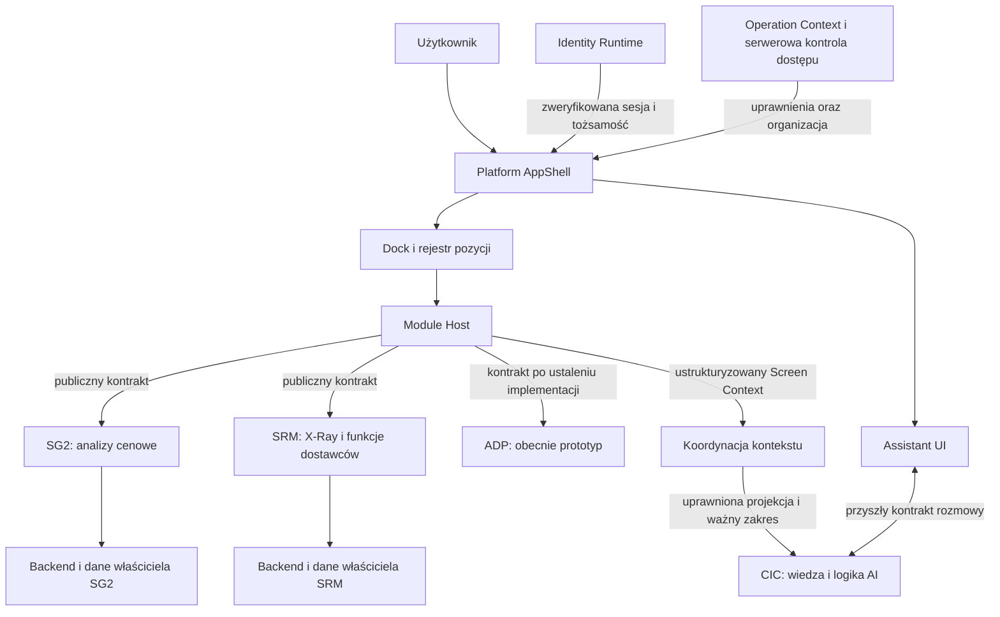

# Platform AppShell — Business & Architecture Canon v1.0

Wersja: **1.0**. Data propozycji: **2026-10-27**. Właściciel logiczny: **Architecture Platform**.

**Status przed zatwierdzeniem: PROPOSED_FREEZE / APPROVAL_PENDING.** Dokument i wpis manifestu na gałęzi propozycji nie stanowią aktywnego kanonu authority. Po jawnym zatwierdzeniu i przyjęciu tej zmiany do `profitia/SG-dev/main` dokument obowiązuje jako **ACTIVE_TARGET_CANON / GOVERNANCE_ONLY**. Nie potwierdza implementacji, integracji ani gotowości środowiska. Sam zapis, CI, PMOS lub publikacja PR nie oznaczają zatwierdzenia.

## 1. Cel, zakres i moc normatywna

Platform AppShell jest wspólnym, spersonalizowanym środowiskiem pracy użytkownika platformy SpendGuru. Udostępnia aplikacje i capability w jednym doświadczeniu nawigacyjnym. Nie jest aplikacją biznesową SRM ani modułem SG2, ADP lub CIC. Pierwszą konfiguracją biznesową jest PORR; kolejne organizacje korzystają z konfiguracji i uprawnień, bez odrębnego kodu produktu dla każdego klienta.

Ten kanon zamraża role, granice, zachowanie i standard dołączania modułów. Słowa **MUSI**, **NIE WOLNO** i **MOŻE** określają wymagania, zakazy i dopuszczenia dla przyszłych zadań. Nie udzielają uprawnień do zapisu poza routingiem ani do wdrożenia.

Zakres tej zmiany to wyłącznie dokumentacja governance i jej rejestracja. Nie obejmuje kodu aplikacji, rejestru runtime, bazy preferencji, nowych praw dostępu, integracji, zmian MagicPath, Clerk, Neon, Render ani wdrożeń. Przyszła realizacja wymaga osobnych zadań właścicieli produktów, ich preflightu, odbioru i odrębnej autoryzacji środowiskowej.

## 2. Authority, źródła i pierwszeństwo

Authority: `profitia/SG-dev`, branch `main`. Profil tej zmiany: `ARCHITECTURE`, workspace `SG-dev Architecture`, środowisko analizy `development`. Bazę źródeł i aktualne rewizje prototypów zapisuje [raport weryfikacji](evidence/2026-10-27-platform-appshell-business-architecture-freeze-v1.md).

Dokument stosuje aktualne `AGENTS.md`, aktywny [manifest](registries/governance-manifest-v2.json), [kanon wykonania v3.0](v3.0-profitia-agent-execution-canon.md), [routing v1.1](v1.1-repository-routing-and-module-ownership-canon.md) i [baseline](registries/current-architecture-baseline-v1.json). Nie zastępuje następujących kontraktów:

| Źródło obowiązujące | Wiążąca granica dla AppShella |
| --- | --- |
| [SpendGuru/SRM Target Architecture v1.0](v1.0-spendguru-srm-target-architecture-canon.md) | Produkty, organizacje, wspólna platforma, izolacja danych i AppShield. |
| [SRM Business Capability v1.0](v1.0-srm-business-capability-canon.md) | Własność capability SRM, w tym dostawcy, ADP i umowy; bez rozszerzania ich do nowego produktu przez etykietę Docka. |
| [SRM Architecture & Component Placement v1.0](v1.0-srm-architecture-and-component-placement-canon.md) | Lokalny composition root SRM, prywatny backend i publiczne granice montowania. |
| [Modular X-Ray Mounting v1.1](v1.1-srm-modular-xray-mounting-amendment.md) | Publiczne mounty i host DTO X-Ray, integracje po stronie SRM. |
| [SRM Maps Runtime v1.2](v1.2-srm-maps-runtime-amendment.md) | Nowsze uzupełnienie granic Maps; nie zastępuje kontraktu X-Ray ani nie przenosi Maps do AppShella. |
| [Identity Runtime v1.0](v1.0-identity-runtime-architecture-and-ownership-canon.md) | Istniejący właściciel tożsamości, kont i sesji; AppShell jest konsumentem. |
| [Operation Context & Access Contract](v1.0-operation-context-and-access-contract.md) i [macierz operacji](registries/operation-access-matrix-v1.json) | Serwerowe uprawnienia, zakresy danych, kontekst i granularne przyjęcie E1. |
| [Shared Development Contract Integration](runbooks/shared-development-contract-integration-v1.md) | Osobne zadania producenta i konsumenta, wersje, dowody przyjęcia i niezależny rozwój. |

Makiety określają zamiar wizualny i scenariusze, nie ownership, uprawnienia lub dowód działania backendu. Zrzut lub nazwa produktu nie nadpisują kontraktu. Nierozstrzygnięty konflikt z nadrzędnym kanonem blokuje zależną realizację; wymaga jawnej decyzji i analizy wpływu, bez cichej korekty źródła.

## 3. Terminologia i mapa logiczna

| Pojęcie | Jednoznaczne znaczenie |
| --- | --- |
| **Platform AppShell** | Nadrzędne środowisko pracy, wspólna nawigacja, Module Host, Dock i umiejscowienie asystenta. |
| **Local Application Shell** | Composition root jednej aplikacji, np. SRM: jej lokalne trasy, host services, BFF i weryfikacja kontraktów. Historyczne `SRM AppShell` oznacza właśnie tę rolę. |
| **AppShield** | Istniejąca prezentacyjna warstwa SRM według jego kanonów; nie platformowy silnik dostępu, tożsamości ani autoryzacji. |
| **Dock** | Platformowy mechanizm uruchamiania i przełączania aplikacji; nie źródło praw do danych. |
| **Module Host** | Przestrzeń prezentacji aktywnego modułu wewnątrz Platform AppShella. |
| **Screen Context** | Jawny, wersjonowany kontrakt uprawnionego kontekstu aktywnego ekranu dla asystenta. |
| **CIC** | Odrębna capability wiedzy, AI i generowania odpowiedzi. |
| **Pozycja aplikacyjna** | Logiczna funkcjonalność dostępna użytkownikowi; jej etykieta nie przesądza o aplikacji, usłudze lub wdrożeniu realizującym funkcję. |

AppShell składa się logicznie z przestrzeni roboczej, Docka, rejestru pozycji, koordynacji nawigacji, Module Host, konsumenta sesji/organizacji, preferencji, Assistant UI i obsługi Screen Context. Są to odpowiedzialności, a nie nakaz utworzenia osobnych usług, pakietów lub baz.

Diagram opisuje docelowe relacje, nie stan uruchomionych połączeń. ADP nie otrzymuje przez diagram nowego backendu; CIC nie staje się częścią backendu AppShella.

## 4. Zasady nadrzędne — FROZEN BUSINESS & ARCHITECTURE

1. Jedno doświadczenie platformowe nie oznacza jednej aplikacji, bazy, domeny lub pipeline'u wdrożeniowego.
2. AppShell odpowiada za dostęp nawigacyjny i prezentację; logika, dane, obliczenia i integracje pozostają u właścicieli capability.
3. Każdy moduł MUSI mieć jawny publiczny kontrakt integracyjny. NIE WOLNO importować prywatnego kodu innej aplikacji dla wygody wspólnego okna.
4. Użytkownik przełącza moduły w swoim AppShellu; Module Host zachowuje powłokę i Dock. Zewnętrzny adres zastępujący całą kartę przeglądarki nie realizuje tego wymagania.
5. AppShell konsumuje istniejącą tożsamość i zweryfikowany kontekst; nie tworzy konkurencyjnego systemu logowania ani praw dostępu.
6. Każda chroniona operacja jest autoryzowana serwerowo. Ikona, konfiguracja pakietu, aktywna karta i przekazany identyfikator nie nadają dostępu.
7. Jeden wspólny asystent wykorzystuje Assistant UI, Screen Context i odrębny CIC. Moduły nie tworzą konkurencyjnych implementacji tej funkcji platformy.
8. Moduły zachowują osobne ownership, zadania i kontrakty publikacji. Nie wymagają zbiorowego wdrożenia niezależnych backendów bez rzeczywistej zależności.
9. Organizacja, użytkownik, członkostwo, produkt, aplikacja, wdrożenie i środowisko są oddzielnymi pojęciami. NIE WOLNO kodować PORR ani jego identyfikatorów w reużywalnym rdzeniu.
10. Aktywacja produktu, demonstracja, zgodność kontraktu i przyjęcie źródła to odrębne, udokumentowane fakty.

## 5. Macierz ownership i lokalizacja

| Obszar | Właściciel i odpowiedzialność | Granica / aktualna powierzchnia |
| --- | --- | --- |
| Wspólne reguły Platform AppShell | **Architecture Platform**: kanon i kontrakty platformy, granice konsumentów. | `Canon/**` według Governance Source Layer; wspólne kontrakty tylko w zatwierdzonym routingu, np. istniejące `packages/platform-contracts/**`, w osobnym zadaniu. |
| Fizyczny pierwszy host PORR | Dopuszczony **SG Runtime / profil SG2** jako wykonawca powłoki. | `apps/sg-runtime/**`; zapis wymaga zadania SG2. Profil ARCHITECTURE nie nadaje prawa do jego kodu. |
| SG2 / analizy cenowe | Właściciele SG2 utrzymują UI, modele, dane, API, prognozy i rozwój zgodnie z routingiem. | Benchmark Finder i związane API w `apps/sg-runtime/**`; inne powierzchnie mają własny routing, bez ich konsolidacji przez ten kanon. |
| Osobny frontend Price Change Index | **SG2 Price Change Index**, profil SG2. | `packages/sg2-price-change-index-ui/**` oraz `apps/sg2-price-change-index-demo/**`: publiczny frontend i izolowany host demonstracyjny, nie domniemany backend Benchmark Findera. |
| SRM / X-Ray | **SRM Runtime / SRM X-Ray Module**, profil SRM: capability dostawców, backend i integracje m.in. MGBI/Vercly. | `apps/srm/**`, zarejestrowane `packages/srm-xray/**`; publiczne mounty lub API według amendmentu v1.1. |
| ADP | Zakres biznesowy dostawców/relacji należy do SRM, w tym SRM-CAP-001 i SRM-CAP-005. | Makieta nie rejestruje osobnej aplikacji. Właściciel przyszłej realizacji MUSI potwierdzić zakres i legalną powierzchnię; brak podstaw do utworzenia `apps/adp` przez samą nazwę. |
| Identity Runtime | Istniejący właściciel **Architecture Platform** zgodnie z kanonem Identity. | `apps/identity-runtime/**` i jego publiczne kontrakty; AppShell nie przejmuje backendu Identity ani konfiguracji dostawcy uwierzytelnienia. |
| CIC | Istniejący właściciel **CIC**: wiedza, AI, generowanie odpowiedzi i własne dane. | Profil CIC wskazuje odrębne authority `profitia/conversational-intelligence-core`; umieszczenie UI w SG-dev nie przenosi CIC do monorepo ani do SG2. |

AppShell odpowiada za workspace, Dock, rejestr pozycji, koordynację nawigacji, prezentację sesji i aktywnej organizacji, wspólne mechanizmy UI, umiejscowienie asystenta, obsługę Screen Context i preferencje workspace. Nie jest właścicielem danych produktowych, baz aplikacji, integracji dostawców, obliczeń, prognoz, silnika CIC ani nadawania uprawnień.

Obecny routing jest źródłem praw do zapisu. Nie zarejestrowano tu nowej ścieżki produktu lub właściciela kodu. Nie zamraża się `apps/sg-runtime` jako jedynego przyszłego hosta, nie nakazuje `apps/app-shell` i nie tworzy nowej usługi Render. Późniejsze wydzielenie hosta wymaga osobnej decyzji; publiczne kontrakty mają umożliwiać je bez przepisywania logiki aplikacji biznesowych.

## 6. Pierwszy zakres PORR i mapowanie produktów

| Pozycja biznesowa | Ustalenie źródłowe i kandydat realizacji | Status integracji z Platform AppShell |
| --- | --- | --- |
| **Benchmark Finder / obszar analiz cenowych SpendGuru** | W SG Runtime istnieje `app/[locale]/benchmark-finder/page.tsx` i jego klient. Makieta AppShell używa etykiety **Price Change Index**; niezależnie istnieje publiczny frontend PCI i jego syntetyczny demo host. Są to różne powierzchnie i kontrakty. | **BINDING_OPEN**: właściciel SG2 i biznesowy właściciel pakietu MUSZĄ potwierdzić zakres pozycji, nazwę oraz konkretny kontrakt/wersję przed jej rzeczywistą aktywacją. Nie uznaje się PCI za zamiennik Benchmark Findera ani ich automatyczną integrację. |
| **X-Ray Supplier Intelligence** | Capability SRM; general company data, financial data, Vercly KYS i composite mount według v1.1. | **CONTRACT_AVAILABLE / HOST_ADOPTION_UNVERIFIED**: istnienie publicznych mountów nie potwierdza ich przyjęcia przez Platform AppShell, zgodnej sesji lub wdrożenia. |
| **ADP — Arkusz Danych Podstawowych** | Dane dostawców, karta dostawcy i relacja; obecnie klikalny prototyp. Etykieta „Ankieta” w makiecie nie ustanawia odrębnego produktu. | **DESIGN_PROTOTYPE_ONLY**: bez docelowego backendu i mechanizmów biznesowych. Przyszłe mapowanie do capability SRM i publicznego kontraktu wymaga zadania właściciela. |

Nazwy statusów w tej tabeli są opisem dowodów w dokumencie, nie nowym enumem runtime lub rejestrem wdrożeń. Stabilny identyfikator pozycji biznesowej MUSI być odrębny od etykiety, AppID, ProductID, identyfikatora usługi i ścieżki. Konkretnych identyfikatorów, tras i mapowania E1 nie wymyśla się w tym zadaniu.

W wariancie PORR trzem funkcjonalnościom podlega każdy aktywny użytkownik z aktualnym członkostwem i właściwym dostępem do pakietu. Nie nadaje to wszystkich operacji wszystkim członkom. Niedostępność integracji MUSI być jawna; demo nie może udawać zapisu, pobrania danych lub zakończonej integracji. Wybór wiązania cenowego jest bramką tej pozycji, nie warunkiem dalszego niezależnego rozwoju X-Ray lub ADP.

## 7. Dock, Module Host i nawigacja

Dock jest podstawowym mechanizmem uruchamiania i przełączania aplikacji. Użytkownik MOŻE umieścić go przy lewej, prawej, górnej lub dolnej krawędzi. Dock MOŻE być widoczny, schowany i wysuwany na żądanie. Działa niezależnie od modułu i pozostaje dostępny bez powrotu do ekranu startowego.

Pozycja, widoczność i przyszła konfiguracja Docka należą do preferencji użytkownika workspace. Aplikacja biznesowa nie nadpisuje ich własnym stanem. Wysunięcie i przełączenie MUSZĄ być dostępne klawiaturą i dotykiem, bez wymogu samego hovera. Aktywna aplikacja jest jednoznaczna także bez koloru. Ukrycie Docka nie może odciąć dostępu do nawigacji.

Module Host utrzymuje powłokę, granice błędów oraz stany ładowania, niedostępności, braku dostępu i niezgodnej wersji. Awaria jednego modułu nie blokuje przejścia do pozostałych. Moduł nie przejmuje globalnego routera, Docka, motywu lub preferencji. Wewnętrzne trasy i deep linki przekazuje przez uzgodniony kontrakt nawigacyjny, bez arbitralnego przekierowania poza hosta.

Kontrakt modułu MUSI określać wejście, powrót/przełączenie, synchronizację historii, montowanie/odmontowanie, reset oraz usuwanie listenerów i starego kontekstu. Nie wolno po cichu zgubić niezapisanej pracy; zasada zachowania/resetu i komunikat ostrzeżenia należą do kontraktu danego produktu. Kanon nie narzuca utrzymywania wszystkich modułów w pamięci ani nowej reguły autosave.

## 8. Publiczny kontrakt integracyjny modułu

Przed udostępnieniem pozycji właściciel MUSI przedstawić następujący rekord kontraktu. Jest to wymaganie dokumentacyjne dla istniejącego procesu rejestracji, nie polecenie stworzenia nowej bazy lub konkurencyjnego rejestru.

| Pole kontraktu | Wymagane ustalenie |
| --- | --- |
| Tożsamość i funkcja | Stabilny logiczny identyfikator, nazwa, opis i zakres biznesowy; jawne mapowanie pozycji na produkt/aplikację. |
| Ownership i source | Właściciel biznesowy i techniczny, profil, repo, dozwolone ścieżki i publiczne eksporty/API; niezależny runtime, jeśli istnieje. |
| Dostęp | Prawo organizacji do produktu, wymagane uprawnienia i operacje E1, klasy danych oraz miejsce serwerowej weryfikacji. |
| Wejście i host | Zatwierdzona trasa w AppShellu, model montowania, wymagania frameworka/builda, domeny, sesji i zależności host services. |
| Nawigacja i cykl życia | Deep link, historia, powrót, przełączenie, reset, niezapisany stan, mount/unmount i cleanup. |
| Stany operacyjne | Ładowanie, brak danych, zero, błąd, timeout, brak dostępu, cofnięcie dostępu, niedostępność i niezgodna wersja. |
| Kontekst wykonania | Zweryfikowana sesja, UserID i organizacja w odpowiednim zakresie, środowisko, locale; żaden parametr przeglądarki nie jest grantem. |
| Prezentacja | Kanoniczny motyw jasny/ciemny, responsywność, dostępność, izolacja stylów i uzgodnione przejęcie focusu/przewijania. |
| Asystent | Wersja Screen Context, dozwolona projekcja, źródła/aktualność, invalidacja albo jawne `context unavailable` z uzasadnieniem. |
| Kompatybilność | Wersja kontraktu, obsługiwany zakres wersji hosta, przypięta wersja/digest implementacji, strategia migracji i rollbacku. |
| Dowody i status | Faktyczny etap: projekt, symulacja, kontrakt, integracja, weryfikacja i aktywacja; zadania/PR/SHA, środowisko, wyniki odbioru i ograniczenia. |

### 8.1 Dopuszczalne modele prezentacji

| Model | Warunki |
| --- | --- |
| **NATIVE VIEW** | Publiczny komponent renderowany przez hosta. Wymaga zatwierdzonego eksportu, zgodnych zależności/builda, cyklu życia i izolacji efektów. Nie wolno importować prywatnych plików `apps/**`. |
| **SERVICE-BACKED VIEW** | UI hosta konsumuje wersjonowane API właściciela biznesowego. API zachowuje autoryzację, dane i logikę; host nie duplikuje obliczeń ani reguł dla zastąpienia backendu. |
| **REMOTE EMBED** | Odrębny runtime wewnątrz Module Host. Wyłącznie kontrolowany wyjątek po weryfikacji sesji, dostępu, izolacji, polityki osadzania, domen, nawigacji i kompatybilności. |

Nie ustanawia się `iframe` jako domyślnego standardu. Wyjątek REMOTE EMBED MUSI wskazać właściciela, cel i zakres, dopuszczone origins, CSP/frame-ancestors oraz sandbox/permissions według potrzeb, brak tokenów w URL, walidację komunikatów i ich źródła, zachowanie sesji/cookies, rozmiar/focus/klawiaturę, wylogowanie i cofnięcie dostępu. Musi mieć dowody dla faktycznych domen i przeglądarek, ograniczenia, punkt ponownego przeglądu oraz plan wymiany na zatwierdzony kontrakt. Samo wyłączenie zabezpieczenia osadzania nie jest odbiorem.

Brak potwierdzonej zgodności frameworków, domen lub sesji oznacza brak gotowości danego sposobu integracji. Czasowy adapter SRM nie przenosi jego backendu do SG2. Link zewnętrzny MOŻE być jawnie opisanym działaniem pomocniczym; nie jest docelową integracją pozycji Docka.

## 9. Assistant UI, Screen Context i CIC

Assistant UI należy do AppShella i jest dostępny niezależnie od aplikacji; użytkownik MOŻE go pokazać lub ukryć. Odpowiada za prezentację, dostępność i obsługę interfejsu rozmowy. CIC zachowuje wiedzę, mechanizmy AI, generowanie odpowiedzi i swoje dane. Aplikacje dostarczają uprawniony kontekst, nie własną konkurencyjną wersję wspólnego asystenta. Nie zmienia to istniejących wdrożeń samym zapisem kanonu.

Docelowy asystent prowadzi rozmowę, interpretuje udostępnione dane i wykresy, dostarcza komentarze, insighty, rekomendacje i wskazówki. Każda przyszła akcja biznesowa wymaga zwykłej autoryzacji właściwej operacji; odpowiedź AI nie jest grantem ani potwierdzeniem zapisu.

**Etap demonstracyjny: wyłącznie widżet wizualny.** Nie deklaruje się obsługi rzeczywistych rozmów, odpowiedzi AI lub kontekstu ekranu. Obecne lokalne, oznaczone odpowiedzi demonstracyjne w MagicPath są symulacją prezentacji, bez integracji z CIC. Poniższy kontrakt jest wymaganiem przyszłym.

### 9.1 Minimalny Screen Context v1 — kontrakt logiczny

| Informacja | Znaczenie i ograniczenie |
| --- | --- |
| Wersja kontraktu | Wersja schematu i zgodność producenta/konsumenta; nieznana wersja nie jest interpretowana domyślnie. |
| Tożsamość modułu | Logiczny moduł i aplikacja-producent, wersja/revision projekcji; nie sama etykieta karty. |
| Aktywny widok | Stabilna identyfikacja ekranu i jego stanu/nawigacji w danym module. |
| Obiekt biznesowy | Typ i identyfikator zaznaczonego obiektu albo jawny brak; tylko w dozwolonym zakresie. |
| Filtry | Aktywne kryteria, okresy, jednostki i waluta, gdy dotyczą widoku. |
| Widoczne dane | Minimalna, ustrukturyzowana i uprawniona projekcja danych/serii wykresu, z zakresem i informacją o niekompletności; brak wartości nie oznacza zera. |
| Źródło i aktualność | Pochodzenie, czas danych i pobrania/projekcji, opóźnienie/cache, ograniczenia licencyjne i poufność, jeśli dotyczą. |
| Zakres i ważność | Powiązanie z bieżącą zweryfikowaną sesją, użytkownikiem, organizacją, środowiskiem oraz aktualną kontrolą dostępu; identyfikator/sekwencja kontekstu i warunki wygaśnięcia. |

To logiczny kontrakt danych, nie gotowe DTO/API ani rozszerzenie istniejącego E1. Moduł jawnie produkuje projekcję; koordynator AppShella pilnuje aktywnego widoku i ważności; zaufana granica przed CIC ponownie weryfikuje zakres dostępu. Kontekst z przeglądarki jest danymi wejściowymi, nie dowodem uprawnienia. Ostateczne nazwy pól, transport i granice walidatorów wymagają wersjonowanego kontraktu właścicieli.

Nie wolno opierać kontekstu wyłącznie na niekontrolowanym DOM lub zrzutach ekranu. Uzupełniająca analiza obrazu, jeśli później zaakceptowana, nie omija projekcji, autoryzacji, pochodzenia i minimalizacji. Tekst danych jest niezaufanym materiałem, nie instrukcją do wykonania lub nadania uprawnień.

Zmiana użytkownika, organizacji, modułu, wylogowanie, cofnięcie dostępu albo wygaśnięcie zakresu MUSZĄ unieważnić stary kontekst. Zmiana ekranu/filtrów/obiektu aktualizuje projekcję i jej sekwencję. Odpowiedź spóźniona lub pochodząca z poprzedniego zakresu jest odrzucana przed prezentacją. Ukrycie asystenta nie zachowuje ważności wbrew tym regułom. Nieprzyjęty kontrakt lub brak kontekstu są jawne; nie uzupełnia się ich nieuprawnionym odczytem.

Nie wolno automatycznie mieszać rozmów między organizacjami ani promować prywatnej projekcji do wiedzy wspólnej. Retencja, historia rozmów, zgody oraz polityki źródeł CIC pozostają u odpowiednich właścicieli i wymagają osobnych uzgodnień.

## 10. Tożsamość, dostęp, organizacje i preferencje

AppShell konsumuje Identity Runtime i istniejące kontrakty kont/sesji; nie zakłada drugiego uwierzytelnienia dla każdego modułu. Odbiorca żądania niezależnie sprawdza sesję i dostęp. Nie wolno przekazywać sekretów dostawców lub tokenów jako danych Screen Context, parametrów URL lub elementów kodu reużywalnego.

Kontekst jest serwerowo wyprowadzany zgodnie z Operation Context & Access Contract. UserID/OrganisationID podane przez klienta są wskazówkami do weryfikacji, nie autoryzacją. Właściwe zakresy ORGANISATION, ACCOUNT, BOOTSTRAP i PLATFORM oraz klasy danych zachowują swoje znaczenie; brak organizacji nie oznacza wildcard. Konfiguracja demo nie uprawnia do operacji chronionych.

Wymagane jest oddzielne sprawdzenie aktywnej tożsamości, członkostwa, prawa organizacji do produktu, uprawnień użytkownika i konkretnej operacji/obiektu. Filtrowanie Docka jest projekcją tych ustaleń. Bezpośredni URL, ukrycie/pokazanie pozycji lub pole `permissions` nie zastępują serwerowego sprawdzenia. Cofnięcie praw MUSI działać także dla otwartego modułu, cache i kontekstu asystenta.

Nowe operacje wymagają właściwego przyjęcia E1 i macierzy przez właściciela; nie uznaje się istniejącej implementacji za automatyczne przyjęcie całego kontraktu. Dowody są osobne dla operacji, konsumenta, wersji i środowiska.

Preferencje workspace należą do użytkownika. Globalne ustawienia konta odpowiadają ACCOUNT_PRIVATE; preferencje jawnie zależne od organizacji wymagają USER_IN_ORGANISATION_PRIVATE i zachowania izolacji. Ten kanon nie rozszerza bieżącego API ustawień i nie wybiera magazynu danych. Konfiguracja pakietu organizacji nie jest indywidualną preferencją ani rolą użytkownika. Personalizacja nie może ukrywać braku uprawnień, zmieniać ich lub przenosić danych między organizacjami.

## 11. Równoległy rozwój i niezależne wydania

Strategia: **jedno monorepo SG-dev — osobne aplikacje i niezależnie rozwijane moduły, z kontrolowanymi kontraktami współpracy**. Nie przenosi ona odrębnego authority CIC do tego repo.

Logiczny właściciel Platform AppShell, fizyczny host i właściciel modułu MUSZĄ być wskazani osobno. Każde zadanie używa aktualnego routingu, właściwego profilu i własnego workspace/PMOS/PHR. Nowy path/owner wymaga onboardingu przed pierwszym zapisem; `NO_MATCH` lub konflikt zatrzymują ten target. Przykład ścieżki w kanonie nie jest rejestracją.

Producent publikuje wersjonowany publiczny kontrakt; konsument jawnie przyjmuje przypiętą wersję i dowody kompatybilności zgodnie z istniejącym runbookiem. Nie stosuje się automatycznego pobierania `latest`. Niezależne API/runtime zachowują swoje pipeline'y i rollback w granicach kompatybilności, bez wymuszania wdrożenia wszystkich aplikacji.

NATIVE VIEW wbudowany w artifact hosta wymaga ponownego wydania tego hosta dla aktualizacji UI. Osobne ownership i development nie oznaczają niezależnego wdrożenia każdego komponentu. Rozdzielenie wdrożenia UI/runtime wymaga odpowiednio zatwierdzonego modelu. Wycofanie pozycji Docka nie usuwa danych ani aplikacji właściciela; plan wycofania zachowuje zgodność, odbiera dostęp w prawidłowej warstwie i usuwa stary Screen Context.

## 12. Obowiązkowa procedura dołączenia modułu

Kolejny moduł zgodny z tym kanonem przechodzi poniższe kroki bez ponownego projektowania całej powłoki. Wynik każdego kroku jest częścią istniejącego zadania governance/integracji i jego dowodów.

| Krok | Wymagana decyzja i wynik |
| --- | --- |
| **1. Klasyfikacja** | Określ: nowa aplikacja biznesowa, moduł istniejącego produktu, widżet platformowy albo capability bez ekranu. Granicą jest odpowiedzialność biznesowa, nie rozmiar karty. Capability bez UI nie musi otrzymać własnej pozycji Docka. |
| **2. Ownership** | Sprawdź capability istniejących produktów; wskaż właściciela biznesowego/technicznego, kodu, danych i backendu. Spór lub brak właściciela blokują zależną integrację. |
| **3. Routing** | Rozwiąż dokładne ścieżki i profil z aktualnego rejestru. Dla nowej powierzchni wykonaj wymagany onboarding i test resolvera; do tego czasu nie zapisuj produktu. |
| **4. Publiczny kontrakt** | Uzupełnij rekord z sekcji 8, zakres funkcji, wersję, jawne API/eksporty i macierz kompatybilności. Oddziel logical slot od fizycznej aplikacji/usługi. |
| **5. Module Host** | Wybierz NATIVE VIEW, SERVICE-BACKED VIEW albo zatwierdzony wyjątek REMOTE EMBED. Potwierdź sesję, framework/domeny, lifecycle, nawigację i brak utraty powłoki. |
| **6. Dostęp** | Uzgodnij prawa produktu, członkostwo i operacje/klasy E1. Potwierdź serwerowe sprawdzenie oraz odmowę, także dla bezpośrednich tras i cofniętych praw. |
| **7. Screen Context** | Określ uprawnioną projekcję, wersję, źródła i invalidację; sprawdź odrzucenie spóźnionych danych. Jeśli integracja jest odroczona, oznacz brak kontekstu i wyłącz obietnicę komentarzy ekranu. |
| **8. Dock** | Zarejestruj pozycję w zatwierdzonym mechanizmie hosta: identyfikator, etykieta, wejście, dostępność, prawo do produktu i wersja kontraktu. Wpis nie nadaje uprawnień. Bez nowego równoległego rejestru. |
| **9. Odbiór i aktywacja** | Zbierz dowody sekcji 13, zadania/PR/SHA i zgodę właścicieli producenta/hosta. Oznacz prawdziwy status. Aktywacja środowiskowa wymaga osobnej autoryzacji; prototyp nie przechodzi jako integracja. |
| **10. Utrzymanie i wycofanie** | Ustal niezależne wersje, obsługiwany zakres, monitoring błędów, rollback i deprecjację. Pokaż, które zmiany wymagają wydania hosta, a które tylko backendu. |

### 12.1 Przykład: hipotetyczna czwarta pozycja „Contract Management”

Najpierw rozstrzygnij zakres. Obsługa umów z dostawcami, terminów i relacji strategicznych pokrywa **SRM-CAP-007**. Dla tego wariantu właścicielem pozostaje SRM, a pierwsza realizacja może użyć istniejącego routingu `apps/srm/**` w zadaniu SRM. Nowy publiczny package wymaga osobnego onboardingu; nie wolno go utworzyć na podstawie przykładu.

AppShell otrzymuje publiczny komponent lub wersjonowane API SRM z uzgodnionym sposobem montowania. Kontrakt wskazuje wejście, uprawnienia do konkretnych umów, organizację, stany i lifecycle. Screen Context obejmuje uprawniony identyfikator umowy, widok, filtry, widoczne warunki/statusy oraz źródło/aktualność; nie załącza całych poufnych dokumentów bez potrzeby. Nowa pozycja Docka wymaga kroków 8–9; kod, dane i obliczenia umów pozostają w SRM. API może mieć osobne wydanie kompatybilne; aktualizacja komponentu NATIVE VIEW wymaga również wydania hosta.

Jeśli „Contract Management” oznacza szerszy, przekrojowy produkt CLM wykraczający poza SRM-CAP-007, właścicielstwo i nowa powierzchnia wymagają jawnej decyzji i onboardingu. Nie zakłada się `apps/contract-management`, nowego backendu ani przeniesienia umów z SRM. Niezależna praca nad innymi modułami trwa dalej. Przykład nie tworzy modułu, kodu, operacji, trasy ani identyfikatora produktu.

## 13. Wymagania zgodności przed rzeczywistą aktywacją

Właściciele hosta i modułu MUSZĄ przedstawić dowody adekwatne do wybranego modelu:

- prawidłowy routing, ownership, źródłowe PR/SHA, wersję/digest publicznego kontraktu oraz dowód przyjęcia przez konsumenta;
- uruchomienie, deep link, przełączenie bez utraty powłoki, dostęp do Docka przy czterech krawędziach i w stanie schowanym oraz bezpieczny lifecycle;
- ładowanie, niedostępność, błąd, brak/zero danych, niezgodność wersji, brak praw i awarię jednego modułu przy nadal działającej nawigacji;
- jasny/ciemny motyw, responsywność, klawiaturę, dotyk, focus i izolację styli według wspólnego kanonu UI; instrukcje i metadane projektowe oddzielone od widoku klienta;
- pozytywny i negatywny dostęp serwerowy: inny użytkownik/organizacja, odebrane prawa, bezpośrednia trasa/obiekt, wylogowanie oraz brak sekretów w przeglądarce;
- Screen Context lub jawny brak jego wsparcia: projekcję, źródła, ograniczenia, zmianę zakresu i odrzucanie spóźnionych odpowiedzi; nie deklarować integracji CIC bez rzeczywistego odbioru;
- test kontraktowy producenta i konsumenta, wersje zgodności, niezależny rollback oraz wymagane odbiory sesji/polityk dla REMOTE EMBED.

Są to bramki przyszłej aktywacji, nie zlecenie wykonania wdrożeń w tym zadaniu. Dowody MUSZĄ rozdzielać źródło, build/CI, lokalną symulację, integrację, zainstalowaną wersję, runtime i akceptację biznesową. Sam build, HTTP 200, screenshot lub wpis Docka nie wystarczają.

## 14. Decyzje trwałe, przejściowe i otwarte

### FROZEN BUSINESS & ARCHITECTURE

Po przyjęciu obowiązują sekcje 1–13: platformowa rola AppShella, granice ownership, odrębność produktów i CIC, wspólna tożsamość/E1, Module Host, Dock, jawny kontrakt modułu, Screen Context, model wieloorganizacyjny, routing i procedura rozszerzania. Zamrożenie zasad nie rozstrzyga otwartego wiązania konkretnej pozycji ani nie aktywuje produktu.

### TRANSITIONAL IMPLEMENTATION — etykieta redakcyjna

| Dopuszczenie przejściowe | Granica i warunek wyjścia |
| --- | --- |
| Pierwszy host w `apps/sg-runtime` | Zadanie SG2, zgodny routing i publiczne kontrakty; przyszły osobny host po odrębnej decyzji, bez przenoszenia własności SRM/CIC. |
| Demonstracyjny ADP | Klikalny projekt bez backendu; wyjście po uzgodnieniu capability, ownership, kontraktu i rzeczywistym odbiorze implementacji. |
| Statyczny asystent | Widżet i jawne lokalne symulacje; wyjście po przyjęciu Assistant UI/Screen Context/CIC i dowodach kontroli dostępu. |
| Ewentualny czasowy adapter osadzenia SRM | Nie jest zatwierdzony samym kanonem. Wymaga odbioru warunków REMOTE EMBED, ograniczeń i planu wymiany. |

Ta etykieta **nie jest** formalnym stanem kodu `TRANSITIONAL`. Nie zmienia `ALIGNED`/`LEGACY`, referencji baseline, aktywnej polityki ani epoki klasyfikacji w rejestrze architektury. Klasyfikację każdej przyszłej zmiany nadal wyznacza aktywny resolver/governance.

### OPEN DECISIONS

| Decyzja | Kto / kiedy musi ją rozstrzygnąć |
| --- | --- |
| Benchmark Finder a PCI: nazwa, zakres i konkretne wiązanie pierwszej pozycji | Właściciele SG2 i pakietu biznesowego, przed rzeczywistą aktywacją tej pozycji. Nie blokuje formalizacji kanonu lub niezależnego developmentu innych pozycji. |
| Docelowa fizyczna realizacja ADP i publiczny kontrakt | Właściciel SRM/capability z Architecture w razie nowej powierzchni, przed implementacją zależnego kontraktu/aktywacją. |
| Ostateczny niezależny runtime AppShella | Architecture i właściciele hostów, jeżeli powstanie uzasadnienie wydzielenia. Nie jest warunkiem demonstracji. |
| Trwały magazyn i szczegółowy model preferencji | Właściciele platformy/tożsamości w osobnym zadaniu; przed realną trwałością, bez obecnego projektu bazy. |
| Transport/schemat Screen Context, API CIC, retencja i mechanizmy międzydomenowe | Architecture, CIC, Identity i konsumenci przed integracją tych zakresów. Brak decyzji nie jest zgodą na dowolną implementację. |
| Konkretny adapter/mount dla każdego modułu | Właściciel modułu i hosta przy onboardingu, na podstawie realnej zgodności. Nie zakłada się wspólnego frameworka lub sesji. |

Nie trzeba rozstrzygać wszystkich tych decyzji przed demonstracją lub rozpoczęciem niezależnej pracy. Każda blokuje wyłącznie zależną realizację; nie wolno zastępować jej domniemanym wymaganiem.

## 15. Wersjonowanie, drift i procedura zmian

Nowy moduł zgodny z publicznym kontraktem wymaga rejestracji, odbioru i dowodów, **nie zmiany całego kanonu**. Zmiana etykiety/wyglądu, naprawa implementacji, zgodne rozszerzenie danych opcjonalnych lub kolejna konfiguracja organizacji nie otwierają automatycznie architektury. Ich kontrakty i źródła podlegają zwykłemu wersjonowaniu właścicieli.

| Rodzaj zmiany | Wymagany tryb |
| --- | --- |
| Literówka lub doprecyzowanie bez zmiany obowiązku | Poprawka redakcyjna, PR i historia; bez deklarowania nowej integracji. |
| Kompatybilne rozszerzenie kanonu lub opcjonalnego kontraktu | Wersja minor/amendment, jawna kompatybilność i analiza konsumentów; istniejący zgodni konsumenci nadal działają. |
| Zmiana roli AppShella, ownership, modelu tożsamości/dostępu, dopuszczalnego osadzania lub relacji do CIC | Świadoma nowa wersja kanonu/amendment normatywny, przegląd właścicieli, wpływ na wszystkie dotknięte moduły i plan migracji. Zerwanie kompatybilności wymaga nowej wersji major kontraktu/kanonu. |
| Nowy owner/path/runtime albo operacja uprawnień | Odrębny wymagany onboarding/kontrakt i zgoda w aktualnym procesie; sama aktualizacja tego tekstu nie daje praw do zapisu/wdrożenia. |

Producent nie zmienia znaczenia pola, zakresu danych lub domyślnej autoryzacji pod tą samą wersją. Zmiana wymaga jawnego zakresu wersji, dowodów konsumentów i okresu deprecjacji. Otwarty punkt można rozstrzygnąć bez zmiany zasad bazowych, jeśli decyzja mieści się w nich i zostanie zapisana we właściwym kontrakcie; konflikt wymaga aktualizacji kanonu przed zależną realizacją.

## 16. Zatwierdzenie i BUSINESS & ARCHITECTURE FREEZE

Propozycja jest przedkładana przez zadanie ARCHITECTURE w PR do authority `main`, z walidacją manifestu/routingu, raportem źródeł i zgodnością wskazanych kanonów. Wpis `ACTIVE` w proponowanym manifeście opisuje **planowaną rejestrację po przyjęciu**; nie nadaje gałęzi roboczej statusu authority. Nie tworzy się nieobsługiwanego statusu manifestu ani równoległego rejestru zatwierdzeń.

Warunkiem wejścia w życie jest jawne zatwierdzenie w procesie governance i przyjęcie właściwego PR do `main`. Odbiór musi obejmować Architecture Platform i potwierdzenie przez odpowiednich właścicieli granic produktów; nierozstrzygnięty konflikt normatywny wymaga decyzji przed przyjęciem. Ten dokument nie obchodzi repozytoryjnych wymagań review/merge. Do tego momentu obowiązuje **APPROVAL_PENDING**, a nie aktywny freeze. Ślad zatwierdzenia stanowi review/decyzja i merge PR, nie wygenerowana deklaracja autora.

**Oświadczenie BUSINESS & ARCHITECTURE FREEZE v1.0:** z chwilą prawidłowego zatwierdzenia i przyjęcia do authority `main` zasady oznaczone FROZEN BUSINESS & ARCHITECTURE stają się wiążącym kanonem Platform AppShell. Nowe moduły dołącza się według sekcji 12 bez ponownego projektowania powłoki. Dopuszczenia przejściowe i decyzje otwarte zachowują wskazane ograniczenia. Freeze nie potwierdza implementacji, nie przenosi ownership i nie autoryzuje żadnego wdrożenia.
